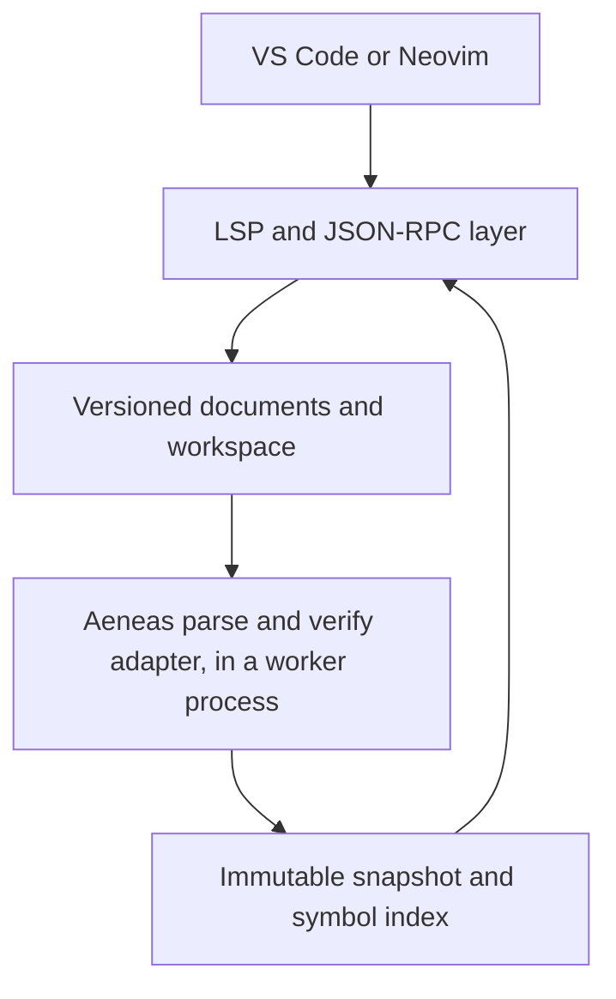

# Architecture

This document describes the intended structure of the server. Sections marked *planned* describe work in later milestones. See [ROADMAP.md](../ROADMAP.md) for the schedule.

## Overview



`virgil-lsp --stdio` communicates with the editor over standard input/output and owns the protocol layer, in-memory document overlays, and single-file parsing. The diagram includes planned semantic features. Whole-program analysis runs automatically for configured projects, publishing [semantic diagnostics](#semantic-diagnostics) and answering [go-to-definition](#definition), [hover](#hover), [references](#references), [rename](#rename), [signature help](#signature-help), and [workspace symbols](#workspace-symbols) from its results, and through the development `analyze` command and the unadvertised `virgil-lsp/analyze` stdio request; see [Analysis worker](#analysis-worker) for its process model. [Completion](#completion) describes suggestions from the document's text and temporary project analyses, including [receiver members](#member-completion). Editor integrations only launch the server and forward configuration.

## Source layout

| Directory | Responsibility | Status |
| --- | --- | --- |
| `src/main.v3` | Command-line entry point | Present |
| `src/worker/` | Analysis worker: its entry point (`WorkerMain.v3`), the supervisor that runs it, framing, and the message codec ([ADR-0004](decisions/0004-analysis-worker-process.md)) | Present |
| `src/os/<target>/` | System calls the Virgil `System` component lacks (pipes, process creation, polling), one file per target | Present for `x86-64-linux` and `x86-64-darwin` |
| `src/Log.v3` | Logging to standard error. Standard output is protocol-only. | Present |
| `src/analysis/` | **The only code that touches Aeneas.** Adapter, analysis snapshots, symbol indexes. | Adapter and server-owned snapshots present |
| `src/protocol/` | Byte framing, JSON-RPC message model, server request tracking, lifecycle state machine, document synchronization, feature handlers, watched-file and workspace-folder events, parser and semantic diagnostic publication, analysis scheduling | See [JSON-RPC messages](#json-rpc-messages) for handlers and their implementation status |
| `src/documents/` | URI normalization, versioned in-memory overlays with injected disk fallback, `PositionMap` | Present |
| `src/workspace/` | Project-file parsing, bounded glob expansion, workspace discovery, active contexts, diagnostic ownership, and configuration revisions | Present |
| `src/features/` | Semantic symbols and later features | Planned (M4–M5) |

## Build model

Virgil is a whole-program compiler. Every source file is passed to the compiler at once and shares one global namespace. The `virgil-lsp` executable is compiled from:

1. `src/main.v3` (passed first, because the first component with a `main` method becomes the entry point);
2. the rest of `src/`, except `src/worker/WorkerMain.v3` and the `src/os/` directories of other targets;
3. a generated `build/gen/BuildInfo.v3` with the version and revisions;
4. `vendor/virgil/aeneas/src/*/*.v3` and the libraries listed in `vendor/virgil/aeneas/DEPS`;
5. `vendor/virgil/lib/file/json/JsonParser.v3`, which the server uses but Aeneas does not.

Aeneas has its own `main`, but it comes later on the command line, so it isn't selected. Because all names share one namespace, server types must not reuse Aeneas top-level names ([ADR-0002](decisions/0002-pinned-virgil-adapter-boundary.md)).

`virgil-lsp-worker` is compiled from the same list with `src/worker/WorkerMain.v3` first instead of `src/main.v3`, and with its own heap size (see [ADR-0004](decisions/0004-analysis-worker-process.md#measurements)). The `Makefile` asks `scripts/v3c.sh -print-target` for the host target and adds `src/os/<target>/`. Virgil compiles only the code reachable from the entry point, so the server executable doesn't contain the verifier.

## Compiler adapter

The adapter (`src/analysis/AeneasAdapter.v3`) exposes compiler functionality in server-owned types:

- `parseFile(path, bytes, options)` runs Aeneas's single-file parser on in-memory bytes and returns `AnalysisDiagnostic`s and a declaration count. `AnalysisSingleFileParser` adapts the pinned `Parser.parseFile` driver with an adapter-local parser state and whitespace-skip observer. Current-token extraction records both byte endpoints using live parser coordinates, including hint names consumed without skipping. Retrospective `tokenAt` extraction retains the pinned compiler's coordinate rules and does not register its recomputed columns in the diagnostic position map for this entry point. Extraction is bounded by EOF, so an incomplete hint such as `class C #` reports a syntax error without trapping or adding bytes to the input. An adapter-local error sink captures the offsets when errors are emitted, including the current byte position for point errors. [Aeneas crash paths](aeneas-crash-paths.md) owns the range recovery, parser stack limit, expression chain limit, and remaining containment limits. Grammar parsing stays in the unmodified compiler. *(present)*
- `documentSymbols(path, bytes, options)` is the syntax-outline adapter entry point. It shares `parseFile`'s parser driver and recovery (see [Document symbols](#document-symbols)). *(present)*
- `analyzeProgram(sources, options, collectStats)` runs in the [analysis worker](#analysis-worker) in product executables; adapter tests and probes also call it directly. It builds a fresh `Program` from in-memory `AnalysisSource`s and runs the shared `AnalysisSingleFileParser` with the program’s type cache, then `Compilation.verify()` if parsing succeeded, reusing one default-configured `Compiler`. It returns a `ProgramAnalysis` with diagnostics and timing; process-wide type-cache counts are collected only when requested (`--stats`), otherwise `globalTypesAdded` is -1. The adapter removes program-dependent global cache entries before returning, even on errors; `globalTypesAdded` counts retained builtin-only growth after this cleanup. Parse/verify timings exclude cleanup and diagnostic coordinate mapping. See [Coordinates](#coordinates) for exact diagnostic byte ranges and compiler display coordinates, and [worker framing](decisions/0004-analysis-worker-process.md#channel-and-framing) for their transport. Nothing is read from disk. Without a target, Aeneas supplies a synthetic `System` component, as it does for its interpreter. *(present; [semantic diagnostics](#semantic-diagnostics) analyze project contexts automatically, and the development request accepts explicit disk sources plus overlays or a document's active project context)*
- `ProgramAnalysis.occurrences(path)` lazily walks each parsed file once after verification runs, including when semantic errors leave only partial bindings, and maps resolved uses to source declarations (`AnalysisOccurrence`, `AnalysisDeclaration`): `VarExpr` uses, the names in type references, and index operators. Unqualified match-case names are recorded as `VARIANT_CASE` or `ENUM_CASE` uses from verifier pattern metadata. Enum parameter fields are recorded as `FIELD` uses of the parameter declaration, following getter operators (including enum-type getter functions) or recovering the field from a verified enum-case receiver when a literal case argument was folded to a constant. Each resolved use is reported once, even when verification shares subtrees. See [Coordinates](#coordinates) for occurrence and declaration ranges, their byte ordering, and compiler-coordinate lookup limitations. Parsing failures return an empty array because verification did not run. Verification errors do not prevent collection of resolved uses; bindings with no source declaration, including null type bindings and unresolved type names, are skipped. The array is cached per file in that analysis; callers must not modify it. Paths are indexed once when the analysis is created. `definitionAt(path, line, column)` binary-searches the cached occurrence ranges at a compiler position. Each declaration carries a signature, and an occurrence carries its use-site type where that differs from its declaration's; `builtinUses(path)` and `declarationSites(path)` give a file's builtin uses and declaration sites. See [Display text](#display-text). *(present)*

The collector indexes field, parameter, local, and return type references, including for-loop variable types and lambda signatures; `extends`, `descriptor`, and `describes` clauses; match type patterns; and type arguments in types and expressions, such as `Box<Foo>`, `M.id<Foo>(x)`, and `Foo.!<Bar>(x)`. Each name that verification resolved (`NamedTypeRef.binding`) is a use, including those nested in function and tuple types. Verification shares class parameters with their synthesized fields and constructor, and a variant's cases share a synthesized superclass that names the variant and its type parameters at their declarations; the collector visits each source type once and never the synthesized superclass. A type expression already used as a receiver, such as `Box` in `Box<Foo>.new()`, is recorded once, and only its type arguments are new uses. With `-lang:open-types`, a variant that extends another, as in `type W extends V`, extends `V`'s default case `case _`, and verification rebinds the reference to that case's synthetic class; the use targets `V`, while an explicit case such as `V.A` keeps its case target. Builtin types record no occurrence: `int`, `Array` in `Array<Foo>`, `set` in `E.set`, and `Ref` in `Ref<L>`, in types and expressions alike, although verification binds `Ref<L>` to the layout's reference type (see below). A builtin in an expression is a [builtin use](#display-text) instead, with a type and no definition.

A type parameter is a `TYPE_PARAM` declaration at its declaring token, for classes, variants, and methods. Its uses in type references and in expressions, such as `T.default`, `T.?(x)`, and `T.!(x)`, target that token. An inferred type argument is a type variable and records nothing. A variant case used as a type, such as `V.A` in a signature or a match pattern `x: V.B`, resolves to the case's synthetic class and targets the `case` declaration, as an expression-side use of the case does.

An index operation, such as `c[i]`, occupies its opening bracket, a one-byte token span, where an index method is also named. A read targets the `[]` method and an assignment `c[i] = v` targets `[]=`. A compound assignment such as `c[i] += v` reads and writes through the one bracket, which can have only one occurrence; it records `[]=`, since the expression is the assignment's target, or `[]` if only the read resolved. Builtin array and range indexing binds no method and records nothing. Construction of a class with a descriptor (`-lang:descriptors`), which verification binds to compiler sugar (`ClassNewDesc`), targets the constructor, as other construction does.

A layout reference has no binding of its own, so the collector reads what verification kept instead. In `Ref<L>` and `ref<L>`, in types and expressions alike, verification looks `L` up by name among the program's layouts and binds the whole reference to that layout's reference type (`RefType.layoutDecl`); the use is `L`, a `LAYOUT` use, and only if `L` is exactly the layout's name. A layout field's memory type, such as `Inner` in `+0 inner: Inner` or `+1 pair: Inner[2]`, is a name without a type reference (`MemoryTypeRef`); verification keeps a nested layout's reference type (`mtlayout`), or else the type it resolved the name to (`mttype`), so a nested layout and an enum are uses, as is a class, which is an error there. Builtin memory types, such as `u8`, record nothing. Layout field accesses, such as `r.a`, are `VarExpr` uses.

A packing is a `PACKING` declaration, and its parameters are `PARAMETER` declarations; their signatures give sizes in bits, such as `packing Low(a: 4, b: 4): 8` and `a: 4`. Verification keeps no binding in a packing expression, so the collector repeats its lookups. A field, within `#concat` or as an argument, names a parameter of the packing, where a later parameter hides an earlier one of the same name. A packing application, such as `Low` in `#concat(Low(x, 0b0000), y)`, names a packing of the program, in any file; verification looks it up by name in the program's table (`Program.packings`), where a later packing of the same name replaces an earlier one. Both lookups ignore type arguments, as in `P<int>(b)`, which verification accepts and does not resolve; the use is the name alone. Verification checks an application's arguments only if they are as many as the packing's parameters, and so does the collector. It does all this only if verification reached the packing: at the [error limit](#semantic-diagnostics), verification stops before later declarations, but it finishes a packing it started, even one whose own error reaches the limit. It keeps no flag for that, so `AnalysisPackings` derives one. Only `verifyPacking` sets a packing's bit width, to its declared size as a byte, which is nonzero for a valid size from 1 to 64. Any other size, including 0 and 256, which is 0 as a byte, gets a `PackingDeclError` at the size literal, where nothing else reports an error, and the program keeps every error even past the limit. A packing was therefore verified exactly if its width is nonzero or that error is at its size. Errors name a file by path, so this is exact for each indexed file: when a request repeats a path, its copies share coordinates, and a skipped packing in one copy can match another copy's error, but only the first copy of a path is indexed. An application of a packing that the program does not declare traps in Aeneas (row 8–11 of the [crash paths](aeneas-crash-paths.md)), so it never reaches collection. Two kinds of name are not indexed. The letters of a bit pattern, such as `0b_aabb`, are one literal token and select parameters by their first letters, so a letter is neither a token nor its parameter's name; they are not counted as skipped uses either. A `#packing` hint on a variant case, such as `#packing Low(f, 0b0000)`, is not verified by the pinned compiler, which accepts a hint that names no packing, so its names resolve to nothing.

The `OccurrenceCoverage` unit tests cover each kind above, with and without semantic errors, through the worker encoding. `OccurrenceCoverage:layout_and_packing_fixtures` analyzes each layout and packing fixture of the pinned Virgil checkout alone in a worker and checks that its occurrences are sound, except five on which [Aeneas traps](aeneas-crash-paths.md) with or without collection (rows 8–11).

The collector counts uses skipped because they are not token spans and calls skipped because their spans do not locate their parentheses and arguments (`ProgramAnalysis.skippedUses`; see [Coordinates](#coordinates) and [Call sites](#call-sites)). The worker adds any occurrences, builtin uses, and calls the encoder omits and sends the total as a `RESULT` statistic, and the supervisor logs a warning when it is not zero. Intentionally excluded call forms do not contribute to this count. [Running](development.md#running) owns the CLI reporting options. Tests require it to be zero for the Aeneas sources, `lib/util`, and the occurrence fixtures, and check that their occurrences are in byte order without overlaps and spell their targets. [Display text](#display-text) records the collection timings; occurrence counts and decoded result allocation are in [ADR-0004](decisions/0004-analysis-worker-process.md#supported-program-size).

Occurrence targets use source declarations rather than compiler-generated parameters or constructors: lambda captures follow their outer bindings (including nested captures), `this` resolves to the enclosing class, and default `.new` resolves to the class name. [References](#references) leave these two aliases out. Explicit constructors still target their `new` declaration. Inline `export def` declarations have no separate use token and are omitted, including aliased declarations and declarations with semantic errors; separately named exports remain indexed.

The adapter never runs initializers, reachability analysis, or code generation.

The development [`analyze` command](development.md#running) exercises this path through the analysis worker.

### Display text

[Hover](#hover) needs a declaration's signature and the type of a use, which only the worker can render, since the snapshot holds no compiler object. The collector makes this text while it collects occurrences, in `AnalysisDisplay` (`src/analysis/AnalysisDisplay.v3`), which the collectors of all of a program's files share. The text is plain Virgil syntax, with no Markdown:

| Declaration | Signature |
| --- | --- |
| Class, with its parameters | `class Pair<T>(first: T, var second: Foo) extends Base` |
| Variant that extends another (`-lang:open-types`) | `type Cached<T> extends Opt<T>`, although it extends `Opt<T>`'s default case |
| Variant, or data type | `type Opt<T>`, `type Row(m: int, index: int)` |
| Variant case | `case Some(v: T)`, or the data type's own signature for its single case |
| Component, enum, layout | `component C`, `enum E(code: int)`, `layout L` |
| Enum case | `E.X` |
| Constructor | `new(f: int, y: int)`, including parameters that name fields |
| Method | `def id<T>(p: T) -> T`, `def chain() -> this` |
| Index method | `def [i: int] -> int`, `def [i: int] = v: int` |
| Field | `def x: int`, `var x: int`, `def var x: int` |
| Parameter, local | `p: Foo`, `var local: Foo`, `def fixed: int` |
| Layout field | `+4 b: byte[4]`, its memory type as the source writes it |
| Packing | `packing Low(a: 4, b: 4): 8`, its parameters' sizes and its width in bits |
| Packing parameter | `a: 4`, its size in bits |
| Type parameter | `T` |

Types are written as Virgil writes them: `Array<Foo>`, `(Foo, int) -> (Foo, Box<Foo>)`, `int -> D`, `void -> Box<Foo>`, `Ref<L>`, `E.set`, and `Opt<Foo>.Some` for a variant case of an instantiated variant. A type that is not known renders as `?`: a null type, the error type, an unresolved type name, or an inference variable without a solution.

Rendering is bounded while it runs, not trimmed afterwards. A text reserves space for a final `…` (U+2026) within its 256-byte limit, and a type nested 12 levels deep renders as `…`, which also ends a text cut at the byte bound (`AnalysisDisplayText`). The work is therefore linear in the output even for types whose trees share subtrees, such as a tuple of 30 levels of `(t, t)`, which is about a billion leaves. Full type text is cached per analysis, since Aeneas hash-conses types, and each text is interned once. Call parameter labels also render their types at the depth used in the full signature label.

An occurrence has a use-site type only when it differs from its declaration's type, as at a generic call (`id(c)` uses `def id<T>(p: T) -> T` with type `Child -> Child`), a construction (`Box<Foo>.new()` with type `void -> Box<Foo>`), or an instantiated class name (`Box<Foo>`). An index operation has no expression type of its own, so its bracket has the type of the method it calls, as verification types a named call of the method: the type arguments of the receiver's instantiation of the declaring class replace its type parameters, a parameter that becomes a function type is parenthesized, and a return of `this` is the receiver's type, including when a parent class declares the method. On a `Box<int>`, `b[0]` has `int -> int`, as `b.[](0)` has, and `b[0] = v` and `b[0] += v` have `(int, int) -> void`; on a `Child` that extends `Chain<int>`, a `def [i: int] -> this` gives `c[0]` the type `int -> Child`. Tests check that each index operation and the named call render alike. Most uses have none, which costs nothing. A builtin use is a `VarExpr` whose binding resolved to no source declaration, such as `Array<int>.new`, `T.default`, `T.?`, or `int.view`; it is a token span with a type and no definition, and is never an occurrence. A builtin whose type is not known records nothing.

A file's declaration sites are the name tokens of its declarations, whether or not anything uses them, sorted by byte offset without overlaps: classes, variants, components, enums, layouts, packings, constructors, methods, fields (class parameters as their fields), enum and variant cases, layout fields, packing parameters, type parameters, method, constructor, and lambda parameters, locals, loop variables, and match pattern variables. An index method's site is its opening bracket, as for its uses; `_` used as a discarded local or function parameter name has no site. A default variant case `case _` has a site like other variant cases. A data type shares its name with its single case, so its site is the type. Every declaration that an occurrence in the same file targets has a site at its range. The tests [`AnalysisDisplay`](../test/unit/AnalysisDisplayTest.v3) and [`OccurrenceCoverage`](../test/unit/OccurrenceCoverageTest.v3) cover each kind, the bounds, and these invariants, and the CLI's `--display` golden pins the text for the occurrence fixture.

Before call-site collection was added, collecting the Aeneas sources with display text took 65.7 ms against 43.2 ms before display text, medians of 10 fresh-process runs of each build, interleaved, in a 384 MB heap. Rendering was 14.6 ms of the difference: the same build without it took 51.0 ms. Through the worker, `analyze --stats --bindings` took 622 ms against 613 ms end to end. [Call sites](#call-sites) records the later collection timings. The collector sorts with a merge sort that allocates one scratch array (`AnalysisTables.sort`), and hashes into open-addressed tables that grow without the 1,024-bucket limit of Virgil's `HashMap` (`AnalysisIndexMap`, `AnalysisStringTable`): with `Arrays.sort`, the garbage of sorting the program's sites and occurrences made the worker collect its heap during collection, which took four times as long. [ADR-0004](decisions/0004-analysis-worker-process.md#supported-program-size) records the result size.

**Table hashes.** The display's tables and the encoder's (`AnalysisStringTable`, and the `AnalysisIndexMap`s of signatures and declarations) slot their keys by SipHash-1-3 (`AnalysisTables.hashBytes`), a keyed pseudorandom function. Each worker draws its 128-bit key once, as it starts, from the kernel (`HostOs.randomWords`: `getrandom` on Linux, `getentropy` on macOS), so a workspace cannot be written whose names or paths share a probe sequence. If that call fails, the key comes from the time and the process ID instead, which is best effort: someone who could learn both could predict it. Unit tests keep a fixed key. The tables used the polynomial `h * 31 + b` before ([#155](https://github.com/SaltedTan/virgil-language-server/issues/155)), which gives every equal-length name built from `Aa` and `BB` blocks one hash, and a declaration key added its position to its path's hash, so declarations at one position in files with such names collided too. A declaration key, a call's callee, and an encoded declaration now hash their path with their line, column, and kind as one input (`AnalysisTables.hashPosition`), and a signature hashes its label and then each parameter with the hash so far. Every table lists its keys in insertion order, so no result depends on the key: `AnalysisTables:seeds` checks that two keys give a program the same result bytes, with occurrences and for a scope query, and [ADR-0004](decisions/0004-analysis-worker-process.md#supported-program-size) has the ordinary-analysis bytes and heap. The indexes that a snapshot's signature reader keys are numbers that the reader assigns in order, not text, and are only mixed (`AnalysisTables.mix`).

The display's type table and its call keys (`AnalysisTypeKeyMap`) hold compiler types, whose hash (`Type.hash`) is a polynomial in their constructors' uids that many distinct types share. For consecutive uids u, 33u + (u + 33) = 33(u + 1) + u, so `K<T0, T33>` and `K<T1, T0>` hash alike, and a `K` with 26 type parameters gives 8,192 distinct types of one hash, one for each choice of the two pairs in each of 13 places. No mixing of that hash separates them, and a type cannot be hashed by itself: it moves under the collector, so it has no identity hash, and its tree can be exponentially larger than its DAG. So these tables slot a type by its compiler hash, tabulated with tables that the worker's key fills (`AnalysisTables.hashInt`, simple tabulation hashing, with which linear probing takes O(1) expected probes for any set of keys chosen without the tables); a call key also hashes its callee's path and position, as before. The keys whose types share a compiler hash, for one callee, share a slot, and from the second on an AA tree holds them, ordered by the types' structure (`compareTypes`): their constructors' uids, and then their first nested types that differ. A comparison takes time bounded by the types' depth times their arity, however large their trees. The compiler hash-conses the types that analysis interns, so on them the order is a total order, zero only for one type. A table reuses an index only for the very key that holds it; the order only guides the search. Machine lowering, which analysis never runs, also makes `Pointer` types anew each time, and the order is zero for two such twins and for types that differ only after them; a key that compares zero with another on its way into the tree goes instead into a list for its class, which lookups that the tree does not answer scan, so each type still gets its own index and text. A program's types can therefore not share a probe sequence either, and those that share a compiler hash cost a lookup O(log n) comparisons. In the Aeneas sources, 49 pairs of types share one, and so do the types of two calls of one callee; their trees and the tables' added fields take 4,336 bytes of a fresh worker's heap. The compiler's own type cache (`TypeCache.getN`) still keeps the types of one hash in one chain, so Aeneas's verification of such a program is superlinear. Aeneas's own verification of a method's parameters with such names also stays superlinear (the Verifier's `Strings.newMap` duplicate check and `MethodEnv.bindVar`), upstream in `vendor/virgil`.

The hash reads a word per load and has its rounds written out: with byte loads and a method per round, hashing took about three times as long and collecting the Aeneas sources 136 ms against 100 ms. A type's slot hash is tabulated because SipHash, about 15 ns, made collection 2.5% slower: the type table hashes a type for each one it renders. As it is, collection takes 100.1 ms against 101.6 ms before the keyed hashes, medians of 15 interleaved fresh-process `analyze --stats --bindings` runs of each build on one core (553.4 ms against 554.7 ms end to end), and the tables probe about as often as before: for the Aeneas sources, the display's string table probes 86,135 slots past a key's first in 70,531 operations (86,123 before), its declaration keys 332,574 in 230,310 (335,125), its type table 74,634 in 61,166 (73,700), its call keys 57,428 in 40,302 (59,588), and the encoder's declaration index 510,048 in 418,705 (500,513), counting the probes of each table's growth and the keys that a tree visits. For a method of n parameters named from thirteen `Aa`/`BB` blocks, `component C { def m(PARAMS) { var x = 0; } }`, the first scope query took 5.7, 12.7, 45.5, and 185.2 ms at 1,000, 2,000, 4,000, and 8,000 parameters, with 0.67M, 2.70M, 10.80M, and 43.19M string-table probes, and takes 0.9, 1.9, 3.7, and 8.2 ms with fewer probes than strings, in process. For n calls `id<K<...>>(null)` of a generic `def id<T>(x: T) -> T`, each with a different one of those `K`s, collection took 15.9, 43.4, 158.3, and 637.4 ms at 1,000, 2,000, 4,000, and 8,000 calls, with 2.93M, 9.98M, 50.04M, and 243.03M type-table probes and 0.67M, 2.70M, 10.80M, and 43.18M call-key probes, and takes 10.1, 21.4, 45.6, and 92.8 ms, with 41,543, 91,113, 198,259, and 428,549 and 9,216, 20,381, 44,694, and 97,297, in process; Aeneas's verification took 5.8, 21.8, 86.3, and 351.0 ms of the same runs. [Maps keyed by path or URI](#maps-keyed-by-path-or-uri) has the colliding file names. `AnalysisTablesTest` checks the hash against SipHash's reference values and that, from n keys to 2n, the probes of the string table, the signature table, the declaration keys, a program of colliding files, the encoder's declaration index, a cold scope query over colliding parameters, a program of colliding types, and the display's types and calls of distinct compiler hashes with equal low bits at most triple; each fails with the polynomial hash, or with the type table or call keys that slotted the compiler's type hash untabulated. `AnalysisTables:pointer_twins` checks that types that differ only after `Pointer` twins keep their own text and call signatures in one display. `AnalysisTables:tied_keys` checks that keys whose order is zero keep their first index and are held once, however often they are added again.

### Call sites

Signature help ([ROADMAP](../ROADMAP.md) M5) needs, for the call around the cursor, its argument list, each argument's span, and the parameters of what it calls ([#126](https://github.com/SaltedTan/virgil-language-server/issues/126)). A declaration's signature cannot give these: it is presentation text, cut at 256 bytes, with no parameter boundaries. The collector therefore records each call while it collects occurrences, and the worker sends them in protocol version 7 ([ADR-0004](decisions/0004-analysis-worker-process.md#channel-and-framing)). [Signature help](#signature-help) answers from them. `ProgramAnalysis.calls(path)` and `AnalysisSnapshot.calls(path)` give a file's calls in the order of their opening parentheses, and `AnalysisSnapshot.callAt(path, offset)` gives the innermost call whose argument list holds an offset, after its opening parenthesis and up to its closing one. A call (`AnalysisCall`) has:

- its argument list, from the byte offset of its opening parenthesis to just past its closing one;
- each argument's span, without the whitespace, comments, and commas around it;
- its callee: the offset of the name it calls, as `f` in `a.f<int>(x)`, which is an occurrence, and then has its target declaration, or a [builtin use](#display-text). A callee that is not a name, as in `f(a)(b)` or `(if(c, f, g))(x)`, has none;
- its signature (`AnalysisSignature`), as verification checked the call against it: a label, the byte in the label where the first parameter starts, and each parameter's label as its own string. The label lists the parameters separated by `, `, so that signature help can highlight one: `def add(a: int, b: int) -> int`, at byte 8, with `a: int` and `b: int`. A label cut at the 256-byte bound may not hold every parameter (`AnalysisSignature.holds`). Generic call labels omit generic parameter declarations even when instantiation leaves the parameter and result types unchanged. A callee whose type is not a known function type, such as an unresolved name, gives no signature but keeps its call record, so `callAt` selects it instead of an enclosing call.

| Call | Signature |
| --- | --- |
| Method or component function: `add(1, 2)`, `c.m(3, 4)`, `M.add(1, 2)` | `def add(a: int, b: int) -> int` |
| Generic method, as the call instantiates it: `id<int>(1)`, `id(n)`, `g.pair(true)` on a `G<int>` | `def id(p: int) -> int`, `def pair(u: bool) -> (int, bool)`, without type parameters |
| Method called through its class: `C.m(c, 5, 6)` | `def m(C, a: int, b: int) -> int`; the receiver is a first parameter, a type without a name |
| Construction: a default constructor, an explicit one, none | `class C(x: int)`, `new(v: int)`, `class E`; `class Box<Foo>` for `Box<Foo>.new()` |
| Variant or data case: `V.B(7, "x")`, `Data<bool>(2)` for `type Data<T>(value: int)` | `case B(f: int, s: Array<byte>)`, `type Data(value: int)` |
| Closure: a parameter, local, field, or result of function type, as in `f(x)` or `adder()(1, 2)` | its type: `int -> int`, `(int, int) -> int`, each parameter a type |
| Builtin: `Array<int>.new(4)`, `int.+(1, 2)`, `B.!(b)` | its type: `int -> Array<int>` |
| Partial application: `add(_, 9)` | the whole signature; `_` is an argument like any other |

Some parentheses are not calls and have none: `void(e)`, which only discards its operands; `Pointer.atField`, which needs a compilation target, so verification never accepts it here; and what the syntax tree does not keep as an application, such as a constructor's `super(...)` clause. The exclusions for `void(...)` and `Pointer.atField(...)` also apply when an unresolved enclosing callee leaves verification bindings unset, by name, unless the program declares something named `void` or `Pointer` respectively, which such a call could name instead; then the call has a record like any other. Index operations and operators are not calls either; [hover](#hover) shows an index method's signature at its bracket. A tuple passed whole to a function of several parameters, as in `add(t)`, is one argument for two parameters.

The parser keeps a span for neither an argument list nor its arguments, so the collector finds them from the tokens around them, whose byte offsets the parser captured: only whitespace, comments, and commas can separate a callee, its opening parenthesis, its arguments, and its closing parenthesis. An argument ends at the end of its last token, its closing bracket, or the semicolon of an empty function body, as in `fun ();`; where no token records a bracket, as at the end of a block, the [replay map](#coordinates) locates it. A call that ends an argument ends after its own last argument, so finding where an argument ends reads the calls nested at its end, including those in the callee of a call without arguments, as in `h(h(1)())()`. The collector keeps each nested call's last-argument end that such a read finds (`AnalysisCallEnds`), and the call reads it when the walk reaches it rather than reading its arguments again. A call of a result, as in `f(a)(b)`, `(h(1))()`, or `fs[f(i)]()`, finds its opening parenthesis after the call that the walk has just finished, without reading that call again. Nested calls therefore take time linear in their depth rather than quadratic: `OccurrenceCollector:nested_call_scaling` counts the expressions that collection reads to locate them, which doubling the depth of each shape of nesting at most doubles. Taking a nested call's end from its argument list's syntax range instead would build the replay map of nearly every file, which made a fresh worker collect its heap during the Aeneas sources' analysis and added 200 ms. A call whose syntax is not where that puts it would be counted with the skipped uses; none is known, and the tests require none for the Aeneas sources, `lib/util`, and the fixtures, whose calls they check against the source text.

The collector records each call as a few bytes, in the wire's encoding, and the worker sends the bytes on. [ADR-0004](decisions/0004-analysis-worker-process.md#supported-program-size) owns the result sizes, worker heap headroom, and the cost of an object per call. Collecting the Aeneas sources with calls takes 108.7 ms against 90.6 ms before, and `analyze --stats --bindings` 689 ms against 642 ms end to end, medians of 10 fresh-process runs of each build, interleaved. These timings predate the generic call-label correction recorded in the ADR.

`OccurrenceCollector:call_sites` and `AnalysisWire:call_sites_round_trip` check [the call-sites fixture](../test/fixtures/analysis/call-sites/main.v3), including nested and zero-argument calls and calls out of the collector's order, through the collector and through a worker. The [display tests](../test/unit/AnalysisDisplayTest.v3) cover generic data cases, forwarding calls, and exclusions under unresolved callees. `OccurrenceCoverage` checks the calls of the Aeneas sources and of every layout and packing fixture against their source text, `test/protocol/coordinates.py` checks their offsets after tabs, comments, and non-ASCII text, and the CLI's `--display` golden prints them.

### Known constraints of the compiler front end

The M0 spike (issue #1) and retention investigation (issue #12) measured these. They shape the analysis snapshot design below. The detailed, extended inventory of known process-killing parse and verify inputs is in [Aeneas crash paths](aeneas-crash-paths.md).

- **Global type-cache retention is mitigated in the adapter.** `TypeCon.create` interns a composite type in the cache of a nested type's *constructor*, not in the cache that holds the nested type. Tuple, function, and array constructors are global, so types such as `(A, B) -> void` or `Array<(A, B)>` land in the process-wide `TypeUtil.globalCache` even when `A` and `B` are program classes. So does every composite type over an enum, because enum constructors also use the global cache. Without cleanup, each analysis of the Aeneas sources retains about 70 MB more, and the second analysis with the default 200 MB semispace heap fails with `HeapOverflow`. The adapter now removes these entries after parse/verify; builtin-only types remain interned.
- **The additional root was the initial cache bucket arrays, not a last-program field.** Virgil executes component initialization at compile time. The initial `TypeUtil.globalCache.singleBuckets` and `multiBuckets` arrays therefore live in the executable's data segment. `MachRtGcTables.recordRootObject` records every reference-array element as a permanent root; `NativeGlobalScanner.scanGlobals` scans those slots even after `TypeCache.rebalance` replaces the array. Rebalancing leaves stale bucket heads behind. Purging only the current arrays misses them. In the pinned Aeneas-source repro, one concrete path is an original `singleBuckets` element → `Array<(int, PackingBit)>` → `nested.head` (the tuple) → `nested.tail.head` (`PackingBit`'s `ClassType`) → `classDecl` → verified syntax and its connected type graph. The old multi-buckets also point at program-dependent function types (for example `(Array<byte>, int, T2) -> int` in the StringBuilder repro). These paths need not go through `Program`, and a small later analysis need not overwrite those slots. Clearing the original arrays as well as purging the current cache reduced the standalone Aeneas repro from 74,594,512 bytes live to 164,016 bytes (with source inputs no longer live).
- **The UID counter never resets.** `UID.next` is global, and type hashes are raw UIDs. Once it passes 2^29, non-generic class types look "open", and verification crashes with `TypeCheckException` in `Type.substitute()`. One analysis of the Aeneas sources uses about 32,500 UIDs, so the limit is about 16,500 such analyses per process. See the worker's [restart policy](decisions/0004-analysis-worker-process.md#restart-policy) for containment.
- **Parsing and verification can kill or hang the process.** See [Aeneas crash paths](aeneas-crash-paths.md) for the known inputs, trap sites, and containment limits. The adapter verifies only after a clean parse to avoid traps from truncated trees. Whole-program analysis runs in the [analysis worker](#analysis-worker), which contains these failures. Single-file parsing still runs in the server with adapter guards described in that reference.
- **Global options.** The parser and type system read `CLOptions` (language options such as `-lang:fun-exprs` and `-lang:legacy-infer`). Each entry point takes the language options to use, a project's validated [`compilerArgs`](configuration.md#compiler-flags) or none. `AeneasAdapter.setLanguageOptions` resets the options to their defaults and applies the flags in order, as `v3c` does, and each entry point restores the defaults before it returns. The type checker reads the options as it runs, and no type-system cache depends on them, so one process can analyze projects with different options in turn. `AeneasAdapter.languageOptions()` supplies the pinned compiler's language options directly to `ProjectCompilerFlags` for validation.
- **At most 15 errors.** `Program.ERROR` is created with a limit of 15, and verification stops once it is reached.
- **Timing.** Parse plus verify takes about 0.1 ms for the two-file fixture and about 105 ms (59 ms parsing, 46 ms verification) for the 205 Aeneas source files (83,322 lines) on an Intel Core i7-14700KF (`scripts/bench-analysis.sh 10`). Before source-declaration normalization, avoiding repeated walks of shared subtrees reduced the reported bindings to 159,815 (previously 161,300). Collection then took about 28 ms with a 1 GB heap, but 272 ms with the default 200 MB heap because of GC pressure. These are medians of 10 fresh-process runs of `analyze --stats --bindings` on the same Aeneas file set as the benchmark, with stdout redirected to `/dev/null`; the time is the `bindings in ... us` statistic, not report rendering. The executable before shared-subtree deduplication measured 28 ms and 380 ms respectively on the same machine. These measurements predate the analysis worker and ran in the `analyze` process. Analyses now run in the worker, whose heap `WORKER_HEAP` sets (for example `make WORKER_HEAP=1g`); [ADR-0004](decisions/0004-analysis-worker-process.md#measurements) has the measurements for that choice.

### Adapter retention workaround and regression probe

`src/analysis/AnalysisTypeCache.v3` detaches the initial bucket arrays on the first **runtime** whole-program analysis: it copies their entries into runtime-allocated arrays and clears the original permanent root slots. This must not run in a component initializer, which would merely create more static arrays. All later resized bucket arrays are ordinary collectible heap objects. After every parse/verify attempt, it unlinks entries whose constructors or nested types belong to a program, explicitly including enums and enum sets. Classification uses an iterative worklist and one memo shared across both bucket passes, so each distinct type is classified once without recursion; the memo is discarded after cleanup to avoid retaining program types. Unlinking also clears `Type.link` on removed entries; retained builtin types keep their identity. No vendor modification or forced GC is needed in production.

This is for serialized front-end-only analyses, not a general compiler reset. `ProgramAnalysis` still owns its verified VST while callers retain the snapshot. Cleanup does not mutate that tree; lazy binding queries remain valid after later analyses (covered by `AeneasAdapter:lazy_bindings_after_cache_cleanup`). The adapter never feeds a returned tree into more compiler phases, which might need the removed interning entries. Dropping the snapshot lets GC reclaim the tree. The UID counter, fatal traps, and peak memory needed to parse/verify are unchanged; the [analysis worker](#analysis-worker) contains them.

`make test` runs `test/analysis/RetainProbe.v3` in a **fresh process**, before the unit and transcript suites. It builds 128 classes with inferred generic calls and nested composite types, plus enums and shared nested builtin tuples. After each helper frame holding a snapshot has returned, it forces GC and requires live heap to be within 256 KiB of the pre-analysis baseline. It covers four successful analyses, verification errors, parse errors, and a later unrelated tiny program. Caller-owned input bytes stay live throughout. The allowance covers bounded cache bucket growth and builtin operator/type caches, not a retained program. In the original fixture, before shared-tuple coverage was added, removing just the initial-array detachment made the first check fail: 1,322,536 bytes live versus a 26,552-byte baseline, even with the current-cache purge still enabled. Shared-graph and deep-type cleanup also have dedicated regressions in `AeneasAdapter:shared_nested_tuple_cleanup` and `test/analysis/TypeDepthProbe.v3`; see [Tests](development.md#tests) for how to run them.

The same probe accepts source paths for larger measurements:

```sh
make BUILD=build/retain-large V3C='scripts/v3c.sh -heap-size=1g' build/retain-large/retain-probe
build/retain-large/retain-probe vendor/virgil/lib/util/StringBuilder.v3
build/retain-large/retain-probe vendor/virgil/lib/util/*.v3
AENEAS_DEPS=$(grep -v '^lib/test' vendor/virgil/aeneas/DEPS | awk '{print "vendor/virgil/" $0}')
build/retain-large/retain-probe vendor/virgil/aeneas/src/*/*.v3 $AENEAS_DEPS
```

Pinned x86-64-linux results (`RiGc.forceGC()` / `Semispace.fromSpaceUsed()`, bytes, source inputs kept live):

| Program | Before analysis | After dropping result | Added live heap |
| --- | ---: | ---: | ---: |
| Generated regression before shared-tuple coverage | 26,552 | 28,440 | 1,888 |
| StringBuilder alone (semantic errors) | 10,736 | 17,744 | 7,008 |
| `lib/util/*.v3` | 169,592 | 211,752 | 42,160 |
| Aeneas sources and dependencies (198 files) | 2,896,488 | 3,060,504 | 164,016 |

Each row stayed flat across four analyses. Eight CLI analyses of the Aeneas file set, run in the `analyze` process before the analysis worker existed, also completed with the **default 200 MB heap**, with no additional global types after the first run. These are post-GC live-heap measurements, not RSS or peak worker-memory requirements: a worker still needs room for the large active verified tree, temporaries, and both semispaces. Retaining several snapshots retains their trees intentionally.

## Coordinates

Aeneas reports one-based lines and one-based **display columns with tab expansion**. LSP uses zero-based lines and, by default, UTF-16 code-unit offsets with no tab expansion. The adapter retains compiler coordinates unchanged for CLI reporting; both single-file parser diagnostics and whole-program diagnostics additionally carry exact UTF-8 byte offsets (`beginOffset`, `endOffset`). Offsets are -1 only when no captured source is attached (in particular, program-level diagnostics with null paths). `PositionMap` (`src/documents/PositionMap.v3`) converts between UTF-8 byte offsets, compiler line/column pairs, and LSP positions for one document text. Subtracting one from a compiler column is wrong for tab-indented code. The unit test `AeneasAdapter:parse_tab_columns` records the current compiler behaviour.

The map is pure and takes compiler coordinates as plain ints. Its rules:

| | Compiler (Aeneas) | LSP 3.17 |
| --- | --- | --- |
| Base | One-based lines and columns | Zero-based lines and characters |
| Line ends | `\n` only. A `\r` is an ordinary byte with a column. | `\n`, `\r\n`, or `\r`, not part of the line |
| Columns or characters | One per byte, so a non-ASCII character takes one column per UTF-8 byte. A tab moves column *c* to 1 + ⌊(*c* + 8) / 8⌋ × 8, as `ParserState.column` does: the next stop of 9, 17, 25, …, except that from a multiple of 8 it skips a stop (8 → 17). | Code units of the position encoding: `utf-16` (default), `utf-8`, or `utf-32`. Invalid UTF-8 reads as U+FFFD, one per invalid sequence as in the WHATWG decoder: a byte that cannot start a sequence, or the longest valid prefix of an incomplete sequence. Each U+FFFD counts as 1 UTF-16 unit, 3 UTF-8 units, or 1 UTF-32 unit. |
| Out of range | A column past the line end is the line end. A column inside a tab's expansion is the tab. | A character past the line end is the line end. A line past the last line is the end of the document. |

A position inside a character (the middle of a surrogate pair or of a multi-byte UTF-8 sequence) maps to the start of that character, as does a byte offset inside a character or between the `\r` and `\n` of `\r\n`. Byte offsets are clamped to 0 through the text length inclusive (EOF). Compiler lines before 1 and LSP lines below 0 map to the document start; negative characters or columns map to the requested line's start. A compiler line past the last line maps to EOF. The position encoding is a parameter of the map, and `initialize` does not negotiate one yet.

Aeneas's pinned [`Parser.v3` `skipToNextToken`](https://github.com/titzer/virgil/blob/7cf038fc13a5474836bec8b14c7a3e796fd07fa5/aeneas/src/vst/Parser.v3#L1444-L1511) counts every non-newline byte inside block comments (tabs included) as one column and does not advance columns inside line comments; newlines reset the column and advance the line. Consequently, reversing compiler columns with a context-free tab rule after a tab inside a block comment on the same line, or at EOF after a trailing line comment, is not exact. Single-file parser diagnostic ranges avoid that conversion: the analysis layer captures byte offsets while parsing, then the publication handler calls `PositionMap.offsetToPosition` for each endpoint. Whole-program diagnostics use the adapter-local `AnalysisCoordinates` replay map over captured UTF-8 source bytes. It stores sparse checkpoints at line boundaries, whitespace tabs, and line comments, bounds linear byte-column spans between them, and preserves literal bytes so comment markers inside strings or byte literals do not start comments. Nonempty range endpoints use the first offset at a coordinate, preserving a token end immediately before a line comment; an EOF point uses the actual source length, including a trailing comment. Failed-parse diagnostics use the shared parser’s direct captures, since `ParserState.advance1` can leave the last byte’s column at EOF. Retrospective `tokenAt` spans retain their byte endpoints during that same parse; their internal ranges use live columns, while exported diagnostics retain the original compiler display columns, including for enclosing expression ranges. `ParserState.tokenAt` found those coordinates by searching back through the line ends and replaying the token's line from its start, so n simple-body methods on one line took time quadratic in n. The adapter's parser state (`AnalysisRetrospectiveStarts`) instead records each token it will extract, a simple body's `=>` or a member's `[]` or `[]=`, as `optN` consumes it. The token's line is one more than the number of line ends recorded so far, which all come before it, as every later one comes after it. Its column comes from a cursor that moves forward along the line, expanding tabs as `ParserState.column` does, so each byte of a line is scanned at most once. The parser extracts these tokens in the reverse order of their records, so the records form a stack. A token after a newline that the parser did not record as a line end would still replay its line, as `ParserState.column` reports that newline; no input in the Virgil test suite reaches it. With 8,000 copies of `def f<i>() => 0;` on one line, the replay scanned 535,764,495 bytes and the server parsed the file in 512 ms; the cursor scans 134,899 bytes, and parsing takes 13.5 ms (2,000: 36.1 ms to 3.7 ms; 4,000: 131 ms to 11.2 ms). 1,200 nested lambdas, `var f = fun() => fun() => ... 0;`, parse in 2.0 ms rather than 15 ms. Medians of 11 to 21 fresh-process `analyze --stats` runs. `AnalysisCoordinates:retrospective_coordinates` compares each token's coordinates with `ParserState.line` and `ParserState.column` when it is extracted, through both parser entry points, and `retrospective_coordinates_work` pins the scan. Replay retains malformed literal failure spans so escaped quotes cannot trigger repeated scans of the same suffix. Both byte endpoints cross the worker boundary unchanged, and [semantic diagnostics](#semantic-diagnostics) convert them with `PositionMap.offsetToPosition`. For `component C {\n/*\t*/ def x = ;\n}\n`, Aeneas reports the semicolon at 2:15, but its byte offset maps correctly to LSP 1:14. `PositionMap:analysis_block_comment_offsets` and adapter/protocol tests cover this path. The plain compiler-coordinate conversions still use the table's context-free tab rule; diagnostic publication uses captured byte offsets exclusively.

Declaration and occurrence ranges carry byte offsets too, computed in the worker from the bytes of the file each token is in, so a declaration in another file is located in that file's bytes. The parser driver gives every token it extracts its byte offset (`AnalysisCapturedToken`). Retrospective `[]` and `[]=` uses therefore take their offsets from the capture, not from their exported context-free columns. Names that the compiler manufactures at a position, such as a constructor's `new` or an index method's `[]`, have no captured offset. `ProgramAnalysis` keeps each file's bytes (`AnalysisSourceMaps`), replays such a name's live coordinates through the file's `AnalysisCoordinates` map, built on first use, and spans only the bytes the source spells of the name there. An index method declaration, such as `def [i: int]` or `def [] -> int`, is named `[]` or `[]=` at its opening bracket and selects just that bracket. Every occurrence is a token span (`AnalysisRange.isTokenSpan`): it ends on its begin line, and its compiler column span equals its byte length, as for every token the parser extracts, retrospective `[]` and `[]=` included. See [worker framing](decisions/0004-analysis-worker-process.md#channel-and-framing) for the compact transport layout and `AnalysisSnapshotFile` for snapshot storage. The collector records every use through one method, which skips a use that is not a token span, such as a manufactured name the source doesn't spell in full, since neither its compiler span nor its byte span would locate it; no current use is one. The encoder also omits any occurrence that is not, rather than misstating it. Both drops are counted and reported (see [Compiler adapter](#compiler-adapter)). An index operation's occurrence is its opening bracket, located by replaying the parser's live coordinates, like an index method's declaration. Declarations keep full ranges, since a manufactured name's span, such as an index method's bracket, can be shorter than its name. Occurrences are kept in byte order. Compiler coordinates follow it except after block-comment tabs: in `/*\t\t\t*/ def f(c: C, i: int) -> int => c.[](i);`, `[]` exports column 60 and the later `i` column 44, so a compiler-coordinate lookup on that line can miss. `AnalysisSnapshot.definitionAtOffset` looks up uses by byte offset, with exclusive ends, and has no such exception. `AnalysisCoordinates:binding_offsets`, `cross_file_binding_offsets`, `retrospective_binding_offsets`, and `manufactured_name_spans`, and `AnalysisWire:occurrence_token_spans`, cover these rules. Capturing offsets adds about 2 ms to the 65 ms parse of the Aeneas sources and 2.4 MB to the 76 MB live heap of their held analysis. Collecting their `VarExpr` bindings then took about 37 ms instead of 27 ms, about 9 ms of it replaying manufactured names (medians of 10 fresh-process `analyze --stats --bindings` runs; the same with a 1 GB worker heap, so not collection pressure).

The parser driver records an offset at every skip and token, for both kinds of capture, in `AnalysisPositionIndex`: sorted parallel arrays that grow by appending in parse order and are searched by binary search. A whole-program parse reuses the same arrays for every file. Earlier string-keyed `HashMap`s made whole-program parsing of the Aeneas sources about 13 times slower than Aeneas's own driver (602 ms against 46 ms, issue #84), because Virgil's `HashMap` stops growing its table at 1,024 buckets. A fresh index per file also left enough garbage to trigger an extra collection of the verified program in the 384 MB worker heap, which took binding collection from about 30 ms to about 150 ms. At that point, the shared driver parsed those sources in about 59 ms. The remaining 13 ms over Aeneas's driver was the cost of the exact ranges and the driver's recovery. A key that arrives out of order is shifted into place if at most 64 entries follow it (`AnalysisPositionWork.SHIFT_LIMIT`). One further back waits in a buffer, which the next lookup sorts and merges in one pass, moving each later entry once. `Parser.parseReturnTypeAndBody` extracts a simple body's `=>` only after the body, so nested expression lambdas insert their coordinates in reverse order: shifting each into place moved n(n-1) entries for n lambdas, 1,438,800 for 1,200 in `var f = fun() => fun() => ... 0;`, while buffering moves 4,160 at 300 and at 1,200. Both `has` and `get` merge buffered keys before searching, so neither sees a stale index. A client that looks up after every far reverse insertion can still force repeated merges; the parser does not use its backfill indexes that way. In the review case with 600 interleaved errors, no merges occurred during parsing and two occurred during diagnostic conversion. Repeated keys resolve as they would in place: a key's first set inserts it, and a later set replaces it only if asked to. The buffer is allocated on first use; [ADR-0004](decisions/0004-analysis-worker-process.md#supported-program-size) records the ordinary-analysis heap cost. `AnalysisCoordinates:position_index_reference` compares the index with one that shifts every insertion, and `position_index_reverse_work` and `nested_lambda_work` pin the moves.

## Document store

`DocumentStore` (`src/documents/DocumentStore.v3`) owns open-document overlays, keyed by `DocumentUri.normalize(uri)`. It does no file I/O: its injected reader takes a decoded local absolute path and returns bytes, or `null` if unavailable. The stdio entry point injects `System.fileLoad` for ordinary reads and `AnalysisSourceFiles.load` for budgeted reads. `readBounded(uri, maxBytes)` enforces the development request's remaining source budget, including for overlays, without falling back to disk when an overlay is too large. Without an overlay, it requires the injected bounded reader; it returns `null` rather than using the ordinary reader when none is configured. `read(uri)` always returns the open overlay first, even when it is empty; otherwise it reads a local file afresh. Non-`file:` documents have no disk fallback. `overlay(uri)` returns only an open document's record (canonical URI, language ID, version, and text). Accepted changes replace records, so retained records preserve the version and text they captured; callers must treat their text bytes as read-only. Server-owned analysis snapshots record submission provenance and can test freshness against this store; [semantic diagnostics](#semantic-diagnostics) publish only fresh results.

The aggregate overlay capacity is **1,048,576 charged bytes (1 MiB)** (`DocumentLimits.MAX_BYTES`). Each open document charges its UTF-8 text, canonical URI, and language ID byte lengths, plus 256 bytes for its record, array headers/alignment, and map entry. This conservative per-record allowance also bounds the number of empty documents. The overlays are in an ordered map, which takes O(log n) whatever the URIs ([Maps keyed by path or URI](#maps-keyed-by-path-or-uri)) and has no table beyond its entries. This is an admission budget, not an exact heap measurement or a promise of 1 MiB of text regardless of metadata. The limit is injected into the store constructor (smaller in boundary tests); stdio always uses the supported default.

`open` and `change` check the projected aggregate charge **before** inserting or replacing a record. Replacement subtracts the old record's charge, so same-size updates work at capacity; shrinking and closing release capacity. A rejected operation preserves every accepted overlay, including the previous text and version of the changed document, and does not consume a version or reserve capacity. There is no eviction. Only the final replacement in a validated full-text change batch is charged. Callers retaining old overlay records keep those snapshots alive outside this store's budget; development and automatic analyses copy accepted source bytes into a bounded worker frame and release their source references after submission.

A capacity rejection is logged to stderr and sends an LSP `window/showMessage` notification with `MessageType.Warning` (2), identifying the ignored `didOpen` or `didChange` and asking the client to close documents or reduce text and retry. It is **not** a JSON-RPC error response: synchronization messages are notifications and have no response ID. The session continues, but a rejected open leaves the overlay absent: retry `didOpen` with text that fits after freeing capacity as needed; `didChange` cannot open it. A rejected change leaves the last accepted text and version: send a fitting full-text `didChange` with a version greater than the last accepted version (the rejected version may be reused), or close and reopen with text that fits. The warning makes this loss of synchronization visible instead of silently evicting accepted edits.

The capacity leaves headroom for [parsing the next message](#framing) within the default semispace heap's live budget. It is deliberately conservative relative to the measured worst-shape failure boundary, leaving most of that parsing margin for framing buffers, temporary replacement text, and fixed server state. Even when the store is full, the incoming message is parsed before admission, so the limit must leave this headroom rather than merely staying below the live-heap size. Larger heaps do not raise the supported overlay budget, and this bound does not cover future analysis caches or caller-retained snapshots.

`LspDocumentSync` (`src/protocol/LspDocumentSync.v3`) registers four notifications on the lifecycle's dispatcher. They run only while the server is running and never produce responses. Invalid parameters and rejected operations are ignored and logged through `Log.warn` to stderr in stdio mode; capacity rejections additionally emit the server notification described above.

| Notification | Effect |
| --- | --- |
| `textDocument/didOpen` | Records URI, language ID, integer version, and full text. A second open for an already-open canonical URI is ignored and logged, regardless of its version. Close first to restart a version sequence. |
| `textDocument/didChange` | Accepts only a version **greater than** the current version (gaps and negative initial versions are allowed). Equal, older, and out-of-order versions are ignored and logged, as are changes to unopened documents. Every content change must contain full text and no `range` or `rangeLength`; the whole batch is validated before changing anything. Only the final full replacement is stored after the entire batch passes validation. An empty batch is ignored and logged, without consuming its version. |
| `textDocument/didSave` | Validates that the document is open without changing its overlay record, text, or version, and does not read or write disk. Save requests no text (`includeText: false`); unsolicited string text is ignored because it has no version and must not overwrite an accepted edit. Save on a closed document is ignored and logged. |
| `textDocument/didClose` | Drops the overlay immediately, restoring disk fallback. Close on a closed document is ignored and logged. A subsequent open may start at any integer version. |

Malformed batches, duplicate opens, and stale changes never alter text or version. Full synchronization is advertised as `textDocumentSync: {openClose: true, change: 1, save: {includeText: false}}`; incremental synchronization and position-encoding negotiation are not advertised. See [Document symbols](#document-symbols) for outline support. Parser diagnostics are push notifications and need no capability advertisement.

### Parser diagnostics

For overlays other than local `.virgil-lsp.json` buffers, accepted opens and full-text changes synchronously run `AeneasAdapter.parseFile` on the retained overlay and send `textDocument/publishDiagnostics` for its canonical URI and version. Only the last replacement in a validated change batch is parsed. Each publication replaces the previous list, including an empty list when the parse is clean. Accepted closes publish an empty list with the last open version without reading the disk. Saves and rejected events never publish parser diagnostics. Each document is parsed with the [language options](configuration.md#compiler-flags) of its active project. After a payload or poll in which a configuration changed, `LspParserDiagnostics.reparse` parses again, and republishes, each open document whose active project now has different options. These lists also carry a document's current [semantic diagnostics](#semantic-diagnostics), which an open, change, or close drops until a new analysis completes. Local project-file buffers use [configuration diagnostics](configuration.md#configuration-diagnostics). Lifecycle admission also gates publication, so no diagnostics are sent before initialization or after shutdown.

Diagnostics include the Aeneas message, error code, `source: "aeneas"`, error severity, and a UTF-16 range derived from exact byte offsets, not compiler display columns. Aeneas point errors remain empty ranges, including at EOF. Non-file overlays are analyzed the same way as file overlays. See [Compiler adapter](#compiler-adapter) for parsing and recovery details and [Coordinates](#coordinates) for range conversion. Documents in no [project](configuration.md) get parser diagnostics only. See [semantic diagnostics](#semantic-diagnostics) for automatic scheduling triggers; development requests do not publish diagnostics.

See [Stdio transport](#stdio-transport) for the notification sink and write-failure behavior.

### URI identity on Linux and macOS

`DocumentUri` is pure and uses POSIX paths on the [supported platforms](decisions/0003-supported-platforms.md):

- The `file:` scheme and the optional `localhost` authority are ASCII case-insensitive. Empty authority and `localhost` are equivalent: `file:/tmp/a`, `file:///tmp/a`, and `FILE://LOCALHOST/tmp/a` identify one document. Other file authorities are rejected rather than treated as local files. Paths must be absolute.
- Percent escapes are decoded **once**, with either hex case, into UTF-8 path bytes. Malformed escapes, NUL bytes, invalid UTF-8, and raw query/fragment delimiters are rejected. Literal `?`, `#`, and `%` in filenames must be escaped. Raw Unicode and spaces are accepted and canonicalized; `+` is a literal plus, never a space.
- Path normalization is lexical: repeated slashes, `.` and `..` segments, and trailing slashes are removed; parents above root stay at root. Encoded slashes and dots participate after decoding. Canonical keys are `file://` followed by the absolute path, retaining `/` and ASCII unreserved characters (`A–Z a–z 0–9 - . _ ~`) and encoding all other bytes with uppercase `%HH`.
- Path case and Unicode normalization are preserved, including on macOS. No `realpath`, symlink resolution, filesystem case folding, or inode lookup is performed. Lexical identity is not filesystem identity: symlink aliases and different case spellings on a case-insensitive filesystem are not coalesced, and clients should send lexically normalized paths rather than traversing symlinks with `..`.
- Non-`file:` URIs remain exact opaque keys: scheme case, escapes, queries, fragments, and dot segments are untouched. Empty/null URIs are rejected. Native Windows drive and UNC paths are not supported (WSL uses Linux file URIs). A drive-shaped URI such as `file:///c%3A/x.v3` maps to the POSIX path `/c:/x.v3`, without conversion to a native drive path.

For example, `file:///tmp/%61%20b.v3` and `file:/tmp/a b.v3` share the key `file:///tmp/a%20b.v3` and disk path `/tmp/a b.v3`. `untitled:a%20b` and `untitled:a b` remain distinct.

## Document symbols

`LspDocumentSymbols` handles `textDocument/documentSymbol` and advertises `documentSymbolProvider: true`. It returns hierarchical `DocumentSymbol[]` from the requested open document's current overlay, without reading disk or running semantic verification. Malformed parameters receive `InvalidParams`; a closed/unopened document or any parse failure returns `[]`, never a stale or truncated outline.

The analysis layer walks VST declarations in source order. Each symbol carries the kind of declaration that [snapshots](#analysis-snapshots-partly-present) record (`AnalysisDeclKind`), and `LspSymbolKind.of` (`src/protocol/LspDocumentSymbols.v3`) gives its LSP `SymbolKind`. [Workspace symbols](#workspace-symbols) use the same mapping:

| Declaration | `AnalysisDeclKind` | `SymbolKind` |
| --- | --- | --- |
| Component | `COMPONENT` | Namespace (3) |
| Class, variant, or data type | `CLASS` | Class (5) |
| Variant case, including the default case `_` | `VARIANT_CASE` | EnumMember (22) |
| Enum | `ENUM` | Enum (10) |
| Enum case | `ENUM_CASE` | EnumMember (22) |
| Layout, packing | `LAYOUT`, `PACKING` | Struct (23) |
| Method, including index and file-scope methods | `METHOD` | Method (6) |
| Constructor | `CONSTRUCTOR` | Constructor (9) |
| Field, including header parameters and file-scope fields | `FIELD` | Field (8) |
| Layout field | `LAYOUT_FIELD` | Field (8) |

Virgil's declaration forms decide the kinds. A variant, including a data type, is a class: verification makes it one, it can have methods, and with `-lang:open-types` it can extend another. Its cases, like an enum's, are the alternatives its values take, so both are enum members. A packing lays out bits as a layout lays out memory. File-scope methods and fields are members of the file's synthetic component, as a component's members are, so they are methods and fields, not functions and variables; they appear at the root rather than under the synthetic component. Locals, parameters, and type parameters are not outline symbols; they map to Variable (13) and TypeParameter (26).

Class and enum header parameters, and a variant case's, are field children. A variant's cases, explicit or the default case `_`, are its children in source order, among its methods, each with its own fields and methods. The parser lifts each case's synthetic class to file scope; the outline shows it only as its case. A data type, such as `type Row(m: int, index: int)`, is its own single case and shares its name token with it, so it is one symbol, with its fields and methods. Compiler-generated tag/name members are omitted.

The VST does not store complete declaration ranges. `SymbolSyntaxIndex` records the parser's consumption spans **before** it skips whitespace and comments, associates VST name tokens with those spans, and balances consumed single-byte delimiters to find declaration ends. Strings, comments, and composite operators such as `[]` and `[]=` cannot introduce false delimiters. `range` includes modifiers and excludes trailing whitespace/comments. Body declarations include their final brace; semicolon-terminated declarations include their semicolon, including expression-bodied methods with nested function bodies. Comma-separated fields share their statement range. Class/enum header fields include `var` when present and stop before the separating comma or closing parenthesis; enum-member ranges include their argument lists when present. A variant case runs from `case` to its semicolon or its body's closing brace. `selectionRange` selects each declaration's name. The adapter returns server-owned symbols with UTF-8 byte offsets; the protocol converts both ranges through `PositionMap` with UTF-16 positions. This also avoids the compiler's same-line block-comment tab column anomaly. CRLF and bare CR are normalized only in parser input, preserving byte offsets and leaving the overlay unchanged.

The outline parses through `AnalysisSingleFileParser`, the same driver as [`parseFile`](#compiler-adapter); its skip observer feeds both the diagnostic position map and `SymbolSyntaxIndex`. [Aeneas crash paths](aeneas-crash-paths.md) owns the shared recovery and containment limits.

**Details.** A symbol's `detail` is its declaration's [signature](#display-text), such as `def get() -> T`, `case Some(v: T)`, or a data type's `type Row(m: int, index: int)`, but only if the document's active project context (`WorkspaceProjects.forDocument(uri).active`, as for [definition](#definition)) has a snapshot of this very overlay: its configuration revision is current, and its stamp for the document is the open overlay's version and accepted record (`AnalysisSnapshot.matchesDocument`). The snapshot's byte ranges for the document are then this text's, so a symbol takes the signature of the declaration whose name has exactly its name's byte range (`declarationAtOffset`), never one found by name, and the syntax ranges stay the authority for `range` and `selectionRange`. Only the document's own stamp is checked, because details describe its own declarations; a signature that depends on another file, such as an inferred field type, can describe that file as it was analyzed until the next analysis completes. Otherwise, until an analysis of the current text completes, for a document in no project, and while a file of the project fails to parse, which leaves the snapshot without declarations, symbols have no details. The outline never waits for an analysis, and details change nothing else in it.

Golden transcripts and handler-level unit tests cover all supported declaration kinds, nested bodies, exact ranges, unsaved replacements, parse failure/recovery (including malformed ranges typed one keystroke at a time), URI aliases, lifecycle/parameter errors, and UTF-16 positions. [LspDocumentSymbolsTest](../test/unit/LspDocumentSymbolsTest.v3) also covers variant cases, default cases, and data types, and, with the real worker, details from a current snapshot after non-ASCII text, and their absence before the first analysis, after an edit, after a close and reopen with the same version, and outside a project. The [compiler-flags transcript](../test/diagnostics/compiler-flags.jsonl) shows details after its project's analysis. The [headless Neovim test](../editors/nvim/README.md#headless-smoke-test) and the VS Code [Extension Host test](../clients/vscode/README.md#extension-host-test) check a variant case nested in its variant.

## Project files *(partly present)*

[Configuration](configuration.md) specifies the `.virgil-lsp.json` format, and [ADR-0005](decisions/0005-project-file-format.md) records its design. `src/workspace/` holds the parser, which does no file-system access:

- `ProjectJsonParser` (`ProjectJson.v3`) parses the file into `ProjectJson` values that record their UTF-8 byte ranges and keep object members in order, including repeated keys. It extends `JsonRpcJsonParser`, so string escapes, numbers, and the nesting and value limits are those of [JSON-RPC messages](#json-limitations-and-workarounds).
- `ProjectConfigParser.parse(bytes)` (`ProjectConfig.v3`) checks the values against version 1. It returns a `ProjectConfig` model, or `ProjectConfigDiagnostic`s with codes and byte ranges, but never both. `ProjectPatterns` checks pattern syntax, and `ProjectCompilerFlags` checks `compilerArgs` against the language options.

A project file chooses its project names and member keys as a workspace chooses paths, so the validator keeps the names, and each object's keys, in `OrderedStringMap`s ([Maps keyed by path or URI](#maps-keyed-by-path-or-uri)) rather than `Strings.newMap`s ([#158](https://github.com/SaltedTan/virgil-language-server/issues/158)). A file whose names or keys all hash alike now parses in O(n log n) time. With names of thirteen `Aa`/`BB` blocks and the issue's invalid source `a`, parsing takes (medians of 7, on an Intel Core i7-14700KF):

| Names or keys | Count | Before | After |
| --- | ---: | ---: | ---: |
| Project names, one per project | 1,200 | 10.7 ms | 2.2 ms |
| | 2,400 | 33.9 ms | 3.8 ms |
| | 4,800 | 131.3 ms | 6.3 ms |
| Member keys in one project | 2,100 | 24.7 ms | 2.8 ms |
| | 4,200 | 88.6 ms | 6.3 ms |
| | 8,400 | 400.6 ms | 11.2 ms |

Ordinary names of the same length parse as fast as before or a little faster: 4,800 names in about 7 ms rather than 9 ms, and 8,400 keys in 13 ms rather than 17 ms. `ProjectConfigMapsTest` (`test/unit/ProjectConfigMapsTest.v3`) parses colliding project names, a project's keys, and the file's keys, valid and invalid, and checks the model or every diagnostic, that the names or keys went into ordered maps (`OrderedStringMaps.added`), and that their comparisons at most about double from n to 2n.

`ProjectFiles` uses host-specific `getdents64` (Linux) / `getdirentries64` (Darwin), `openat`, and `fstat` to enumerate directories and admit regular files without following symlinks. `ProjectGlob` matches UTF-8 segments and uses dynamic programming for `**`; its `ProjectGlobMatcher` splits each pattern and path once and can count its work against a budget. `ProjectExpansion` preserves pattern order, sorts each pattern's matches, deduplicates paths, applies exclusions, and checks metadata/overlay lengths against file-count and source budgets before any source read. Neither keys a map by path or name, because a workspace chooses its paths and `Strings.newMap`'s polynomial hash lets equal-length names built from `Aa` and `BB` blocks all collide. `ProjectFiles.list` returns each entry's type at its name's index, sorted with it, and expansion keeps its visited, matched, and selected paths in `OrderedStringSet`s (`src/workspace/OrderedStringSet.v3`): AA trees in byte order, which hash nothing, visit about 2 log2(n) keys per operation, and skip the bytes that a search has already found shared with the keys on either side. A pattern's visited and matched sets hold paths relative to its base, which are shorter. `WorkspaceProjects` records initialize roots, discovers configurations, selects each document's nearest file, and retains distinct `ProjectContext`s with deterministic active selection. [Configuration](configuration.md#workspace-folders-and-active-projects) owns the discovery, ordering, bounds, and symlink policies.

`LspProjectDiagnostics` publishes [configuration diagnostics](configuration.md#configuration-diagnostics) and warns on transitions to invalid configuration. [Configuration](configuration.md#workspace-folders-and-active-projects) owns configuration refresh, cached source expansion, workspace-folder changes, and [changes on disk](configuration.md#changes-on-disk), which `LspWorkspaceEvents` (`src/protocol/LspWorkspaceEvents.v3`) receives as `workspace/didChangeWatchedFiles` and `workspace/didChangeWorkspaceFolders`. `WorkspaceProjects.owners` selects the context whose analysis supplies each file's [semantic diagnostics](#semantic-diagnostics), resolving each distinct governing configuration once per call.

## Maps keyed by path or URI

A workspace chooses its file names and a client its URIs, so the server and the worker key no `Strings.newMap` by either, apart from one of at most 256 entries listed below ([#139](https://github.com/SaltedTan/virgil-language-server/issues/139)). `Strings.newMap` hashes a string as `h = h * 31 + c` from its length, so equal-length names built from `Aa` and `BB` blocks all hash alike, and Virgil's `HashMap` stops growing its table at 1,024 buckets: such a map turns into a list scan that compares long shared prefixes. Maps keyed by path or URI are `OrderedStringMap`s (`src/workspace/OrderedStringMap.v3`) instead: the AA tree of `OrderedStringSet` ([Project files](#project-files-partly-present)) with a value at each key and removal, in byte order. An operation compares at most about 2 log2(n) + 1 keys, whatever the keys are, and skips the bytes that it knows its key shares with them: those it shares with the nearest keys passed on either side, and, once it has compared its key with the root, the lesser of those it shares with the root and a lower bound on the bytes that all the map's keys share, typically their directory. A lookup or update first tries the entry last found or added if it has the very same key object, as `HashMap` does, and `add` inserts a key only if it is absent, in one search.

| Map | Keys | Where |
| --- | --- | --- |
| `DocumentStore` overlays and disk stamps | canonical URIs | each open, change, close, capture, and freshness check |
| `LspDiagnosticLists` lists | canonical URIs | each publication |
| `LspParserDiagnostics` options | canonical URIs | each parse of an open document |
| `LspSemanticDiagnostics.publish` index and kept URIs | analyzed paths and URIs | each semantic publication |
| `WorkspaceProjects.owners` | directories and project files | each semantic publication and reparse |
| `LspDevelopmentAnalysis` distinct URIs | canonical URIs | each development request |
| `AnalysisSourceCoordinates` tokens, `AnalysisSourceMaps` sources and replay maps | source paths | each analysis, in the worker |
| `ProgramAnalysis` files and a scope query's syntax indexes | source paths | each analysis, in the worker |
| `AnalysisWorkerRequest.occurrences` and the result's path table (`AnalysisWire`) | source paths | each analysis with occurrences or a query, in the worker |

`LspDiagnosticLists` and `LspParserDiagnostics.reparse` visit URIs in the map's byte order, which is the `ProjectFiles.before` order they sorted them into before, so publications keep their order. Results, limits, and diagnostics are unchanged. [ADR-0004](decisions/0004-analysis-worker-process.md#supported-program-size) owns the ordinary-analysis result and worker-heap measurements.

**Measurements.** Each request-path figure is a median, in an in-process server with the real worker (`AnalysisSupervisor`), of instrumented copies of `c206b15` and of this change that time only `LspSemanticDiagnostics.publish` and `LspSnapshotRequests.current`. The program is a project of 1,024 sources: a `main.v3` with one type error, opened, and 1,023 closed files of one `component` each, named either from thirteen `Aa`/`BB` blocks or as ordinary names of the same 26 bytes, in a directory of 28 or 693 bytes. Publication is timed in 33 analyses, the 11 after the first in each of three runs of each build, started by changes to `main.v3` and, the last, by the file event below. The freshness check is timed in 60 checks, two for each `textDocument/definition` request, after a `workspace/didChangeWatchedFiles` event has given each closed file its own disk stamp. Runs alternated between the builds, on an Intel Core i7-14700KF.

| Names | Directory | Publication before | Publication after | Freshness check before | Freshness check after |
| --- | ---: | ---: | ---: | ---: | ---: |
| ordinary | 28 bytes | 25.4 ms | 25.6 ms | 4.65 ms | 4.42 ms |
| colliding | 28 bytes | 97.2 ms | 26.1 ms | 26.0 ms | 4.54 ms |
| ordinary | 693 bytes | 309.6 ms | 304.8 ms | 36.9 ms | 35.7 ms |
| colliding | 693 bytes | 1,451.5 ms | 309.8 ms | 323.7 ms | 36.6 ms |

With ordinary names the differences are within the variation between runs: a longer run with the 28-byte directory, of 88 publications and 160 checks, measured publication at 25.8 ms before and 25.2 ms after, and the check at 4.60 and 4.66 ms. Timed apart, the part of the publication after finding owners, which keeps the URIs and updates their lists, took about 0.5 ms before and 0.3 ms after. Finding each path's owner, which matches it against the project's patterns, and indexing the paths take about 21 ms of the 25-ms publication, and the freshness check's time is mostly normalizing each source's URI. Capturing the sources of an analysis (`LspAnalysisCapture.capture`), which looks up each source's overlay and disk stamp, took 119, 438, 1,672, and 6,331 ms for 1,000, 2,000, 4,000, and 8,000 stamped files with colliding names below a 200-byte directory, and takes 24, 43, 86, and 182 ms (medians of 3).

A whole worker request on [#155](https://github.com/SaltedTan/virgil-language-server/issues/155)'s workspace takes, from writing the request to reading the result in a fresh worker (medians of 3):

| Request | Files | Before | After | After, ordinary names |
| --- | ---: | ---: | ---: | ---: |
| `ANALYZE` with `WANT_OCCURRENCES` | 2,000 | 1.007 s | 0.029 s | 0.016 s |
| | 4,000 | 3.967 s | 0.096 s | 0.025 s |
| | 8,000 | 15.134 s | 0.309 s | 0.058 s |
| `WANT_SCOPE` | 2,000 | 0.698 s | 0.027 s | 0.013 s |
| | 4,000 | 2.791 s | 0.056 s | 0.025 s |
| | 8,000 | 10.633 s | 0.131 s | 0.043 s |

The workspace is n files named from thirteen `Aa`/`BB` blocks (bit j of i chooses the block), each declaring `component C<i> {}` at the same coordinates, and `main.v3` with `component Main { def m() { var x = 0; } }`, where the scope query is at the initializer. What remained above ordinary names was the declaration keys of #155's item 2, which hashed each declaration's path with the polynomial and added its position. With the keyed [table hashes](#display-text), the colliding workspace takes 0.014, 0.025, and 0.056 s with occurrences and 0.011, 0.020, and 0.043 s for the scope, against 0.016, 0.026, and 0.053 s and 0.013, 0.023, and 0.043 s with ordinary names (medians of 5). In process, the display's declaration keys probed 2.69M, 10.78M, and 43.17M slots and probe 2,021, 4,078, and 8,174, and a second scope query takes 1.2, 2.6, and 6.3 ms, against 8.3, 21.9, and 83.2 ms before.

**Maps that stay hash-keyed.** Their keys are not paths or URIs, or a small limit bounds them:

- `LspSnapshotRequests.answer` keys the waiting requests' URIs, at most `MAX_WAITING` (256) of them: a batch whose URIs all hash alike costs a bounded number of comparisons, about 66,000 for 256 colliding URIs, once per completed analysis.
- `JsonRpcDispatcher`'s handlers are keyed by the few dozen method names that the server registers. A client's method name is only looked up, so a chain holds at most the server's own names.
- A project file's `compilerArgs` and the worker's request options (`AnalysisWire.decodeAnalyze`, at most 64) key only accepted language options, which `ProjectCompilerFlags.check` admits before it adds one, so each map holds at most the pinned compiler's seven. [Project files](#project-files-partly-present) keep their project names and member keys in ordered maps.
- `LspDiagnosticLists.publish` keys a URI's diagnostics by range, code, and message: at most one parser diagnostic, since the parser stops at a file's first syntax error, then each semantic one, at most 16.
- A scope answer's hidden builtin names (`AnalysisWire`, at most 1,000), completion's labels (`LspCompletion`, at most 1,000 candidates), the verifier's own maps by declaration name (`Program.layouts`, `Program.packings`), and the JSON objects that the server builds with fixed keys or that `JsonRpcJsonParser` builds from a message, within `JsonRpcJson.MAX_VALUES`.
- The analysis tables (`AnalysisIndexMap`, `AnalysisStringTable`) hash interned strings and declaration keys with a key that each worker draws as it starts ([Display text](#display-text)), so their keys' text cannot make them collide.

`PathMapsTest` (`test/unit/PathMapsTest.v3`) runs each converted map at 256 or 512 paths whose names hash alike below a 600- or 400-byte directory, and at twice as many: the document store's overlays and disk stamps, capture and the freshness check, diagnostic lists, parser diagnostics and their republication order, project ownership, a development request's distinct URIs, a semantic publication by the real worker, and a worker's analysis with occurrences or a scope query, decoded by the server. Each checks its result, that the maps it exercises added the paths to ordered maps (`OrderedStringMaps.added`, which a map that went back to `Strings.newMap` would not), and that their comparisons (`OrderedStringMaps.compares`) at most about double. `OrderedStringMapTest` checks the map against a scan through additions and removals, its byte order, its shared-prefix bound, and that colliding keys cost it what ordinary ones do.

## Analysis worker

[ADR-0004](decisions/0004-analysis-worker-process.md) owns the process model, IPC contract, restart policy, and heap measurements. `AnalysisSupervisor` (`src/worker/AnalysisSupervisor.v3`) decodes worker results into an `AnalysisSnapshot`; see [Analysis snapshots](#analysis-snapshots-partly-present) for the server-owned representation.

The development `analyze` and `repair` commands and the stdio server share the supervisor's asynchronous startup/analysis state machine. In the stdio server, [semantic diagnostics](#semantic-diagnostics) drive it, run automatic analyses and the [rename preflight](#rename), and hand other outcomes to the unadvertised `virgil-lsp/analyze` request, which submits either an explicit set of URIs (**option 2a**) or the active project for a document. [Development stdio requests](development.md#development-stdio-requests) owns submission, completion, and lifecycle behavior.

`virgil-lsp/snapshot` is an unadvertised read-only inspection request for the retained snapshot, including during a hang or after a crash. This proves server-owned results remain usable without a live worker; see [Analysis snapshots](#analysis-snapshots-partly-present) for freshness. [Development stdio requests](development.md#development-stdio-requests) owns the formats, limits, and errors. The [interactive protocol transcripts](../test/protocol/worker.py) check concurrent responses during startup and a hanging analysis, crash recovery, fragmented stdin at timeout, lifecycle cleanup, and 20 Aeneas analyses across routine replacements.

## Analysis snapshots *(partly present)*

`AnalysisSnapshot` (`src/analysis/AnalysisSnapshot.v3`) is the server-owned result of one analysis: diagnostics, the distinct declarations, each file's occurrences (in compact int arrays; see `AnalysisSnapshotFile`), and the worker's measurements. It answers `occurrences` and `definitionAt` like `ProgramAnalysis` but references no compiler object, so it outlives the worker that produced it. `definitionAtOffset(path, offset)` binary-searches the byte ranges without allocating; an offset just past a use is outside it. For [references](#references), `references(decl, withName)` scans every file's targets for a declaration's uses without an object per use, and allocates only its result; the snapshot keeps no reverse index. It holds no source bytes. *(present)*

For stdio submissions, `LspAnalysisCapture` captures each source's canonical URI and overlay version or disk provenance alongside the bytes, keeps that record outside the worker protocol, and the submitter attaches it to the completed snapshot before replying or publishing. `AnalysisSnapshot.matchesDocument(store, uri)` normalizes the query URI and returns false for absent/unrecorded sources. Overlay stamps require the same accepted document record: any accepted change or close invalidates them, including close/reopen with the same version number. Rejected changes, duplicate opens, and saves leave freshness unchanged. A lightweight identity token avoids retaining overlay text. The stamp of a disk input also records the document store's disk stamp for the file, which `DocumentStore.diskChanged` replaces whenever the client reports the file created, changed, or deleted ([changes on disk](configuration.md#changes-on-disk)). A disk input is **current while no overlay exists and no change to the file has been reported since**; opening an overlay makes it stale, and closing it restores freshness unless a change was reported. This stamp-based check does not read disk bytes or compare file sizes or modification times, so unreported disk changes leave it current. The store tracks at most 8,192 reported files (`DocumentLimits.MAX_DISK_STAMPS`); a report about one more replaces every file's disk stamp, which makes every disk input stale. Freshness is per-source, not a claim that the whole program's dependencies are current. Raw worker/CLI snapshots have no document-store provenance and `matchesDocument` returns false for them. The development inspection API reports the stamps and per-source freshness; see [Development stdio requests](development.md#development-stdio-requests). [AnalysisDocumentVersionsTest](../test/unit/AnalysisDocumentVersionsTest.v3) covers changes and closes while pending, version reuse, rejected events, and the disk policy, including reported disk changes. *(present)*

The stamp of a disk input also keeps the length and 64-bit FNV-1a hash of the bytes the worker analyzed; the snapshot retains no source bytes. So that a request served after publication can convert byte ranges with `PositionMap`, `LspAnalysisCapture.analyzedText(store, snapshot, i)` returns the analyzed text of source *i*, whose index `AnalysisSnapshot.documentIndex(uri)` finds: for an overlay input, the overlay while the same accepted record is open; for a disk input, the file read again through `ProjectFiles.load`, without following symlinks and within its captured length, if it still has the captured length and hash. Otherwise, including for an out-of-range index or an unrecorded URI, it returns null to signal that the source's analyzed text is unavailable. The check is of that one source's bytes and is independent of its stamp: a change the client doesn't report fails it while the stamp stays current, and a reported change that leaves the bytes as they were passes it while the stamp is stale. Like freshness, it is not a claim that the whole program is current; a caller that needs that also checks every source's stamp. [LspAnalyzedTextTest](../test/unit/LspAnalyzedTextTest.v3) covers unchanged, edited, and reopened overlays, unchanged disk files, disk files changed with and without a reported event, and a deleted file, for automatic and development analyses. *(present)*

Project submissions also record a `ProjectRevision` token (configuration URI and revision number) and project name. Contexts retain separate last completed snapshots within an aggregate 32 MiB budget, charged using decoded allocation allowances plus path and document-version provenance, including disk inputs' lengths and hashes. Admission reserves the maximum incoming decode allocation and provenance before submission, for project and explicit-URI requests alike. It evicts snapshots from least-recently-used inactive contexts; a subsequent automatic analysis or explicit project analysis request recomputes the snapshot. The selected context's last good snapshot, the supervisor's last completed snapshot, and a pending rename plan's pinned original snapshot are never evicted; admission counts each pinned or latest snapshot once even when no loaded context holds it. Insufficient room after eviction rejects submission while preserving those results. Refreshing a changed/deleted configuration permanently invalidates its prior tokens. `matchesProject()` and `matchesDocument()` then reject those results, including results whose analysis was pending at the time of the edit. Legacy explicit-URI/CLI analyses have no project stamp. [LspProjectAnalysisTest](../test/unit/LspProjectAnalysisTest.v3) covers separate contexts and changes during pending analysis.

A result computed from document version *n* is never published after version *n + 1* has been accepted; see [Semantic diagnostics](#semantic-diagnostics). *(present)*

[Definition](#definition) owns the freshness, waiting, and lookup rules for go-to-definition, which [hover](#hover) and [references](#references) share. *(present)*

A snapshot also holds the [display text](#display-text): its files, indexed by the request's paths in byte order (`AnalysisSnapshotFiles`), one table of the result's distinct strings, a signature for each declaration, each file's use-site types as pairs of occurrence and string indexes, its builtin uses, and its declaration sites as a run of the declaration array. For hover, `declarationAtOffset(path, offset)` binary-searches the sites and `useTypeAtOffset(path, offset)` finds an occurrence's use-site type or a builtin use's type, without allocating; `occurrenceAtOffset`, `builtinUseAtOffset`, `builtinUses`, and `declarationSites` allocate their results. For [workspace symbols](#workspace-symbols), `declarationSiteRun(path)` gives the bounds of a file's sites in the declaration array without allocating. *(present)*

## Semantic diagnostics

`LspSemanticDiagnostics` (`src/protocol/LspSemanticDiagnostics.v3`) analyzes configured projects automatically and publishes their type-checker diagnostics, including for unsaved buffers. It shares the stdio server's `AnalysisSupervisor` with the [development requests](development.md#development-stdio-requests) and drives it from the poll loop.

**Scheduling.** Opening, saving, or closing a document schedules every project context containing it (`WorkspaceProjects.forDocument`) at once. The selected owner contexts of every analyzed file are also scheduled, including owners needed by those contexts. An accepted change schedules them after a **200 ms** debounce interval (`DEBOUNCE_MS`), and each further change restarts the interval. A [file event](configuration.md#changes-on-disk) about a source schedules the contexts that contained or now contain it after the same interval, so a burst of events analyzes each once. Every configuration open, accepted change, or close, and every configuration change that file events or workspace-folder changes reveal, clears semantic lists invalidated by old configuration revisions and schedules every currently loaded project context, including projects with no open source documents. This costs one analysis per loaded project after a configuration edit; repeated notifications coalesce in each project's existing waiting slot. Every enqueue drops waiters whose configuration revision is no longer current, including while an analysis runs. Scheduling reuses each context's cached source list ([configuration refresh policy](configuration.md#workspace-folders-and-active-projects)). At most one analysis runs overall. Each project context has at most one waiting analysis, which captures the newest overlays and disk files only when it starts, so it always carries the latest state. Due contexts start in the order they were first scheduled. A [definition](#definition), [hover](#hover), or [references](#references) request against a missing or stale snapshot makes its context's waiting analysis urgent: due at once, whatever later changes schedule, and started before other due contexts, even ones due earlier. Automatic analyses never get the development request's reject-when-busy error: they wait. A [rename's preflight](#rename) is a job that waits the same way, and jobs and due contexts take turns: when the worker becomes free, a waiting job starts before a due context unless the last analysis to start was a job's, so neither can starve the other. A `virgil-lsp/analyze` request is rejected while the worker is busy, including during a [completion analysis](#names). Shutdown, exit, and the end of the input stop scheduling and cancel the running analysis. Each analysis carries its project's [language options](configuration.md#compiler-flags).

**Inputs.** `LspAnalysisCapture` captures sources exactly as for a project development request: overlays win, and closed files are read afresh from disk within the 4 MiB source budget, without following symlinks. The [snapshot policy](#analysis-snapshots-partly-present) defines the retained source provenance. Automatic analyses collect occurrences, like the development request, and each completed snapshot becomes its context's retained snapshot within the [snapshot budget](#analysis-snapshots-partly-present).

**Freshness.** A completed analysis is published only if its configuration revision is still current and every captured document still matches its [stamp](#analysis-snapshots-partly-present). Otherwise it is discarded and logged: the edit that made it stale scheduled a newer analysis. Each source with diagnostics must also pass the snapshot's [analyzed-text check](#analysis-snapshots-partly-present) before its byte ranges are converted; a failed check discards the result as well.

**Ownership.** A file can belong to several contexts. Its semantic diagnostics come only from its *owner*, the active context `forDocument` would select (`WorkspaceProjects.owners`). An analysis of one project therefore never adds, changes, or clears another project's diagnostics, and a shared file shows its active project's results. Each diagnostic's exact byte offsets ([Coordinates](#coordinates)) become a UTF-16 range through `PositionMap` over the analyzed text. Diagnostics that have no source document are logged.

**Publication.** `LspDiagnosticLists` (`src/protocol/LspDiagnosticLists.v3`) records what each URI was last sent. Because `publishDiagnostics` replaces a URI's whole list, every list is the URI's current parser diagnostics followed by the semantic diagnostics of the newest analysis still current for it. A semantic diagnostic with the same byte range, code, and message as a parser diagnostic is left out, so a whole-program parse error that repeats the single-file one is shown once. Accepted opens, changes, and closes publish as [parser diagnostics](#parser-diagnostics) describe, and drop the URI's semantic diagnostics, which described other text, until a new analysis completes. A completed analysis publishes only the lists it changes. Open documents carry their overlay version; closed project files carry none. A closed file's list is cleared when an analysis no longer reports errors in it, when the file leaves its project, or when its configuration is replaced or deleted; the replacement contexts then publish again. While any file fails to parse, Aeneas does not verify the program, so its type errors disappear until parsing succeeds again.

**Failures.** A worker crash, timeout, malformed or over-budget result, or startup failure, and a capture or snapshot-admission failure, leave every published list unchanged and log a warning to stderr. The first such failure also sends `window/showMessage` (`MessageType.Warning`) naming the project and the reason; later failures are only logged until an analysis completes again. The supervisor's [restart policy](decisions/0004-analysis-worker-process.md#restart-policy) provides a new worker for the next analysis, which the next open, change, save, close, or file event schedules. A failed analysis is not retried by itself.

**Error limit.** `Program.ERROR` in the pinned Aeneas stops at 15 errors (`AeneasAdapter.PROGRAM_MAX_ERRORS`, checked against the compiler by `AeneasAdapter:program_error_limit`), and the adapter cannot replace it. At the limit, parsing records no more errors and parses no more files, and verification stops at the next declaration. The parser also stops at a file's first syntax error. Fifteen errors in one file therefore hide every other file's errors. When an analysis reaches the limit, an Information diagnostic (`source: "virgil-lsp"`, code `ErrorLimit`) follows the last reported error, at its range, saying that errors elsewhere may be missing. Aeneas rejects carriage returns (`ParseError: invalid character valued 0D`, one per CRLF line), as `v3c` does, so a single CRLF file reaches the limit; convert CRLF checkouts, which WSL users may have, to LF.

**Size limits.** Each automatic analysis has the development request's limits: 4 MiB of paths and source per program (the Aeneas sources and their dependencies use 72%), the [16 MiB result-decoding budget](decisions/0004-analysis-worker-process.md#consequences), and the worker heap. ADR-0004 owns the [supported program size measurements and recovery guidance](decisions/0004-analysis-worker-process.md#supported-program-size). A program that exceeds them is reported as a failure.

**Measurements.** Each figure is the time from writing a `didChange` and a `didSave` together (so the analysis starts without the debounce interval) to reading the resulting semantic `publishDiagnostics`, alternating between two type errors so that every analysis publishes. The first run opens the document instead and includes starting the worker. Measured on an Intel Core i7-14700KF with the default 384 MB worker heap, after the parse fix for issue #84; medians of 9 runs after the first. Memory is each process's peak resident set size (`VmHWM`) after the 10 runs.

| Program | Files | First run | Median | Server peak RSS | Worker peak RSS |
| --- | ---: | ---: | ---: | ---: | ---: |
| `test/fixtures/projects/two-file` | 2 | 1.0 ms | 0.4 ms | 1.7 MiB | 0.6 MiB |
| Aeneas sources and dependencies, plus one edited file | 206 | 254 ms | 220 ms | 200 MiB | 336 MiB |

The server's figure for the Aeneas program comes mostly from its default heap's semispaces, touched while decoding results with about 170,000 bindings; the worker's is most of its heap. The development request takes about as long: a median of 241 ms (first run 272 ms) for the 205 Aeneas files. Issue #58 measured 207 ms for it at `c7791a1`, on the 198 files pinned then. From `1a5a0e0`, which added exact byte ranges, until the fix for issue #84, both round trips took about 820 ms; see [Coordinates](#coordinates) for the cause.

The roadmap's M3 rule is to debounce on-change analysis if whole-program verification is fast enough, and otherwise to analyze on save. Edits during an analysis replace each affected project context's waiting analysis with its latest state; several contexts can wait, and the debounce interval absorbs bursts of keystrokes. On-change analysis therefore stays usable even for the largest program measured, whose diagnostics follow a pause in typing by under half a second. For small programs, which analyze in under a millisecond, the 200 ms interval is the whole delay.

The [golden transcripts](../test/diagnostics/run.py) cover a two-file project with an unresolved name and type errors in unsaved content, then fixed, with closed-file diagnostics, a file leaving its project, and a repeated parse error; two projects that share a file without leaking into each other; a stale result discarded after a later edit; and [changes on disk](configuration.md#changes-on-disk): a project file fixed on disk, a project file and a workspace folder discovered without a restart, and sources created, changed, and deleted. [LspSemanticDiagnosticsTest](../test/unit/LspSemanticDiagnosticsTest.v3) covers failure reporting, the error-limit notice, busy rejection of development requests, closed shared-file ownership, the debounce timeout, shutdown, and a result discarded because a source it read was reported changed on disk. [LspAnalyzedTextTest](../test/unit/LspAnalyzedTextTest.v3) covers a result discarded because a closed file with diagnostics changed on disk, unreported and keeping its length, while it was analyzed.

## Definition

`LspSnapshotRequests` (`src/protocol/LspSnapshotRequests.v3`) handles `textDocument/definition`, and the server advertises `definitionProvider: true`. It answers from the occurrence index of one snapshot: that of the document's active project context (`WorkspaceProjects.forDocument(uri).active`, as for [diagnostic ownership](#semantic-diagnostics)), never the supervisor's latest snapshot, which can belong to another project. Malformed parameters (a missing or invalid `textDocument.uri`, or a `position.line` or `position.character` that is missing, not an integer, or negative) receive `InvalidParams`. A document in no project and a current snapshot whose parse failed or that has no occurrences get `null`. [Hover](#hover), [references](#references), and [signature help](#signature-help) share these rules, and those for freshness and the position below; each method supplies only its answer at an offset, a result or an error, here `LspDefinition` (`src/protocol/LspDefinition.v3`), and how to prepare that answer from any other parameters it has (`LspSnapshotMethod.prepare`).

**Freshness.** A snapshot is current only if its configuration revision is current, it analyzed the context's current source list, and every source still matches its [stamp](#analysis-snapshots-partly-present). Checking only the queried file isn't enough: an edit to another file can change what an unchanged identifier binds to. A context without a snapshot, because its first analysis hasn't completed or its snapshot was [evicted](#analysis-snapshots-partly-present), is treated like one with a stale snapshot. If the snapshot is missing or stale and an automatic analysis of the context waits or runs, the reply waits for it (`LspSemanticDiagnostics.whenAnalyzed`): for the waiting analysis if there is one, which becomes urgent and starts as soon as the worker is free, before any other due context and without the debounce interval; otherwise for the running one. Each request waits only for the analysis it was registered against: the requests waiting for one analysis share its single listener (`LspSnapshotWaiters`), which moves with it from waiting to running, so a context has at most two such groups. Later edits and requests don't postpone it. Once that analysis completes, fails, or is dropped because its configuration was replaced, each request is answered from the snapshot of its document's active context at that moment, which a configuration change, such as a nearer project file, may have made another context. The answer is `null` unless that snapshot is now current and the queried document is still the one the request was made against (the same overlay record, or still closed with the same disk stamp); a request never waits twice. A missing or stale snapshot with no automatic analysis pending, for example after a failed analysis, gets `null` at once. The requests waiting for one analysis are answered in arrival order, after its diagnostics are published. A waiting request keeps only its answer function, with what that needs of its other parameters, and its document's overlay identity token or disk stamp, not its text. At most 256 requests, of all six methods together, wait at once (`LspSnapshotRequests.MAX_WAITING`), far more than a client has outstanding; one more takes the slot of the oldest waiting request, the one most likely superseded, and then answers it with `null`, so a request sent from within that reply finds the bound already enforced. `$/cancelRequest` follows the [cancellation policy](#cancellation), and a successful `shutdown`, `exit`, and the end of the input answer every waiting request with `RequestCancelled` (-32800), before `shutdown`'s own response.

**Lookup.** The position becomes a UTF-8 byte offset through `PositionMap` (UTF-16) over the queried source's analyzed text (`LspAnalysisCapture.analyzedText`): its overlay, or for a closed file the disk file read again and checked against its captured length and hash. The method's answer looks that offset up; for a definition, `AnalysisSnapshot.definitionAtOffset` finds the use containing it. Ends are exclusive, so if the answer finds nothing there, it looks up the byte before instead and finds the use containing it: one that ends exactly at the position, so that a cursor just past an identifier, as editors place it after a word, selects it. A use containing the position always wins. In `a.b`, a position between `a` and `.` selects `a`, and one between `.` and `b` selects `b`; in `a+b`, the position before `+` selects `a`. The reply is one `Location`, not a `LocationLink`: the declaring file's canonical URI and the range of the declaration's name token, whose byte offsets ([Coordinates](#coordinates)) are converted through `PositionMap` over that file's analyzed text. If that text is no longer available, for example because a closed target changed on disk, even without a file event, the reply is `null`. Every reply, immediate or not, goes through the server's outgoing-message sink, as the development requests' do.

**Limitations.** Only the uses that the [occurrence index](#compiler-adapter) records resolve; that contract owns the supported names and exclusions. Builtin types such as `int` and `Array` get `null`. While any file of the project fails to parse, Aeneas does not verify the program and the snapshot has no occurrences, so definitions are `null` until parsing succeeds; answering from an older snapshot against edited text needs an edit-mapping policy and is out of scope.

[LspDefinitionTest](../test/unit/LspDefinitionTest.v3) covers declaration targets, type references, type parameters, and index operators, shadowed and same-named declarations, positions just past an identifier, builtins and unresolved names, targets in open and closed files, tabs and non-ASCII text before the use and the target, a target changed on disk, stale snapshots with and without a pending analysis (waiting and running), a request before the first analysis completes and one after it failed, a document changed while its request waits, a nearer project taking the document over while it waits, a request answered when the analysis it waited for ends although later edits and requests wait for the next one, the bound on waiting requests (including a request sent from within an eviction's reply) and that they keep no document text, shutdown and the end of the input, and parameter errors. `LspSemanticDiagnosticsTest` covers an urgent context starting before another that became due first. The [definition transcript](../test/diagnostics/definition.jsonl) answers requests after an unsaved two-file edit: one sent before any analysis completed, one at once, and one after the analysis it waits for. The [ownership transcript](../test/diagnostics/definition-ownership.jsonl) answers a waiting request with `null` after a nearer project takes its document over. The [headless Neovim test](../editors/nvim/README.md#headless-smoke-test) and the VS Code [Extension Host test](../clients/vscode/README.md#extension-host-test) go to a definition in a closed `lib/util` file.

## Hover

`LspHover` (`src/protocol/LspHover.v3`) supplies the answer to `textDocument/hover`, which `LspSnapshotRequests` handles as it does a [definition](#definition): with the same parameter errors, the snapshot of the document's active context, the same freshness check and waiting for a pending analysis, within the same bound on waiting requests, and the same position, including a cursor just past an identifier. The server advertises `hoverProvider: true`.

**Content.** At the offset, hover looks up, in order: an occurrence (`AnalysisSnapshot.occurrenceAtOffset`), which shows its declaration's signature and then its use-site type if it has one, that is, if that type differs from the declaration's; a declaration's own name (`declarationAtOffset`), which shows its signature; and a builtin use (`builtinUseAtOffset`), such as `.length`, which shows its type. The first that contains the offset is the answer; only if none does is the byte before looked up. The texts are the worker's [display text](#display-text), unchanged: a generic call `id(r)` shows `def id<T>(x: T) -> T` and then `Rect -> Rect`. The reply's `range` is that occurrence's, name's, or builtin use's, in UTF-16 positions of the analyzed text. The reply is `null` where nothing applies, such as at a keyword, a literal, or an unresolved name, and where there is no text to show: a declaration without a signature, or an occurrence with neither one nor a use-site type. As for a definition, an occurrence's target must be in a file whose analyzed text is still available (`LspSnapshotPosition.target`, which both answers use), or the reply is `null` and the byte before is not looked up: a closed file changed on disk without a file event keeps its stamp, so only its length and hash show the change. A declaration's name and a builtin use are in the queried file, whose text is already checked.

**Format.** `contents` is a `MarkupContent`. In Markdown, each text is in its own fenced code block with the info string `virgil`, the signature first, and there is no prose. Each fence is a run of backquotes, at least three and longer than the longest run in its text, so no text can close its block ([CommonMark](https://spec.commonmark.org/0.31.2/#fenced-code-blocks)), and nothing in a block needs escaping: `<`, `>`, and `*` stay as they are. A client whose `textDocument.hover.contentFormat` capability lists formats but not `markdown` gets `plaintext` instead, one text per line. Without the capability, the server sends Markdown.

**Limitations.** Hover shows only what the [occurrence index](#compiler-adapter) and its [display text](#display-text) cover; that contract owns the supported names and exclusions. The [definition limitations](#definition) apply: nothing shows while any file of the project fails to parse. A signature inferred from another file can remain stale after an unreported disk edit to that dependency: the [freshness checks](#definition) check every source's stamp, but verify bytes only for the queried and target files. A builtin type in a type position, such as `int` in `var x: int`, is not a use and shows nothing. Hovering an arbitrary sub-expression needs overlapping spans and a selection policy, and is out of scope.

[LspHoverTest](../test/unit/LspHoverTest.v3) covers uses and declaration names of each declaration kind, layouts and packings included, use-site types at generic calls and constructions, builtins, positions with nothing to show, among them a bit pattern's letters and a `#packing` hint, positions just past an identifier, tabs and non-ASCII text before the identifier, a target in a closed file changed on disk and in an open buffer changed after the analysis, stale snapshots with and without a pending analysis, definition and hover requests within one bound on waiting requests, fences around backquotes, the plain-text fallback, and parameter errors; `LspDefinitionTest` covers the shared rules in full. The [hover transcript](../test/diagnostics/hover.jsonl) answers requests after an unsaved two-file edit: one sent before any analysis completed, a use, a generic use, a declaration's name, and a builtin at once, and one after the analysis it waits for. The [headless Neovim test](../editors/nvim/README.md#headless-smoke-test) and the VS Code [Extension Host test](../clients/vscode/README.md#extension-host-test) hover over the use of `StringBuilder` whose definition they go to.

## Workspace symbols

`LspWorkspaceSymbols` (`src/protocol/LspWorkspaceSymbols.v3`) handles `workspace/symbol`, and the server advertises `workspaceSymbolProvider: true`. The reply is `SymbolInformation[]`: each symbol's name, its `SymbolKind` from `LspSymbolKind.of` (the [document symbols](#document-symbols) table), and a `Location` with the declaring file's canonical URI and the range of the declaration's name, in UTF-16 positions of the analyzed text. There is no `containerName`: snapshots don't record which declaration owns another. Parameters without a string `query` receive `InvalidParams`. The reply is always immediate.

**Coverage.** Symbols come from the declaration sites in the snapshots that loaded project contexts already hold (`WorkspaceProjects.loadedContexts()`); a request never starts or waits for an analysis. A project therefore contributes nothing until an analysis of it completes: before any document opens, since project files are discovered on first use; while its first analysis, or the first after a configuration change, is pending; after a failed first analysis; and after its snapshot was [evicted](#analysis-snapshots-partly-present). Loading a configuration [schedules every one of its projects](#semantic-diagnostics), so each is usually analyzed soon after the first document opens. An analysis that recorded no declaration sites, as a parse failure leaves, contributes nothing until parsing succeeds; a shared file still gets its symbols from another project's analysis that has some. A document in no project contributes nothing. Every site is a symbol except locals, parameters (packing parameters included), type parameters, and constructors, which are all named `new` and, without a container name, can't be told apart. That leaves components, classes, variants and data types, variant cases, enums and enum cases, fields (header parameters and file-scope fields included), methods (index and file-scope methods included), layouts and their fields, and packings, whether or not anything uses them.

**Freshness.** A file's symbols come from one analysis of it, and only while that analysis still describes the file: its [stamp](#analysis-snapshots-partly-present) still matches, as a [definition](#definition) requires of every source, and its bytes are still the ones the worker analyzed (`LspAnalysisCapture.analyzedText`, the check that `LspSnapshotPosition.target` makes of a definition's target). Otherwise its symbols are left out, never returned at positions the text no longer has. Unlike a definition, a symbol doesn't need the rest of its snapshot to be current, since a declaration's name and position depend only on its own file's text: after an unsaved edit, only the edited file's symbols disappear, until an analysis of the edit completes. Opening a file that was analyzed from disk hides its symbols in the same way, because the editor then shows the overlay, and the open schedules an analysis. A closed file changed on disk without a file event keeps its stamp; only its length and hash show the change, and its symbols return if the analyzed bytes do.

**Shared files.** A file that several programs analyzed, such as a source two projects share, yields one symbol per declaration site. Its analyses are grouped by path, and its symbols come from the first in context order (the order of `loadedContexts`: configuration URI, then declaration order) that passes both checks. Neither discovery nor load order can change that order. Analyses that recorded no declaration sites are not candidates, so a parse failure in one program does not hide a file that another program analyzed successfully. A file with no current analysis contributes nothing.

**Matching and order.** Matching ignores ASCII case. A name matches the query exactly, as a prefix, as a substring, or as a subsequence, which has the query's characters in order but not necessarily together; the first of these that applies is its match. Matches are ordered by kind of match, in that order; then the loaded projects' own sources before their dependencies; then by name, ignoring ASCII case and then not, so that `Par` comes before `par`; then by path and byte offset. A file is an own source if any loaded project lists it among its `sources` (`ProjectSource.member`), so a file that one project lists as a source and another as a dependency is an own source; files that only `dependencies` or `virgilDependencies` select, including the Virgil root's libraries, rank after. Own sources come first only within a kind of match, so an exact match in a library ranks before a prefix match in the project. The empty query matches every name, in the same order. Names are ASCII identifiers, so a query with any other byte matches nothing.

**Cap.** A reply holds at most 1,000 symbols (`LspWorkspaceSymbols.MAX_RESULTS`), the first in that order; a narrower query finds the others.

**Cost.** A search visits each declaration site of each file once, from one analysis of the file, and keeps at most 2,000 matches at once: past that, it sorts them and keeps the first 1,000, and from then on keeps only a match that ranks before the last of those. It never lists every declaration. Ranking checks stamps but reads no file. Then each file with a match among the first 1,000 has its bytes checked, once; a failed check, which takes an unreported change on disk, moves that file to its next analysis and repeats the search. Positions come from a line index of each such file, built through its last touched line. Each line touched is inspected once, however many of its symbols are converted: the bytes before a name count directly if they are all ASCII, and otherwise a `PositionMap` of that line alone is built once and reused, never one of the whole file. The index retains the line starts it scans, but only touched lines get inspection records and UTF-16 maps, so a source with a single huge line costs one line's inspection, not one scan per symbol.

**Measurements.** Each figure is the time from writing a request to reading its reply, for a project of the Aeneas sources (167 files, its own sources) and the `lib/` files they use (38 files, `virgilDependencies`), all closed but one, after its analysis completed. Measured on an Intel Core i7-14700KF; medians of 20 runs after the first.

| Query | Symbols | Files with symbols | Median |
| --- | ---: | ---: | ---: |
| `""` (empty) | 1,000 | 129 | 18.8 ms |
| `Vector` | 24 | 11 | 3.6 ms |
| `emit` | 480 | 67 | 11.9 ms |

For the empty query, the server spends about 4 ms ranking the program's declaration sites, about 7 ms reading the 129 files with symbols again and checking their lengths and hashes, and about 4 ms on positions and JSON; the rest is the transport and the client. For `Vector`, ranking takes under 2 ms, and so do the checks of its 11 files.

A pathological source is one line of 514 KB: a leading `/* é */` block comment, then a class with 1,000 fields, all on the same line. A query for `f` returns those 1,000 fields, and converting their 2,000 name ends used to build a `PositionMap` of the whole line for every one of them, after the non-ASCII byte; the query took 5.9 s. With each line inspected once and its map built once, it takes 7 ms. The same line without the `é` took 293 ms, because every position scanned from the line's start, and now takes 4 ms. These figures are from a throwaway stdio client on the same machine, like the table's; no harness is committed.

**Limitations.** Coverage is only as complete as the loaded projects' snapshots, as above. Symbols have no container, so same-named members, such as the many methods named `emit`, are told apart only by their files and positions, and constructors are left out. Matching has no fuzzy scoring beyond the subsequence match, such as for word boundaries in camel case. A file whose text changed since its analysis has none of its symbols returned, not even those of declarations the change left alone, until the next analysis completes.

[LspWorkspaceSymbolsTest](../test/unit/LspWorkspaceSymbolsTest.v3) covers each kind of match in rank order, with the query in any case, and names that don't match; the symbol kind and name range of each kind of declaration, unused ones included, after a tab and non-ASCII text, and that locals, parameters, type parameters, and constructors are not symbols; the empty query; the cap, for the empty query and a prefix; one symbol for a file two programs share, and dependencies ranking after own sources; omission of a file after an unsaved edit, after it opens, and after a change on disk with and without a file event, until the analyzed bytes return or an analysis completes; a shared file's symbols from another program's current analysis, including when a parse-failed program shares it; projects before their analyses complete, which a request neither starts nor waits for; configuration URI order after two configurations are loaded in reverse; a configuration change; and parameter errors. It also checks every offset of texts with CRLF, a bare CR, tabs, non-BMP characters, and invalid UTF-8 bytes against `PositionMap`, in increasing and decreasing order. The [workspace-symbol transcript](../test/diagnostics/workspace-symbol.jsonl) queries two projects that share a file before any analysis, after both, around an unsaved edit to the shared file, and around a configuration change that drops one project. The [headless Neovim test](../editors/nvim/README.md#headless-smoke-test) and the VS Code [Extension Host test](../clients/vscode/README.md#extension-host-test) find `join`, which nothing uses, in the fixture's `words/Words.v3`.

## References

`LspReferences` (`src/protocol/LspReferences.v3`) supplies the answer to `textDocument/references`, which `LspSnapshotRequests` handles as it does a [definition](#definition): with the snapshot of the document's active context, the same freshness check and waiting for a pending analysis, within the same bound on waiting requests, and the same position, including a cursor just past an identifier. The server advertises `referencesProvider: true`. A request also needs `context.includeDeclaration`, a boolean; without it, or with a malformed position or URI, it receives `InvalidParams`. A request that waits keeps that boolean in its prepared answer function (`LspSnapshotMethod.prepare`), beside its document's overlay identity or disk stamp, and no text.

**Lookup.** At the offset, a use (`AnalysisSnapshot.definitionAtOffset`) selects the declaration it resolves to, and otherwise a declaration's own name (`declarationAtOffset`) selects that declaration; only if neither contains the offset is the byte before looked up. `this` and a default `.new` therefore select their class, as they go to it. Anything else selects nothing and gets `null`: a keyword, a literal, an unresolved name, or a builtin such as `int` or `.length`. `AnalysisSnapshot.references(decl, withName)` then scans every file's compact occurrence targets (`AnalysisSnapshotFile`) for the declaration's index, without an object per use, and returns each file's byte ranges in source order. The worker sends no reverse index, and the snapshot builds none; see the measurements below.

**Contract.** The references are the [occurrences](#compiler-adapter) whose definition is the declaration's name: the uses that resolve to the declaration, and to any other declaration with the same name token, since a reader cannot tell those apart. Two declarations share a token where verification shares it: a data type, `type Row(m: int)`, and its single case, which a construction such as `Row(1)` uses; and a class parameter and its field, `width` in `class Rect(width: int) extends Base(width)`. The name itself is a reference if `includeDeclaration` is true, and is otherwise left out. Navigation aliases that resolve to a declaration without spelling its name are not references: `this` and a default `.new`, which resolve to their class. The snapshot records only each use's target, so `LspReferences` compares each use's bytes in the analyzed text with the name, and every reference therefore spells its declaration's name, except that an index method's name, `[]` or `[]=`, and its index operations occupy their opening bracket, as in the occurrence index; a named call such as `c.[](i)` spells the whole name. `c[i]` is a reference of `[]` and `c[i] = v` one of `[]=`; a compound assignment such as `c[i] += v` reads and writes through its one bracket, which the occurrence index records only as `[]=`, so it is a reference of `[]=` alone. The reply is a `Location[]`, in byte order of file path and then by position, without duplicates. Each range is converted through `PositionMap` over its file's analyzed text, which for a closed file is read again and checked against its captured length and hash (`LspSnapshotPosition.target`, as for a definition's target). A file whose analyzed text is no longer available, such as a closed file changed on disk without a file event, contributes no locations, and the rest of the reply stands, since the other files' ranges are still exact; nothing in the reply marks the omission. A request in such a file gets `null`, as a definition does.

**Limitations.** Only the uses that the [occurrence index](#compiler-adapter) records are references; that contract owns the supported names and exclusions, such as the letters of a bit pattern and `#packing` hints. References come only from the document's active project context: in a file shared by several programs, they are the active program's, and the uses in another program that shares the file are not among them. The [definition limitations](#definition) apply: while any file of the project fails to parse, the reply is `null`. A program with semantic errors is answered from the uses that verification resolved, so its references can be incomplete: an unresolved name is no declaration's reference, and at the [error limit](#semantic-diagnostics) verification stops before later declarations, whose uses are then missing. A reply lists at most 10,000 locations (`LspReferences.MAX_LOCATIONS`), since each takes about 1 KB of the server's heap until the reply is encoded, and running out of heap kills the process ([JSON limitations](#json-limitations-and-workarounds)); the most-referenced declaration of the Aeneas sources has 1,439 uses. That count alone does not bound the reply, because every Location repeats the URI of its file: a project whose paths percent-encode to long URIs, such as a path of many `#` characters at three bytes each, can take a reply well past what the heap can encode, and encoding one that fills the heap kills the process. So the reply's Locations are also bounded at 4 MiB encoded (`LspReferences.MAX_REPLY_BYTES`). While converting, the server adds each Location's estimate: the encoded length of its file's URI (`JsonRpcJson.stringBytes`, including the JSON escaping and quotes) plus 128 bytes (`LspReferences.LOCATION_BYTES`) for the rest of the object, with four positions of at most 11 digits each, the array's commas, and a share of its brackets. A declaration with more references, counting its name if `includeDeclaration` is true but not the aliases and unavailable files left out, gets `RequestFailed` (-32803) with the message "the declaration *name* has more than 10000 references", and one whose Locations need more gets "the references of the declaration *name* need more than 4194304 bytes", instead of a partial list, which would look complete; the server stops converting at the first location past either bound.

**Measurements.** On the Aeneas sources and their dependencies (205 files, 188,349 occurrences), the snapshot query for the most-referenced declaration, class `Type` with 1,439 uses in 90 files, takes 0.63 ms (median of 51 runs in one process), and one query takes 0.38 ms on average over all 37,825 declarations that something uses. Each query scans all the targets, so a retained reverse index would save under a millisecond while costing the snapshot at least 4 bytes per occurrence, about 750 KB here, against its [retention budget](#analysis-snapshots-partly-present); there is none. A stdio request for `Type`'s references with its declaration, from its name in the open `Type.v3`, takes 23 ms (median of 20 requests after the first analysis), against 1.5 ms for a definition or hover there. The rest is reading the 89 closed files again and checking their hashes (7.5 ms for 1.9 MB), building their position maps (10 ms), and converting and encoding the 1,435 locations that are left once 5 aliases are dropped (3 ms). Measured on an Intel Core i7-14700KF with the default heaps, with throwaway harnesses that follow this method.

[LspReferencesTest](../test/unit/LspReferencesTest.v3) checks exact reference sets, with and without the declaration, for shadowed locals and a parameter that shadows a field, a local captured by a lambda and a nested lambda, a match binding, same-named methods of unrelated classes and same-named type parameters, a generic class and method used at several instantiations, a component, classes with `this` and a default `.new`, an explicit constructor, a field, enum and variant cases in expressions and patterns, a data type and its case, index operators read, written, compound, and named, layouts in memory types and in `Ref` and `ref`, a layout field beside a method of the same name, and packings and their parameters. It also covers an unused declaration, positions just past a use and a declaration's name, positions that select nothing, references in a closed file in byte order of path, which is not the analysis order, after non-ASCII text, a closed file changed on disk, which loses only its own locations, semantic errors, stale snapshots with and without a pending analysis, a parse failure, waiting requests that each keep their own `includeDeclaration`, one bound on waiting references, definition, and hover requests, and parameter errors. It checks the bound on a reply's locations exactly, both with a lowered bound, where aliases do not count, and with `MAX_LOCATIONS` itself: a declaration with exactly that many references is answered in full, and one with more fails, also after its request waits for an analysis. It also checks the bound on a reply's bytes exactly, with a lowered budget that a reply meets and then misses by one byte, and at `MAX_LOCATIONS` with a file whose long percent-encoded path repeats in every Location, where the count alone would let the reply through. `OccurrenceCoverage` checks the snapshot query against the occurrences of the occurrence fixture and `lib/util` for every declaration they use, and of the Aeneas sources for every hundredth. The [references transcript](../test/diagnostics/references.jsonl) answers requests across an unsaved file and a closed one: one sent before any analysis completed, one from the closed file's declaration, one for a class with a default constructor, one after an unsaved edit that it waits for, and one after the closed file changes on disk without a file event. The [headless Neovim test](../editors/nvim/README.md#headless-smoke-test) and the VS Code [Extension Host test](../clients/vscode/README.md#extension-host-test) find the references of the `StringBuilder` they go to: the use, the class's name, and uses in other closed `lib/util` files.

## Prepare rename

Prepare rename requires an open request document, as [rename](#rename) does: it checks for an overlay on arrival and at selection, and refuses a closed document with "open the document to rename from it".

`LspRenameEligibility` (`src/protocol/LspRenameEligibility.v3`) decides whether the name at a position can be renamed, and why not otherwise. `LspPrepareRename` (`src/protocol/LspPrepareRename.v3`) answers `textDocument/prepareRename` from it: an LSP 3.17 `PrepareRenameResult`, `{range, placeholder}`, or `RequestFailed` (-32803) whose message says why. It never answers `null`, which would leave an editor with nothing to show. The range is the selected token in the requested document, including a cursor just past an identifier, and the placeholder is the declaration's name, which a use's alias never spells. `LspSnapshotRequests` supplies the same active context, freshness check, waiting for a pending analysis, waiting bound, and position rules as [definition](#definition).

The server dispatches it for every client and advertises it as `renameProvider.prepareProvider` to a client that declares `textDocument.rename.prepareSupport` ([Rename](#rename)). [Rename](#rename) selects the name with the same rules (`LspRenameEligibility.select`), so it refuses everything this refuses, with the same reason.

**Eligibility.** A rename is refused unless all of these hold.

- The project's analysis parsed and verifies without errors. A use that verification did not resolve would be missing from the edit.
- A current snapshot describes every source, and the exact analyzed bytes of every source are still available, not only the queried and declaring files. Stamps alone do not show a closed file changed on disk without a file event; captured lengths and hashes do.
- The project's patterns select the same files on disk as when it was analyzed. The cached source list can miss a source created or deleted without a file event, so its uses and errors may be absent from the snapshot ([Changes outside the editor](known-limitations.md#stale-results)). Each request therefore expands the active context's source and dependency patterns again, as configuration loading does (`WorkspaceProjects.expandNow`), and refuses with "the project's files changed since the last analysis" if the files or their membership differ; the analysis that the next open, edit, save, close, or file event starts picks them up. This is one program's expansion, so the per-program [expansion limits](configuration.md#patterns) bound it: at most 1,024 sources, 10,000 directory entries examined, 4 MiB of traversal paths, and depth 64; it reads only directory records and metadata, and the request keeps nothing of it after the comparison. One that fails or exceeds a limit refuses the same way. On the Aeneas sources and their dependencies (206 files with the project's own), one expansion takes 4.3 ms (median of 51, warm file-system cache, same machine as the [references measurements](#references)). Expansion keys no map by path ([Project files](#project-files-partly-present)), so names chosen to collide cost what ordinary names do: 1,024 file names of one length built from `Aa` and `BB` blocks, below a 693-byte directory, expand in 41.8 ms, and 1,024 ordinary names of that length in 41.4 ms (the middle of three runs' medians of 11). With maps keyed by path they took 1.71 s, against 47.6 ms. No other context is expanded.
- The position selects a source declaration or a use bound to one. An identifier or keyword that resolves to nothing, such as `int` in `Array<int>`, `def`, or a name in a `#packing` hint, is refused by name, with the cursor on it or just past it; an operator, literal, comment, or whitespace selects nothing and gets a generic reason. A builtin, such as `.length`, has no source declaration.
- The declaration and every use are `ProjectSource.member` of the active context, not a dependency and not a library under the Virgil root. The check puts the context's member paths in an `OrderedStringSet` once and looks up the declaration's file and then each use's file there. Scanning the source list for each file instead costs the files times the sources: with 1,024 sources below a 693-byte directory, checking every one of them took 283 ms that way and 8.3 ms with the set (medians of 11).
- No other declaration that has uses in the analysis shares the name token; one token cannot become two new names. Verification shares one token between a class parameter and its synthesized field, and between a data type and its single case. The snapshot holds each declaration site once, and a second declaration of the same site only if some occurrence targets it, so `width` in `class Rect(width: int) extends Base(width)` and a constructed `type Row(m: int)` are refused, while a class parameter that no superclass call uses, `class D(var y: int)`, and a data type that is only used as a type are eligible. That is enough: a sharer without uses has nothing to rename, [references](#references) already return the uses of every declaration sharing the token, and the [rename's preflight](#rename) verifies every binding before it edits.
- A method shares its name with no other method. A snapshot has no class hierarchy, so this refuses a superset of possible overrides. The [rename's preflight](#rename) cannot refine it: renaming a method that another overrides leaves every use bound as before, a call through the base class to the renamed method and one through the subclass to its own, while the subclass's method silently stops overriding, so the bindings alone would accept it. [Rename](#rename) refuses a new name that another method has for the same reason.
- The declaration is not a packing or a packing parameter. `#packing` hints and bit patterns select those without an occurrence the index records, so changing the declaration's token would miss them.
- Neither the declaration nor any use is in a file that belongs to another loaded program, which the refusal names. Such a file may have uses that this snapshot does not contain. A file belongs to another program when that program's [patterns and exclusions](configuration.md#patterns) select its lexical path (`WorkspaceProjects.otherProgram`, `ProjectGlobMatcher.selects`). Its source list needs no separate check: every file the list retains was selected by that program's patterns, with the session's Virgil root, so the patterns select its path still. The list need not hold every file they select: expanding the program again replaces it, and a configuration whose expansion fails clears it. The Virgil root is fixed for the session, because the server sets it only during `initialize`, and a client restarts the server when the setting changes ([The Virgil root](configuration.md#the-virgil-root)). If it changed after a program was loaded, matching against the new root could miss a dependency that the program's list still holds from the old one. Matching uses the glob rules of expansion, including the leading-dot rule and excludes tested at every directory on the way, and needs no expansion of the other program: globs do not depend on the disk, and the active context's fresh expansion has just shown that every file in question exists. So a file that another program's patterns select was either selected when that program was expanded, and is in its list, or was created since, as a file created without a file event is, which its list does not show yet. Matching reads nothing on disk, retains nothing, and cannot fail, so a program whose own expansion would now fail or exceed a limit still counts. Paths are compared lexically, as [document identity](#uri-identity-on-linux-and-macos) is, without `realpath`. Expansion follows no symlinks ([Symbolic links](configuration.md#symbolic-links)), so no program reaches a file through one, but a program that reaches the same file under another path is not matched: through a hard link, or, on a case-insensitive file system, below a project directory or Virgil root spelled with different case.

  The check's work is bounded per request, because the files can number 1,024 and the other programs' patterns thousands, and the expansion limits bound neither. `WorkspaceProjects.MAX_OWNERSHIP_STEPS` allows 8,000,000 steps of a `ProjectGlobMatcher`: a byte of a pattern or path split at `/`, which happens once per request for each path, and for each program's patterns once a path is below its project directory or the Virgil root; a cell of the matching table; an iteration of a segment's matching loop; one per path and program; a byte compared when a path's directory prefix hashes like a configuration's directory, once per path and configuration; a step per configuration and program, about four per byte of a configuration's path, and three per byte of the Virgil root, to find the other programs and the directories their patterns are relative to; and a byte compared to order two programs that select the same path. A request that exhausts it refuses with "the workspace has too many project patterns to check which programs own the renamed files". Nothing else in the check grows with its input. It builds no map keyed by path, where a workspace could make the paths collide: names of equal length built from `Aa` and `BB` blocks all hash alike. Mapping the other programs' source lists instead took 10.2 s for eight programs of 8,191 such files below a 435-byte directory, which matching their patterns does in 3,013 steps and 8 µs. With the class `Type` of the Aeneas sources (91 files with uses) and 10 or 127 other loaded programs of five patterns each, in a workspace whose directory is 32 bytes long, the check spends 25,937 or 140,670 steps and 0.06 or 0.46 ms, and a whole request takes 16.3 or 21.5 ms (the middle of three runs' medians of 51 requests after the first, same machine as the [references measurements](#references)); the 127 programs beside 1,024 files under the Virgil root cost 1,243,803 steps. Steps grow with the paths' lengths. Exhausting the budget took 26 to 36 ms in earlier measurements, of the same check on an earlier build, on the shapes tried: 127 other programs in 16 nested configurations, each with 1,000 distinct patterns that select nothing, above 1,024 files; 127 programs whose 121 excludes are each tested against 1,024 files; and patterns of 40 stars against 207-byte names. Expanding the other programs again instead of matching took 16.5 or 30.6 ms with only four files each.
- The declaration is not a constructor, an index operator, or another operator whose source token is not a name a rename could spell.

`this` and a default `.new` resolve to their class, but spell an alias rather than the class's name, so they are refused with a message that directs the rename to the class's declaration. An explicit constructor's `new` is refused as a constructor.

`LspPrepareRenameTest` (`test/unit/LspPrepareRenameTest.v3`) covers each eligible declaration kind at its declaration and at a use, including enum-case and variant-field uses, exact ranges and placeholders, a cursor just past an identifier, and every refusal: builtins, builtin types and keywords by name, operators, literals, comments, constructors, `this`, default `.new`, index operators, packings and their parameters, shared name tokens from the declaration and from a use (a superclass call's argument and a constructed data type, beside eligible unused class parameters and an unconstructed data type), same-named methods of classes, components, variant cases, and file-scope methods in two files, dependency declarations and uses, the membership of a declaration's 1,000 use files in a program of 1,002 sources, a file in two programs, a use's file that another program's source, dependency, or Virgil-root-relative `virgilDependencies` pattern selects while its source list lacks the file and its expansion would fail, an exclude of another program that removes the file at its directory or by name, twelve other programs with 256 sources each and one whose pattern names `Main.v3` below its own directory, the ownership budget (a request given exactly the steps its check counts, and one step less, which refuses; 127 ordinary other programs beside 1,024 paths under the Virgil root, within a quarter of it; one program of 2,000 patterns above 1,024 paths, which exhausts it; and 32 other programs whose 4,096 sources, like 1,024 paths of the active program, all hash alike below a 600-byte directory, which stays within a bound proportional to the paths and patterns and finds the program that selects one more path), parse and semantic errors, a closed other file changed on disk, a source created and one deleted without a file event and eligibility again after the event, a file another program selects once created without a file event, a reported stale snapshot, a document changed while waiting, an evicted waiting request, a document in no project, and that `initialize` advertises the handler with `renameProvider.prepareProvider`. With the cursor just past them, `this`, `new`, an index operator, a builtin member, a builtin type, and a keyword keep their own reasons, and an operator gets the generic one. `LspDefinitionTest` covers the shared snapshot and waiting rules in full.

## Rename

`LspRename` (`src/protocol/LspRename.v3`) handles `textDocument/rename`. The server advertises `renameProvider: {prepareProvider: true}` to a client that declares `textDocument.rename.prepareSupport`, and `renameProvider: true` to one that does not, since LSP allows `RenameOptions` only for the former; it dispatches both [prepareRename](#prepare-rename) and rename for every client. The reply is a `WorkspaceEdit` with `documentChanges`, or `RequestFailed` (-32803) whose message says why the rename cannot be made. It never holds part of the edits. A request needs a string `newName` beside its document and position; without one, or with a malformed position or URI, it gets `InvalidParams` with "rename params require a valid textDocument.uri, position, and newName".

**New name.** The complete new name is checked on arrival, before constructing or retaining a rename request, taking the rename slot, or waiting for analysis. A name longer than 255 bytes (`LspRenameNames.MAX_LENGTH`) gets "the new name is longer than 255 bytes"; a request that waits keeps its new name until it is answered, and no identifier needs more.

The new name must be an identifier as the Aeneas lexer reads one (`Char.isIdentStart` and `isIdentMiddle`): an ASCII letter, then ASCII letters, digits, and underscores, so `_x` is not one. It must not be one of the parser's 32 keywords (`Keywords` in `vendor/virgil/aeneas/src/vst/Parser.v3`), such as `if`, `true`, `null`, `var`, `packing`, or `layout`, nor `this`, which names a method's receiver. `solve` and `concat` are special only after `#` in a packing expression, where nothing renameable is, so they are allowed. The reasons are "'*name*' is not a Virgil identifier: it must start with an ASCII letter, followed by ASCII letters, digits, or underscores", "the new name is empty", and "'*name*' is a reserved word in Virgil and cannot be a name".

**Request document.** Both `textDocument/prepareRename` and `textDocument/rename` require the requested document to have an open overlay when the request arrives and again when its position is resolved. A closed request document gets `RequestFailed` with "open the document to rename from it". The shared waiting-request overlay-identity check refuses a document changed, closed, or closed and reopened while waiting, so the requested position cannot select a different declaration. This requirement applies only to the request document; edits to other closed files still carry `version: null`.

**Selection.** `LspSnapshotRequests` selects the snapshot of the document's active context, waits for a pending analysis, and converts the position as for a [definition](#definition), and `LspRenameEligibility.select` chooses the name with prepareRename's rules. A rename therefore refuses everything prepareRename refuses, with the same reason, including a document that changed while the request waited. Selection is followed by these checks:

- The client must declare `workspace.workspaceEdit.documentChanges: true`, so that an edit of an open document carries its version and is refused by a client whose document has changed. Otherwise the reason is "rename needs a client that accepts versioned edits (workspace.workspaceEdit.documentChanges), so that an edit to a changed document is refused". The VS Code client declares it. Neovim 0.11 applies `documentChanges` without declaring them, so [the Neovim configuration](../editors/nvim/README.md) declares them for it; Neovim checks the version of only the first document of an edit.
- A new name equal to the current one gets `{"documentChanges": []}` at once, without a preflight.
- A method may not take a name that any other method has, in any class or component: "cannot rename '*foo*' to '*bar*': another method is named '*bar*', and the analysis cannot rule out an override". A snapshot has no class hierarchy, and the preflight cannot see an override, as for a method's current name under [prepareRename's rules](#prepare-rename): with `class Child extends Base`, renaming `Base.foo` to the name of `Child.bar` keeps every use bound as before, a call `b.foo()` with `b: Base` to the renamed method, but `Child.bar` now overrides it, and that call runs `Child.bar` for a `Child`. Renaming `Child.bar` to `foo` makes it override `Base.foo` the same way.

  Other member kinds need no such rule, because Aeneas rejects every other pairing of a name in a class and its subclass, so the preflight refuses it for its error. A subclass method with the name of a superclass field gets `InheritanceError: cannot override non-method member`, which covers a field renamed to a subclass method's name and a subclass method renamed to a field's. A subclass field with the name of a superclass method or field gets `MemberRedefined`, which covers a method renamed to a subclass field's name, and a subclass field renamed to a superclass method's or field's. Fields do not dispatch, so a name that no verification error reports cannot change which field a use reads without changing a recorded binding.

**Edits.** The edited tokens are the declaration's [references](#references) with its name (`AnalysisSnapshot.references(decl, true)`), which include the uses of a declaration that shares its name token under prepareRename's [sharing rules](#prepare-rename), less the uses that do not spell the name: `this` and a default `.new`, which resolve to their class without naming it, keep their spelling and still resolve to it. There is one `TextDocumentEdit` for each file with an edited token, in byte order of path, with its edits in source order. Planning finds each file with edits in a table of the snapshot's paths sorted once, by binary search, rather than scanning every path for each file, which would cost the files times the paths; it keys no map by path, where paths can [hash alike](#prepare-rename). Each range is in UTF-16 positions of the file's analyzed text, which eligibility has shown to be its current text. Its `version` is the overlay's version for an open document and `null` for a closed file. As [references](#references) bound their reply, a rename has at most 10,000 edits and at most 4 MiB of estimated encoded JSON: each file's URI as `JsonRpcJson.stringBytes` counts it, plus 64 bytes for the rest of its `TextDocumentEdit` (`DOCUMENT_BYTES`), and each edit's new text plus 128 bytes (`EDIT_BYTES`). Past either bound, it gets "renaming '*name*' needs more than 10000 edits" or "the edits that rename '*name*' need more than 4194304 bytes", before any preflight.

**Preflight.** A program that verifies after the edits can still bind a use differently: a local renamed to `count` hides a field `count` that a later use in its scope reads, without any error. Before it replies, the server therefore analyzes the project with the edits applied and compares that analysis's bindings with the snapshot's. The inputs are the snapshot's exact analyzed bytes of every source, in the snapshot's order: each open document's overlay, and each closed file read again and checked against its captured length and hash (`LspAnalysisCapture.analyzedText`). The edits are applied to them, within the 4 MiB [capture budget](#semantic-diagnostics), and they are sent with the context's [language options](configuration.md#compiler-flags) as an ordinary `ANALYZE` with occurrences, through the supervisor that automatic analyses use. [ADR-0004](decisions/0004-analysis-worker-process.md#first-clients) records the decision to reuse `ANALYZE`. When a plan is captured, `WorkspaceProjects.renameSnapshot` pins its original snapshot for every admission against the [snapshot budget](#analysis-snapshots-partly-present): the admission counts it once alongside loaded contexts and the supervisor's latest snapshot, even if its context no longer holds it. Eviction cannot release that pin. Every reply, refusal, cancellation, shutdown, or worker failure releases it. A configuration notification that retires or replaces the plan's context ends the rename immediately with "the documents changed while the rename was checked", withdrawing its job and releasing its pin before another analysis can start. Before starting a queued preflight, the server also refreshes the request document's active context. The preflight result is admitted through the same boundary, and `AnalysisSupervisor.beginTemporary` keeps it from becoming the supervisor's latest snapshot. It is never a context's snapshot, never publishes diagnostics, is not what `virgil-lsp/snapshot` reports, and is dropped once compared.

**Scheduling.** The preflight is a job (`LspAnalysisJob`) of [semantic diagnostics](#semantic-diagnostics): it waits while the supervisor is busy, as automatic analyses do, and takes turns with due contexts, so that neither starves the other. Jobs, a [completion](#completion)'s among them, wait in a queue, first come first. One rename is pending at a time, from its arrival to its reply; another rename meanwhile gets "another rename is being checked; try again once it is answered".

**Comparison.** `LspRenameBindings` compares the analysis of the edits with the snapshot. Every edited token changes length by the same difference, so an offset after *k* edited tokens of its file moves by *k* times that difference. A declaration is the same in both if it has the same kind and file, its translated name range, and its name, or the new name where an edited token names it; a class's default constructor, whose range is the class's name, keeps the name `new`. The rename is accepted only if all of these hold:

1. The edited program parses and verifies, with no diagnostic at all. Otherwise the reason gives the first: "renaming 'a' to 'b' would cause an error at *path*:*line*:*column*: VarDeclError: variable "b" redefined", for a new name that redeclares a local, or `MemberRedefined` for a field.
2. Each file has the same declaration sites, occurrences, and builtin uses, at their translated ranges. Otherwise "… would change the declaration at …", "… the uses at …", or "… the builtin uses at …".
3. Every occurrence at an edited token binds to the translation of what it bound to: the renamed declaration, or one that shares its token. Otherwise "renaming '*x*' to '*y*' would make the use at *path*:*line*:*column* refer to another declaration", as when a field's renamed use would bind to a local of the new name.
4. Every other occurrence, the navigation aliases included, binds to the translation of what it bound to. A use that the renamed declaration would capture gets "… would make the use of another '*y*' at … refer to the renamed declaration", and any other change "… would change what the use at … refers to".
5. The edited tokens are the declaration's name and the uses that `references(decl, true)` returns, by construction. With equal counts and the two rules above, the analysis of the edits binds exactly those tokens, and the aliases, to the renamed declaration.

Positions in reasons are one-based lines and UTF-16 columns of the text before the edits, as an editor shows them.

**Recheck.** The preflight takes about as long as an analysis, and documents can change meanwhile. Just before it replies, the server checks again that the document's active context is the planned one, that the snapshot is still [current](#definition) (the configuration revision, the source list, and every source's stamp), and that eligibility still accepts the selection (`LspRenameEligibility.check`: the project's files expand as analyzed, no other program owns a file, and every source's bytes are still the ones analyzed). Any change refuses the rename with "the documents changed while the rename was checked". No subset of the edits is ever returned.

**Cancellation and failures.** `$/cancelRequest` for the pending rename answers it with `RequestCancelled` at once, whether it waits for an analysis or for its preflight; a waiting preflight never starts, a running one's result is discarded, and another rename may start at once. A rename that waits for an analysis is withdrawn from the waiting requests (`LspSnapshotRequests.withdraw`), so nothing keeps it, its new name, or its plan once it is cancelled: a client may cancel renames as fast as it sends them while an analysis stays pending, and the [waiting bound](#definition) of 256 requests would otherwise let cancelled renames keep 256 new names each as long as a message. Shutdown, exit, and the end of the input answer it with `RequestCancelled` too. A worker that crashes, runs past the [time limit](decisions/0004-analysis-worker-process.md#restart-policy), sends a malformed or over-budget result, or cannot start, and a preflight that the snapshot budget cannot admit, refuse the rename with "the rename could not be checked: *reason*". Such a failure changes no published diagnostics and sends no `window/showMessage`, and the supervisor's restart policy replaces the worker as for any analysis.

**Measurements.** On the Aeneas sources and their dependencies (205 files), with `types/Type.v3` open and the rest closed, after the first analysis completed: renaming class `Type`, 1,435 edits in 90 files, takes 506 ms, and a local with 3 edits in `Type.v3` 480 ms, against 453 ms for a definition request after an edit, which waits for one analysis (medians of 10 requests after the first, Intel Core i7-14700KF, default heaps, a throwaway stdio client). In an instrumented copy, planning `Type`'s rename takes 35 ms, which reads the 204 closed files twice, for eligibility and for the edited sources, and the comparison, recheck, and reply 20 ms, which read them once more; for the local, 23.5 and 16.7 ms. The rest is the analysis. After a forced collection with both snapshots live, the server's heap holds 24.2 MB, as when an automatic analysis replaces a context's snapshot (24.17 MB), and 14.8 MB once the reply is sent; each snapshot is charged 13.3 MB of the 32 MiB budget. The server's peak resident set is 205 MB with and without renames, which the default heap's semispaces set, as in the [semantic diagnostics measurements](#semantic-diagnostics).

**Limitations.** A rename needs a program that verifies, and its preflight analyzes the whole program again, so it takes as long as an analysis. It renames only what [prepareRename](#prepare-rename) accepts: not a method that shares its name with another, or a method to a name that another method has, a packing, a constructor, an operator, a name outside the project's own sources, or a name in a file that another loaded program shares. The edit renames no file, and nothing in comments or strings.

[LspRenameTest](../test/unit/LspRenameTest.v3) checks exact edit sets, with the open document's version or `null`, for locals, parameters, a match binding, fields of a class, a component, and a generic class, methods, classes with `this` and a default `.new`, components, enums and their cases, variants and their cases, a class parameter and a data type's parameter that share a field's token, a data type, layouts and layout fields, and type parameters, across an open document with unsaved changes, an unchanged open document, and a closed file, and a local whose tokens follow `"😀é"` on their line, at UTF-16 columns. Each rename is applied, to the overlays and to the disk with a file event, and renamed back: the reverse rename passes its own preflight and edits the same tokens, moved, which restores every text. It also covers each refusal without an edit: what prepareRename refuses, with its reason (aliases, packings and their parameters, constructors, builtins, keywords, and operators); a capture by a renamed local without a diagnostic, and of a renamed field's use by an existing local; duplicate locals and fields; a method renamed to another method's name, from a base class, a subclass, and a component; a field and a method renamed to the name of a member of the other kind in a subclass or superclass, and a field to a superclass field's name, which fail to verify; invalid names, every kind of reserved word, and a new name one byte over the length bound, beside one at it; parse and semantic errors; dependency and Virgil-root declarations; a client without `documentChanges`; a closed request document, a document closed or closed and reopened while either rename request waited, a configuration replaced while a preflight waited behind another project's analysis, a cancelled preflight followed by another rename whose context retires before a third project's admission (including a detached original, development admission, and the shared budget at every poll), a document changed while the rename waited, an overlay changed and a closed file changed on disk without a file event while the preflight ran, and a stale snapshot; a preflight past the time limit, a worker that ends during the preflight, and a preflight result over the decoding budget, each refused once (the unit-test executable is the worker there: it analyzes as the real worker does, but fails an analysis whose sources spell a trigger name, the rename's new name) with the context's and the supervisor's snapshots and the published diagnostics kept, and the next rename checked by a replaced worker; a concurrent rename; cancellation while waiting and during the preflight, and shutdown; 264 renames with the longest new name cancelled in turn while one analysis stays pending, after each of which no request waits or is recorded; both reply bounds exactly; parameter errors; a same-name rename; that the preflight's analysis is neither the context's nor the supervisor's snapshot and publishes nothing; and that jobs and automatic analyses take turns. The [rename transcript](../test/diagnostics/rename.jsonl) runs a prepareRename that waits for the first analysis, a rename of a field that a closed file declares, from an unsaved file, and refusals of a duplicate local and a keyword. The [headless Neovim test](../editors/nvim/README.md#headless-smoke-test) and the VS Code [Extension Host test](../clients/vscode/README.md#extension-host-test) each rename a local in `words/Words.v3`, once an unsaved edit has fixed its type error, through the editor's own edit, and undo it.

## Signature help

`LspSignatureHelp` (`src/protocol/LspSignatureHelp.v3`) supplies the answer to `textDocument/signatureHelp`, which `LspSnapshotRequests` handles as it does a [definition](#definition): with the same parameter errors, the snapshot of the document's active context, the same freshness check and waiting for a pending analysis, within the same bound on waiting requests, and the same position conversion. The server advertises `signatureHelpProvider` with the trigger characters `(` and `,` and the retrigger character `)`. The optional `context` (`SignatureHelpContext`) is accepted and ignored, whatever its shape: the reply depends only on the text and the position, and a call has only one signature to choose.

**Selection.** At the offset, `AnalysisSnapshot.callAt` gives the innermost [call](#call-sites) whose argument list holds it: `call.open < offset < call.close`, where `call.close` is just past the closing parenthesis. This includes a cursor immediately before the `)`, including in `f()`. At or before the `(`, or just past the `)`, the cursor is outside the call, and unlike a definition, the answer never looks up the byte before instead, which would select a call from just past its `)`. In `f(a, g(b))`, a cursor before `g`'s `)` selects `g`, and one just past it selects `f`, at its second parameter. A call without a signature, such as one whose callee is unresolved, gets `null`, not the call around it: the analysis keeps its record so that `callAt` selects it. As for a [hover](#hover), a call whose target is in a file whose analyzed text is no longer available (`LspSnapshotPosition.target`), such as a closed file changed on disk without a file event, gets `null`.

**Active parameter.** The active parameter is the number of commas that separate arguments before the cursor. The comma between arguments k and k + 1 is the first `,` between their spans in the analyzed text outside comments, which are skipped as Aeneas skips them: a line comment ends at a newline, and block comments don't nest. A cursor up to that comma, at the end of argument k or in a comment before the comma, is at parameter k; one past it is at k + 1. A call without arguments, `f()`, and a cursor before the first argument are at parameter 0. Only whitespace, comments, and one comma separate two arguments' spans; if no comma were found, the next argument's start would stand in for it. The parser also accepts one comma between the last argument and the `)`, which is found the same way and counts like any other: in `f(a,)`, a cursor past it is at parameter 1, and in `f(a /* , */)` every cursor is at parameter 0. A tuple passed whole, as in `add(t)`, is one argument, at parameter 0, and a partial application's `_` counts like any other argument. The index is sent as counted, not clamped, so it can be past the last parameter: in a call with more arguments than parameters, which is a type error, or after a trailing comma that follows as many arguments as there are parameters. How a client shows such an index varies: LSP 3.17 specifies that it defaults to parameter 0, VS Code highlights no parameter, and Neovim 0.11.6 highlights the last. LSP 3.17 has no portable value for "no active parameter"; omitting `activeParameter` also means parameter 0.

**Reply.** One `SignatureInformation`, `activeSignature` 0, and the top-level `activeParameter`, so a client's `activeParameterSupport` changes nothing. The label is the call's `AnalysisSignature` from the worker, unchanged, as verification checked the call: a generic call shows its instantiation, a method called through its class shows the receiver first, a constructor shows its class's parameters or its own, and a closure or a builtin shows its type ([Call sites](#call-sites)); nothing recomputes it. If the client's `textDocument.signatureHelp.signatureInformation.parameterInformation.labelOffsetSupport` is `true`, each parameter's `label` is its `[start, end]` offsets in the signature's label, in UTF-16 code units, the server's position encoding, converted through a `PositionMap` of the label. Otherwise it is the parameter's label string, which the client finds in the signature's label itself, and which can be ambiguous: in `(int, int) -> int`, both are `int`. Only the parameters that the label holds (`AnalysisSignature.holds`) are listed. A label cut at the 256-byte bound ends with `…` (U+2026) after the last parameter it holds, so a later active parameter is past the list, and is sent unclamped as above. Virgil identifiers and type names are ASCII, so that ellipsis, after every listed parameter, is the only non-ASCII text a label can have; the conversion is exact for any label regardless. There is no `documentation`, since the analysis keeps no doc comments, so the client's `documentationFormat`, Markdown or plain text, has nothing to apply to.

**Limitations.** The [definition limitations](#definition) apply: while any file of the project fails to parse, the reply is `null`, never one from an older snapshot at the new text's offsets. An incomplete call, such as `f(a,` or an unclosed `f(`, fails to parse, so it gets `null` until it is complete. The [repair spike](#repair-spike) of [#128](https://github.com/SaltedTan/virgil-language-server/issues/128) measured a repair of such calls, and [ADR-0006](decisions/0006-incomplete-code-repair.md) adopts it for completion; signature help doesn't use it yet. A complete call with a semantic error, such as the `f()` for a function of two parameters that an editor leaves when it closes `(` at once, parses, and gets its signature from the analysis of that exact text. Under an unresolved callee, verification checks none of the arguments, so the calls in them have no signature either. A signature inferred from another file can remain stale after an unreported disk edit to that file, as a [hover](#hover)'s can. Neovim requests signature help with `CTRL-S` in Insert mode, but not as the user types without a plugin or an `LspAttach` autocommand.

**Measurements.** On the Aeneas sources and their dependencies, `callAt` at the last of the 1,443 calls in `vst/Verifier.v3` (106 KB), which reads every call record of the file before it, takes 36 µs (median of 51 runs in one process), and it averages 17 µs over every call of that file. A stdio request with label offsets there, in the open `Verifier.v3`, takes 2.5 ms (median of 20 requests after the first analysis), against 2.4 ms for a hover over the callee's name. Measured on an Intel Core i7-14700KF with the default heaps, with throwaway harnesses that follow this method.

[LspSignatureHelpTest](../test/unit/LspSignatureHelpTest.v3) covers each cursor boundary: at the callee, before the `(`, just after it, inside an argument, at an argument's end, before and after each comma, including commas with a line comment, a block comment, and a comma in a comment between them, before the `)`, and after it. It also covers a parenthesis in a string, nested calls, zero-argument calls, generic calls with explicit and inferred type arguments, an inherited method, default and explicit constructors, a method called through its class, a variant case, a closure, a builtin, a partial application, a tuple passed whole, and a cross-file call; semantic errors, with too few and too many arguments and an unresolved callee around a call and inside one; a cut label; label offsets and strings for each value of `labelOffsetSupport`, with a non-ASCII label for the UTF-16 conversion; comma scanning around comments; tabs and non-ASCII text before a call; a target changed on disk; stale snapshots with and without a pending analysis; a parse failure and recovery; one bound on waiting signature help and hover requests; a document in no project; an ignored `context`; and parameter errors. The [signature-help transcript](../test/diagnostics/signature-help.jsonl) answers requests in unsaved files, with label offsets: one sent before any analysis completed, two against a current snapshot, one of them with a `context`, one after an unsaved edit that it waits for, one while the call does not parse, and two after it parses again, one of them just past the `)`. The [headless Neovim test](../editors/nvim/README.md#headless-smoke-test) and the VS Code [Extension Host test](../clients/vscode/README.md#extension-host-test) request signature help just after the `(` of `.puts(a)` in the fixture's `words/Words.v3`.

## Completion

`LspCompletion` (`src/protocol/LspCompletion.v3`) handles `textDocument/completion`, and the server advertises `completionProvider: {"triggerCharacters": ["."]}`: `.` asks for the receiver's members, and there is no `resolveProvider`, since an item is complete as sent. It offers the keywords that can start at the cursor, from the open document's text alone, and the declarations in scope there ([#129](https://github.com/SaltedTan/virgil-language-server/issues/129)), from a completion analysis of the document's project; after `.`, it offers the members of the receiver's type instead, from the same kind of analysis ([Member completion](#member-completion), [#130](https://github.com/SaltedTan/virgil-language-server/issues/130)).

**Request document.** The keywords come from the open overlay's current text alone, so they are the same while an analysis is pending and in a file that fails to parse. A document without an overlay gets an empty list, not an error: clients ask for completion as the user types, and the disk text of a closed file would not be what the user sees. A missing or invalid `textDocument.uri`, or a `position.line` or `position.character` that is missing, not an integer, or negative, gets `InvalidParams` with "completion params require a valid textDocument.uri and position". The optional `context` is accepted and ignored. The position becomes a byte offset through `PositionMap` (UTF-16) over the overlay, clamped as for [other requests](#coordinates): a character past the line's end is its end, and a line past the last is the end of the text. A request that needs no analysis, for the reasons under [Names](#names) below, is answered before the next message is read, so a `$/cancelRequest` for it is [ignored](#cancellation). After `shutdown`, the [lifecycle](#lifecycle) refuses the request.

**Scanner.** `LspCursorScanner` (`src/protocol/LspCursorContext.v3`) reads the text from its start to the cursor once, following the pinned Aeneas lexer's comment, string, byte-literal, and identifier rules (`Parser.skipToNextToken`, `Strings.parseLiteral`, `Chars.parseLiteral`, and `Char`'s identifier classes), with the number-scanning limitation below:

- A line comment runs from `//` to the next `\n`, so a `\r` before it is part of the comment. A block comment runs from `/*` to the first `*/`; block comments don't nest, `/*/` does not close one, and an unterminated one runs to the end of the text.
- A string runs from `"` to the next unescaped `"`. A backslash escapes the next byte if it is printable, so `"a\"b"` is one string. A control byte, such as a line break or a tab, ends a string where Aeneas reports it unterminated.
- A byte literal is read as Aeneas reads it: a quote, one printable byte or an escape (`\xHH` takes up to two hex digits), and a closing quote. A malformed one, such as `'ab'`, ends where Aeneas stops reading it.
- An identifier is an ASCII letter followed by ASCII letters, digits, and underscores; a keyword is an identifier of two or more bytes that Aeneas's keyword list spells. A number, or `_`, starts with a digit or `_` and runs over identifier bytes and a `.` followed by a digit. Unlike Aeneas, the scanner splits a signed exponent such as `1e+3` at its sign; in `g(fun () #packing 1e+3 ;, |)`, this loses the lambda header and closes the enclosing call at `;` ([#147](https://github.com/SaltedTan/virgil-language-server/issues/147)). Other bytes outside literals, such as control and non-ASCII bytes, are skipped, as Aeneas skips them with an error.
- Adjacent `++` and `--` are single operators. A prefix operator expects an operand; a postfix operator completes one. After `g(i++ |)` no expression keywords are offered, while after `i--` and a line break, statement keywords are offered through the missing-semicolon recovery below. A control header's closing `)` leaves a statement position, so `if (x) ++` starts a prefix expression.

A cursor inside a comment or a literal, or at the end of an unterminated one, is in it, and gets nothing; a cursor just after a closed one is in code. A cursor in or just past a number or `_` also gets nothing, since an identifier cannot continue it.

**Context.** The scan gives an `LspCursorContext`, from which the keywords, the kinds of names, and the repair below are chosen:

- The prefix: the identifier that the cursor is in or just past, from its start to the cursor. A completion's edit replaces exactly that range, never the identifier bytes after the cursor, as is usual in LSP: in `wh|ile`, choosing `while` replaces `wh` and leaves `ile`. A keyword spelled in full is a prefix like any other, so `return|` offers `return`.
- Member access: whether the token before the prefix is `.`, with only whitespace and comments between, the `.`'s offset, and whether the token before the `.` is a number, as in `1.` while `1.5` is typed. A `.` in a number and `..` are not member access.
- The delimiters open at the cursor, outermost first, each with what it encloses: a class's, component's, or case's members, a variant's cases, an enum's or layout's names, statements, a lambda's body, a match's cases, a call's arguments, an if statement's or a while's condition, an if expression's arguments, a for header, parameters (including an indexed method's brackets), a match pattern head's parameters, a group or tuple, a tuple type, a representation hint's arguments, an index, or a type's type arguments. An `if` where a statement can start is a statement, whose `(` holds a condition; elsewhere, as in `var x = if(a, b, c)`, it is an expression, whose `(` holds its arguments and whose `)` ends an operand. A `(` is a tuple type's where only a type can start, and a `<` opens type arguments after a type's name there, as in `x: Array<(int, bool)>`, or after a qualified one, as in `x: V<int>.A<`. A match pattern head's `(` encloses names or `_`, including after qualified or generic heads such as `V<int>.Some(`; its parameters retain that role after commas and are excluded from open calls. A `(` is a call's if it follows a name outside a declaration or pattern head that is not a keyword, a `)`, a `]`, or a `>`, or follows `.new` or `super`. After `>`, a token-level look-back cannot tell a generic call's type arguments from a comparison, as in `f<T>(x)` and `a > (b)`, so it takes both for calls. `LspCursorContext.calls()` gives the open calls' parentheses, for signature help on incomplete calls.
- The syntactic positions of the cursor, below.

The scanner recovers from unbalanced text so that a mistake above the cursor does not misplace it: a closer that nothing opened is skipped; a closer also closes the delimiters opened inside it; and a `;` inside parentheses, brackets, or type arguments closes them, since only a for loop's header and a lambda's empty body hold one there. A lambda's body begins at its header's depth: a `{` there opens a block of statements, `=>` an expression, and a `;` is an empty body, as in `g(fun ();, x)`, so neither ends the statement or the call around it, and the lambda is an operand. The header may hold representation hints after its parameters or return type, which the scanner reads as `Parser.parseRepHints` does: a `#`, a label that may contain `-` and `:`, as in `#no-inline`, and optionally expressions in `(...)` or types in `<...>`, as in `fun () #hint<int, int> ;`. The one label that is a keyword, `packing`, is followed by packing expressions in `(...)` or by one without them, which the scanner reads as `Parser.parsePackingExpr` does: a number, as in `#packing -1`, a bit pattern, as in `#packing 0b1?x`, a `#solve(...)` or `#concat(...)`, or a name with optional type arguments and arguments, as in `#packing f<int>(x)`. Outside a lambda's header, `#packing` is read as the keyword. A hint's arguments may hold lambdas of their own, as in `fun () #hint(fun ();) ;`, and each lambda whose body has not begun keeps its header's depth, so an inner one's body does not end the outer one's header. It is linear in the text before the cursor: each closer pops at most what was pushed, and a stray closer is skipped at once because the scanner counts each kind of open delimiter. It allocates only as delimiters nest, never per byte, and the [document store](#document-store) bounds the text.

**Positions.** The look-back classifies the cursor from the token before the prefix, the innermost open delimiter, and, for each open block, the keyword that began its current declaration or statement. When the text allows more than one position, the context is their union, so a keyword valid in any of them is offered rather than none.

| Before the cursor | Positions |
| --- | --- |
| The start of the file, or a top-level declaration's end (`;` or `}`) | top level |
| `{` of a class, component, or variant case, or a member's end | member declaration |
| `{` of a variant, or a case's or method's end in it | case declaration |
| `{` of a method body, block, or lambda body, a statement's end, the `)` of an `if`, `while`, or `for` header, `else`, or a match case's `=>` | statement and expression; after a statement that ends an `if` or `match` statement without an `else`, also `else`. Each block counts the ones in its current statement that have none, so in `if (a) if (b) x(); else y();` the outer `if` can still take one, and in `while (x) if (y) z();` the inner one can; any other statement ends the count |
| `{` of a match, a case's end, or `,` between its patterns | pattern |
| An operator, `=`, `(`, `[`, or `,` in a call, condition, group, or index; `return`, `in`, or `=>` outside a match | expression |
| `:`, `->`, `extends`, `descriptor`, or `describes`; `(` or `,` in a tuple type; `<` or `,` in a type's type arguments | type; after a constructor's `:`, also its `super` clause |
| `<` in an expression, where a comparison and a generic call's type arguments look alike | expression and type |
| `(` or `,` in parameters, `[` or `,` in an indexed method's parameters, or `=` immediately after that method's `]` | a parameter: `var` for a method's (including an indexed setter's value parameter), constructor's, lambda's, class's, or data type's, nothing for an enum's, variant case's, or packing's |
| `(` or `,` in a match pattern head's parameters, including qualified heads such as `V.Some(a, ` | names or `_`, with no keywords |
| A class's name, type parameters, parameters, or parent | class header (`extends`, `descriptor`, `describes`) |
| A variant's name or parameters | variant header (`extends`) |
| A constructor's parameters | constructor header (`super`) |
| A loop variable in a for header, before its first `;` | `in` |
| `private`, `def` in a class, `thread`, `import` and its name, `export` and its name | what may follow: `private class` and the like, `def var`, `thread component`, `import component`, `export def` |
| `.` | member access, which gets no keywords, only the [members](#member-completion) of the receiver |
| Any other operand: a name, a literal, `)`, `]`, a type's closing `>`, a lambda's end, or a postfix `++` or `--` | nothing, since an operator follows; after a line break, also the positions where the block's declarations or statements start, since a missing `;` leaves them unseparated |

A new name, such as after `class`, `def`, `var`, `case`, or `for (`, gets nothing, and so do an enum's and a layout's bodies, where only names go.

**Keywords.** The candidates are the keywords of the pinned parser, as `AeneasAdapter.keywords()` reads them from Aeneas (`Keywords.kwKeys` in [`Parser.v3`](https://github.com/titzer/virgil/blob/7cf038fc13a5474836bec8b14c7a3e796fd07fa5/aeneas/src/vst/Parser.v3#L5-L59)). `LspKeyword` lists the positions where the parser accepts each one, and a keyword is offered only if both have it; `LspCompletion:pinned_keywords` requires the two lists to be equal, so a keyword that a Virgil update adds or drops fails the tests rather than drifting. `struct` is reserved but starts nothing, so it is never offered, and `this`, which names a method's receiver, is not a keyword but a name, offered with the [names](#names). A language option enables some forms, read with the [language options](configuration.md#compiler-flags) of the document's active project, as parsing reads them (`AeneasAdapter.keywordForms`), or the defaults without one:

| Keyword | Offered with |
| --- | --- |
| `fun` | `-lang:fun-exprs`, on by default |
| `descriptor`, `describes` | `-lang:descriptors` |
| `extends` after a variant's header | `-lang:open-types`; after a class's header it needs none |

**Reply.** The keywords are items with their `label`, `kind` 14 (`Keyword`), and a `textEdit` whose `newText` is the keyword and whose `range` is the prefix's, in UTF-16 positions, in byte order of their labels, with no `sortText`, `filterText`, or `insertText`. They follow the [names](#names), if any, in a `CompletionList`. There are at most 15 of them, and the list is not filtered by the prefix: a client filters items by the text in the edit's range, with its own matching (fuzzy in VS Code, prefix or fuzzy in Neovim by `completeopt`), and a list marked complete lets it filter further as the user types without asking again.

**Editors.** VS Code shows the items as the user types, with no setup. Neovim 0.11 asks only when invoked: it sets `omnifunc` to `vim.lsp.omnifunc` when the server attaches, so `<C-x><C-o>` in Insert mode completes, and `vim.lsp.completion.get()`, mapped to a key, does too once `vim.lsp.completion.enable()` has enabled the server for the buffer ([the Neovim configuration](../editors/nvim/README.md#completion)). Its `autotrigger` option asks only after one of the server's trigger characters, `.`, so it shows members as the user types `.` but not names or keywords as an identifier is typed. LazyVim shows the items as the user types with no setup: its default completion plugin, blink.cmp, includes the `lsp` source (`vim.g.lazyvim_cmp = "auto"` and `sources.default` in LazyVim 16.0.1's `coding.blink` extra), which asks every attached server that advertises `completionProvider`, and blink.cmp 1.10.2 asks its sources as a keyword character is typed (`completion.trigger.show_on_keyword`, on by default). That is read from LazyVim's and blink.cmp's source; no LazyVim session has been tested with it.

### Names

Where the context has a statement, expression, type, or pattern position, completion also offers the names in scope there (`LspCompletionRepair.kinds`): in a statement or an expression, values and callables, which include the types, since a type's name starts an expression such as `Shape.new(3)` or `Color.RED`; in a type position, only types; as the type argument of `Ref<...>` or `ref<...>`, only layouts, the one thing the verifier accepts there (`resolveRefType`), when the innermost `<` follows one of those names and only space and comments come between it and the cursor; and in a match's patterns, the heads that the verifier accepts for the matched expression's type, below. A position that the look-back cannot tell apart, such as `a < |`, gets both values and types. In a comment or a literal, where a new name goes, and where only keywords go, there are no names, and the keywords are the reply at once. After `.`, the receiver's [members](#member-completion) take the place of the names.

**Scope query.** The names come from the worker. A completion analysis of the project answers a scope query at the start of the identifier at the cursor (`ProgramAnalysis.scopeAt`, `AnalysisScopeFinder` in `src/analysis/AnalysisScopeFinder.v3`), which walks only the member and the statements that hold the offset in the parsed program and binds names as the verifier binds them there (`MethodEnv.lookupVar` for a name in an expression, `TypeEnv.lookup` for one in a type), each scope's names nearest first:

- Locals in the order that `TypeChecker` binds them: a local after its initializer (`checkVarDecl`), so `var x = |` doesn't offer `x`; only the earlier statements of each enclosing block, never a sibling block's or a later one's; a branch's own scope (`typeCheckStmtWithNewScope`); a `for` loop's variable in its condition, update, and body, a `for (x in e)` variable in `e` too, as `visitForeach` binds it first, and a `for (i < n)` variable after `n`; a match case's bindings in its statement; and a lambda's parameters, then the locals of the methods around it, which it captures, but not the parameters that verification appends to the lambda for its captures, which come after its own and are named by uses in its body (`MethodEnv.lookupVar`), so the query stops at the first parameter that begins after the lambda's header and reads only the declared ones, even where nested lambdas capture the same variables.
- The method's parameters, and `this` in a method or a constructor of a class or a component, and in a component's field initializer, which `typeCheckNew` checks as a method; a class's or an enum's field initializer has no `this`.
- The members of the receiver's type and of each class it extends, in turn (`MethodEnv.lookupExprMember`, `resolveCompoundMember`), except a member private to another file (`canAccessMember`), an enum's methods, which a name does not reach, and an index method, named `[]` or `[]=`, which no identifier spells. A variant's or an enum's receiver also has `tag` and `name` (`VstVariantTagMember`, `VstVariantNameMember`, which the parser adds to a variant without parameters and to every enum), and a variant's case inherits them; the cases of a variant are not members a name reaches, only a type such as `V.B` names them.
- The file's own top-level declarations, which only that file sees, the method's and the compound's type parameters, the types private to the file, the program's types, and, for values, its layouts.

Initializers and super clauses see what `TypeChecker.typeCheckNew` and `MethodEnv.checkMemberInit` accept there. A component's field initializers, and the file's, are checked with an `initOrder` of 0, so they see every member, later fields and methods included, as in `component K { var a = |b; var b = 2; }`; only a field whose type is inferred from its own initializer is left out, a cycle there (`cyclicMemberTypeInference`). A class's field initializer is checked with the field's `initOrder`, which `VstCompoundVerifier.verify` numbers above the superclass's and in reverse order of declaration, with the constructor's parameters' fields above all: so it sees the earlier fields and the parameters' fields, and no later field, no inherited field, no method, and no `this`; a lambda there, which `enterFunc` checks at the same order, sees the same. A class's super clause is checked after the field initializers, with the constructor's parameters and an `initOrder` at the class's `superInitOrder`: it sees the parameters and the class's own fields, and no inherited field, no method, and no `this` (`InvalidThisUse`). A constructor's body sees everything. A variant case's header is its synthetic class: its parameter types and representation hints are within the case's source extent and see the variant's type parameters and the types around the variant, though the class itself is synthetic and names no value.

A cursor in the space or the comments before an expression or a statement sees what that expression or statement sees: containment starts where the previous token ends, not where the following node's tokens start. So `var b = | a;` is in the initializer, after the field's name and type; a match case's statement begins where its patterns end, after `=>` or `else` (`Parser.parseMatchCase`), so `A(x) => | return x;` sees `x`; the space before a matched expression is the expression's, not the patterns'; and the space before a `for (i < n)` loop's limit does not see `i`. Elsewhere, the space before a statement is in its block, which already binds what the statement sees. Statement containment includes the complete children of loops, both `if` branches, and match arms and defaults, including an unbraced declaration body whose compiler range covers only `var` or `def`. Finding these extents takes time linear in the code around the cursor. A statement or a lambda ends where the last part it ends with does, and the walk enters each with the end that the code around it found. A prefix `++` or `--` ends at its operand, not at its operator, while a postfix one ends at its operator; the expression end that containment and a statement's or field initializer's extent use follows a prefix operator to its operand (`exprEnd`). Aeneas's `range()` reads every unbraced body or expression-bodied lambda that a node ends with, so asking each node for its range at each depth took time cubic in the depth: 10 s for 2,200 nested `if (true)` bodies. Because a match's default case was counted twice, a chain of `else` defaults took time exponential in its length. `AnalysisScope:deep_nesting` counts the members, statements, cases, expressions, types, and parameters that the query reads, including each node that a `range()` asked for through its counting helpers reads, and requires that doubling the depth of each shape of nesting, the number of a lambda's captures, or the number of nested lambdas that capture as many variables at most doubles the count, and at most triples the bytes that the query allocates. It also counts the comparisons that the query's name sets make: at least one, which proves only that the sets are counted, since an uncounted map reports none, and at most twice the smaller count plus a bounded number per name, which a counted scan of a capped or colliding map fails. Neither bound catches an uncounted helper whose work is quadratic. Beyond the verifier's member map, which the query reads as the verifier itself does, the finder's own work is linear in the code that it walks or n log n in the names that it keeps; the shared parse passes and that map's 1,024-bucket cap are tracked in #155. The count misses work that bypasses it: the bytes catch a `range()` asked for directly, which allocates for each node that it reads, but not uncounted work that allocates nothing, such as a loop over a lambda's captures without a step.

A match pattern's head offers what `TypeChecker.visitMatchPattern` looks up in the type that verification inferred for the matched expression (`MatchStmtVerifier`): an enum's cases (`checkEnumPattern`); for a variant, the case members of the type's own declaration (`checkVariantPattern`, `ClassType.lookupCase`), so none for a case's type, such as `V.A`, or for a variant without cases, such as `type Box(x: int);`; and for another type, the constants a pattern can compare, read-only component fields whose initializers are literals. `ClassType.lookupCase` returns the declaration's member map's binding for the case's name if that binding is a case member itself; `Verifier.buildMembers` fills that map in member order with the first member of each name, so the query offers a case exactly when the map binds its name to it. A synthetic member that verification adds after building the map, such as the synthetic method named after a named lambda, `A` in `fun A() => 0` (`TypeChecker.visitFunExpr`), hides no case. The query asks the same map that the verifier does while checking the match. Where verification left the type unknown, an error type, no head is offered rather than a guess.

A nearer name hides a farther one of the same name, separately for values and types, as the verifier's lookup order does. The names are kept in AA trees (`OrderedStringSet`), not hash maps: `Strings.newMap` stops growing its table at 1,024 buckets, so each of tens of thousands of names scans a long chain, and its polynomial string hash puts equal-length names built from `Aa` and `BB` blocks in one chain. A binding keeps hiding farther names when completion excludes it because of initialization order, self-inference, or the requested kinds: an unavailable class field does not expose a file declaration, type, or layout with its name. A local or parameter named `this` also hides the implicit receiver. The builtin types that the project's [language options](configuration.md#compiler-flags) enable (`AeneasAdapter.builtinTypes`: `int`, `byte`, `string`, `Array`, and the others, `System` included, and every integer type `iN` and `uN` that Aeneas's lookup accepts, for each width up to its `Int.MAX_WIDTH`, 64) follow where at least one requested namespace leaves them unhidden. The scope answer carries the hidden builtin names even when the corresponding declarations are excluded or the candidate list is capped.

**Verification reached the cursor.** Names come only from code that verification type-checked. `Verifier.verify` type-checks compound after compound, components first, then classes, enums, and layouts, and stops between two once the error limit (15) is reached (`Verifier.forAll`, `ErrorGen.notTooMany`), leaving the rest unbound. The adapter observes that from the verifier's own state: the cursor is reached if the limit never was, or if the code around it was type-checked, which `TypeChecker.enterMethod` records by setting a method's `func.thisParam`; for a field's initializer, a super clause, or a declaration's header, the compound's constructor stands for the compound, since `typeCheckNew` enters it and `typeCheckVstCompound` then checks every member without stopping. Outside a compound, only a verification that never stopped reaches the cursor. Where the cursor was not reached, the scope query has no answer and the reply is the keywords alone. Errors elsewhere, even past the limit, do not matter once the cursor's member was checked: neither those after it in its compound nor those in compounds checked later.

The query is sent only on request, with an `ANALYZE` flag ([ADR-0004](decisions/0004-analysis-worker-process.md#channel-and-framing), protocol version 9), and the worker answers with the candidates as indices into its result's declarations, with no per-position or whole-program scope data. The request asks for no occurrences, so the result holds only the candidates' declarations, with their signatures. An ordinary analysis carries no scope data; [ADR-0004](decisions/0004-analysis-worker-process.md#supported-program-size) records that its result and the worker's heap are unchanged.

**Repair.** If the document's text parses, it is analyzed as typed. Otherwise the server inserts the one repair that the cursor's context selects ([ADR-0006](decisions/0006-incomplete-code-repair.md); `LspCompletionRepair`), rather than trying a ladder of them: the sentinel identifier `virgilLspCursor` at the cursor, so that the prefix, the sentinel, and the rest of the identifier there are one identifier, and after that identifier, from the text that follows it past whitespace and comments:

- in a match's patterns, ` => ;`, which completes a case, unless `=>` or `,` follows;
- nothing where the text after it completes the expression: before the closer of the innermost open delimiter, `,`, an operator, or `=`, and before `;` in a for loop's header, as in `f(a, |)` or `p.| + 1`;
- before `{`, the closers of the delimiters open in the innermost block, innermost first, as in `if (|` before its body;
- otherwise those closers and `;`, which end the statement or the declaration, as in `x = |`, `f(a, |`, or `if (|`.

The repair inserts nothing before the cursor, so the identifier's start, where the scope is queried, is the same offset in both texts. The server parses the repaired document before sending it; if it still fails to parse, the reply is the keywords alone, at once, and no analysis starts. There is no fallback to an older snapshot. When another file of the project fails to parse, the analysis does not parse either, and the reply is the keywords alone.

**Scheduling.** A completion's analysis is a job (`LspAnalysisJob`) of [semantic diagnostics](#semantic-diagnostics), as a [rename's preflight](#rename) is: it captures the project's sources as an automatic analysis does, with the document's text, as typed or repaired, in place of its overlay; it is admitted within the [snapshot budget](#analysis-snapshots-partly-present); and `AnalysisSupervisor.beginTemporary` keeps its result from becoming the supervisor's latest snapshot. It is never a context's snapshot, never publishes diagnostics, and is dropped once the reply is built. Jobs wait in a queue, first come first, and take turns with due contexts, so that completions, renames, and the projects' analyses do not starve each other. A completion waits for the analysis that runs, if one does. A newer completion replaces one that still waits, which gets its keywords at once; `$/cancelRequest` answers a waiting or a running completion with `RequestCancelled` at once, and a waiting one's job never starts. Shutdown, exit, and the end of the input, a worker that crashes, runs past the [time limit](decisions/0004-analysis-worker-process.md#restart-policy), or sends a malformed or over-budget result, an analysis that the snapshot budget cannot admit, and a document that is closed or changed, or a project that is reconfigured, before the job starts, all leave the keywords alone as the reply; none of them hangs a request. The last reply with names is kept for its document, version, and cursor, and a request there gets it again without an analysis. Every event that can change a completion's sources or project advances an invalidation generation and forgets that reply: a document's change, save, or close, a configuration change, which replaces contexts, and a watched-file or workspace-folder event. A completion's job records the generation when it begins and captures the sources; when its analysis ends in a later generation, the result is stale, and is neither sent nor kept. It then runs once more, if its document is still at the requested version in the same current project and no newer completion waits; otherwise, or if it is stale again, the reply is the keywords alone. A request needs no analysis, and gets the keywords at once, when it has no names to offer, when its document has no active project or no file path, such as an `untitled:` one, and when the server has no worker.

**Reply.** A `CompletionList`. The declarations come first, ordered nearest scope first, then by kind (locals and parameters, fields, methods and constructors, cases, type parameters, then types), then by the bytes of their names, with the builtin types last (`AnalysisScopeOrder`). Each has its `label`, the `kind` that its declaration's [document symbol](#document-symbols) kind names (`LspSymbolKind.completion`: Variable for a local or a parameter, Field, Method, Constructor, Class for a class, a variant, or a builtin type, Module for a component or `System`, Enum, EnumMember for a case, Struct for a layout or a packing, TypeParameter), its signature as its `detail`, a `sortText` of four digits that is its rank, and a `textEdit` that replaces the prefix, as a keyword's does. `this` is a Variable at its scope's rank. The keyword items follow, as described above, with no `sortText`. A client that sorts by `sortText` shows the declarations before the keywords, in the server's order, and each client filters the items by the prefix with its own matching. There are at most 1,000 declarations (`AnalysisScopeOrder.MAX_DECLARATIONS`). Past that cap, the worker keeps only those whose names start with the prefix, byte for byte, up to the cap, and the list's `isIncomplete` is `true`, so that the client asks again as the prefix grows; the builtin types and `this` are then filtered by the prefix too. Otherwise `isIncomplete` is `false`, and the server does not filter by the prefix: a client filters further as the user types without asking again.

**Measurements.** On the Aeneas sources and their dependencies (205 files), with one file open after the first analysis completed, a completion takes 122 to 131 ms (medians; p90 under 150 ms) at the start of a statement that parses, and 131 to 175 ms (p90 under 250 ms) after an inserted `x = `, `f(x, `, or `if (` that needs the repair, `x = ` being the slowest, against about 460 ms when the scope query was first sent with occurrences, as an automatic analysis collects them: medians of 28 or 29 statement positions in each of `vst/Verifier.v3` and `ssa/SsaOptimizer.v3`, each after the analysis of its edit, on an Intel Core i7-14700KF with the default heaps and a throwaway stdio client. Those positions offer 990 to 1,071 items with names, most of them the program's types and the 128 builtin integer types; the worker's 870 to 951 declarations are under its cap. The first request after opening the file waits for the project's first analysis, about 500 ms.

**Limitations.** The look-back sees tokens, not a parse: it unions the positions it cannot tell apart, as above, and offers keywords in a few places where the parser would refuse them, such as `var` after `private def` in a class. After `.`, it offers no keywords, only the receiver's members. Names need a project, and an analysis per request: each new cursor position or document version costs one analysis of the whole program without occurrences, and waits for any analysis that runs first. The repair works only at the cursor ([ADR-0006](decisions/0006-incomplete-code-repair.md)): a syntax error elsewhere in the file or in another file of the program, and a block whose `}` is missing, as in a lambda body or an `if` body still being typed, get the keywords alone, and so does a cursor that verification did not reach before its error limit, as in a file cut at the cursor that has lost declarations that other files use. Elsewhere the candidates come from what verification resolved, so a superclass that failed to resolve contributes no members. The rules for initializers and patterns follow the verifier's checks of names and cases, not of types: a field of the wrong type for a pattern, or a field whose type inference would cycle back through other fields to the one being initialized, is still offered. A name's `detail` shows its type as verification resolved it, so a `string` parameter's is `Array<byte>`.

[AnalysisScopeTest](../test/unit/AnalysisScopeTest.v3) checks the scope query's exact candidates and levels in process: locals in declaration order, shadowing, sibling scopes that do not leak, loops of each form, match cases and patterns, lambdas and their captures, a prefix or postfix increment or decrement at the end of a lambda's body, a statement, or a field initializer, method and class type parameters, inheritance and private members across files, components, field initializers, variants and enums and their cases, a variant case's header and its type parameters and representation hints, file-scope and top-level declarations, type positions, method headers, the cap with a prefix, a program that does not parse or keeps no program, the initializers and super clauses of components, top-level fields, classes, and subclasses, the space and comments before an initializer, a case's statement, a matched expression, and a loop's limit, pattern heads for a case's type, a variant without cases, and an unknown type, a cursor that verification did not reach and errors after it that do not matter, index methods, `Ref<...>` and `ref<...>`, `tag` and `name`, and the builtin integer types. Its initializer, pattern, layout, and implicit-member tests substitute each name at the cursor and require the program to verify exactly when the name is offered. [LspCompletionTest](../test/unit/LspCompletionTest.v3) covers the scanner (line, block, unterminated, and not nested comments; strings with escapes and line breaks; byte literals, malformed ones included; prefixes at an identifier's start, middle, and end; numbers; `.` with whitespace and comments between; offset 0 and the end of the text; CRLF; open calls; and 20,000 nested calls and stray closers), each position above and its keywords, lambda bodies inside calls and brackets (an empty `;` body and a block body keep the call open), lambda headers with representation hints, including hints with type arguments and with lambdas in their arguments and `#packing` with each form of packing expression, tuple types and type arguments, qualified generic types, if expressions, nested `else` branches, the language options, the tie to Aeneas's keyword list, and the keyword-only handler: the capability, a file that fails to parse, nothing in comments, strings, byte literals, numbers, or after a number's `.`, exact edits at an identifier's start, middle, and end, UTF-16 ranges after non-ASCII text, positions out of range, a closed document, a project's compiler flags, keyword-only positions answered without an analysis while one is pending, cancellation and shutdown, and parameter errors. [LspCompletionScopeTest](../test/unit/LspCompletionScopeTest.v3) runs completions with names in a dirty buffer on the real worker: the order, kinds, details, and edits; text as typed and repaired after `x = `, `f(a, `, `if (`, `(a + `, in a lambda, with a prefix, and in the middle of an identifier; type, pattern, component, and subclass positions; a text that the repair does not mend; the cap; reuse; replacement; cancellation while waiting and while running; the time limit; a worker crash and a malformed scope answer from the unit-test executable as worker; shutdown; a document closed while its completion waits; admission; turns with a rename and the project's analyses; an untitled document; another project file edited while a completion runs, which runs it again and caches the new reply; a completion stale twice, stale after its own document changed, or stale behind a newer one, which each get the keywords; layouts in `Ref<...>`; and keywords alone where verification stopped before the cursor. [AnalysisWireTest](../test/unit/AnalysisWireTest.v3) checks the query and the answer on the wire, each malformed form of either, their charge, and that an ordinary result is unchanged. The [completion transcript](../test/protocol/completion/input) runs keyword requests in a document that fails to parse, and the [semantic completion transcript](../test/diagnostics/completion.jsonl) runs requests with names in an unsaved file of a project: repaired, as typed in a type position, again at the same cursor, and after a `.` in a comment. The [headless Neovim test](../editors/nvim/README.md#headless-smoke-test) and the VS Code [Extension Host test](../clients/vscode/README.md#extension-host-test) complete `whi` to `while`, and `li` to the local `line`, in an unsaved `words/Words.v3`, through the editor's own edit, and undo each.

### Member completion

After `.`, completion offers the members of the receiver's type alone: no keywords and no names in scope ([#130](https://github.com/SaltedTan/virgil-language-server/issues/130)). The server declares `.` as a trigger character, so clients ask as it is typed. `LspCompletionRepair.kinds` asks for members (`AnalysisScopeKinds.MEMBERS`) after a `.` in code. It asks for nothing after a `.` that follows a number, as in `1.` while `1.5` is typed, or after a `.` in a comment or a literal. The reply is then an empty list, sent at once with no analysis.

**Member query.** A member query is a [scope query](#names) whose kinds are `MEMBERS` alone; `AnalysisScopeKinds.valid` refuses `MEMBERS` combined with other kinds. Everything else is shared with completion of names: the analysis as typed or repaired, the job, the queue, the generation-guarded reuse of the last reply, cancellation, and the time-limit, crash, and shutdown handling. Only the answer differs. The query's offset is the start of the identifier at the cursor, as for names. So `a.fo|`, which parses, is queried as typed at `fo`. `a.|`, which doesn't parse, is repaired to `a.virgilLspCursor`, with the closers and `;` that the [repair](#names) adds for its context, and is queried at the sentinel. Either way the member name doesn't resolve, but verification has typed the receiver. Where the repaired text doesn't parse, the reply is an empty list.

The lookup collects declarations, types, and builtin detail templates without rendering them. After sorting and applying the 1,000-candidate cap and its prefix filter, it creates declarations and renders details only for the retained candidates, including implicit members, enum-set cases, tuple elements, builtins, and System calls. `AnalysisMembers:deferred_details` checks signature and type-render counts for capped and prefix-filtered queries.

**Receiver.** `AnalysisScopeFinder.findMembers` locates the receiver in the verified tree, not in the text. It walks to the member and the statements that hold the offset, with the same extents as a scope query. It stops at the member expression (`VarExpr`) whose `.` (`VarExpr.dot`) comes before the offset and whose name begins at or after it. So the receiver can be any expression, as in these examples:

- a name or `this`;
- a call, `f().`, or an index, `a[i].`;
- a parenthesized expression or a chain, `a.b().c.`;
- a type: `C.`, `V.A.`, `List<int>.`, or `int.`.

Its binding and type are the ones verification gave it (`TypeChecker.lookupBinding`). [Verification reached the cursor](#names) applies as for names: where verification didn't reach the cursor's member, there is no answer, and the reply is an empty list.

**Lookup rules.** `AnalysisMemberLookup` (`src/analysis/AnalysisMembers.v3`) offers what the pinned verifier resolves for `receiver.name`. Where the receiver names a type, that is `MethodEnv.lookupTypeMember`; otherwise it is `lookupExprMember`, for a value of the receiver's type:

- **A class value.** The fields and methods of its class, then of each superclass in turn (`lookupClassExprMember`, `resolveClassMember`). A member hides those of its name further up, so an overridden method is offered once, at its nearest class.
  - A member private to another file is not offered, and doesn't hide one further up (`canAccessMember`).
  - With `-lang:descriptors`, a class that has a descriptor also offers its root's `descriptor` field (`VstDescriptorField`).
  - A class type, `C.`, also offers its own constructor `new`, if accessible (`lookupClassTypeMember`), never a superclass's.
- **Generic receivers.** A member's detail is its signature with the receiver's type arguments substituted, through each superclass's arguments. For a `List<int>`, the field reads `head: int`. `AnalysisDisplay.memberSignature` renders it with a chain of substitutions (`AnalysisTypeSubst`), one per class, and creates no types after the analysis's type cache is released.
  - A type parameter is found by its index, as `TypeArgs.substituteTypeParam` finds it, not by a search of its class's parameters.
  - A superclass's argument that is its subclass's parameter, as in `class C1<T> extends C0<T>`, is replaced by the subclass's argument in turn. Each argument is resolved through the chain once, when a member first needs it.
  - Such a replacement renders nothing of its own, so it doesn't count toward the [display depth](#display-text): `C0`'s `var x: T` reads `var x: int` for a `C20<int>` twenty classes below it. Types that the text really nests still stop at 12 levels and 256 bytes.
- **A component, `K.`, and `this` in a component.** Its fields and methods (`lookupComponentMember`).
- **Variants.**
  - A variant value: its fields, methods, `tag`, and `name` (`lookupVariantExprMember`).
  - A variant type, `V.`: these plus its cases (`lookupVariantTypeMember`).
  - A case's value, as `e.` for an `e: V.A`: the case's own members, then the variant's one level up.
  - A case as a type (`lookupVariantCaseMember`): a case with parameters, `V.A.`, is a type, and also has the cases. A case without parameters is a value.
  - A data type, such as `type Point(x: int, y: int)`, has no `tag` or `name`.
- **Enums.**
  - An enum value or a case, `E.A.`: the fields, `tag`, and `name` (`lookupEnumExprMember`, `lookupEnumConstMember`).
  - An enum type, `E.`: these plus its cases, `count`, and the type `set` (`lookupEnumTypeMember`).
- **Enum sets.** An `E.set` value offers the enum's cases, each a `bool` (`lookupEnumSetExprMember`). The type `E.set.` offers those cases as functions of a set, plus `all` and `view` (`lookupEnumSetTypeMember`). A case is offered only if it is the first non-constructor member of its name, as `Verifier.buildMembers` binds it; an earlier parameter field of the same name hides it on both the set value and the set type (`AnalysisMembers:enum_set_name_precedence`).
- **Layouts.**
  - A `Ref<L>` value: the layout's fields (`lookupRefExprMember`). The type `Ref<L>.` adds `at` and `of` (`lookupRefTypeMember`).
  - A layout, `L.`: `size` and its fields (`lookupLayoutMember`). The builtin `size` hides a field of that name.
  - A layout's field, `L.f.`: `offset` (`lookupLayoutFieldMember`).
  - Verification leaves `L` and `L.f` unbound (`lookupVar` and `lookupLayoutMember` return without binding them), as it leaves a name that it never looked up, such as one in the arguments of a call whose callee doesn't resolve (`TypeChecker.visitApp` skips them). So the query first requires evidence that verification looked up the member expression after the receiver, which looks up the receiver first: a binding, as `lookupLayoutMember` binds `L.size`, or a type, as `typeCheckExpr` types each expression it checks, unresolved members included. The member that uses it, as `L.f.offset` uses `L.f`, counts too. Only then does the query resolve the receiver to the program's layout of that name, and the layout's field of that name. Without that evidence there are no members, since a local there could shadow the layout's name.
  - The other receivers need a binding or a type that verification recorded, so a receiver that verification skipped has none.
- **Tuples.** The elements `0` to `n-1`, each with its type, and `last` (`lookupTupleExprMember`).
- **Arrays and ranges.** A value offers `length`. The type `Array<T>.` offers `length` and `new`, and `Range<T>.` offers `length` (`lookupArrayTypeMember`, `lookupRangeTypeMember`, and their value counterparts).
- **Builtin types.** The integer, float, and type-parameter types' members, from the list below. `System.` offers its calls (`System_TypeCon`, `SystemCalls`).

Operators, casts, and index methods (`[]`, `[]=`, `==`, `!`, `?`, `~`) are members to the verifier, but no identifier spells them, so none is offered. Pointer members exist only for a compilation target, which an analysis has none of. A receiver whose type verification left unknown, or gave an error, gets no members. The query doesn't guess, and doesn't fall back to keywords or names. Same-named members of unrelated types never mix, since only the receiver's type is read.

**Builtin members.** A member that the verifier binds by name without a declaration comes from an explicit list, `AnalysisBuiltinMembers.LIST`, read from the pinned `MethodEnv`. `AnalysisMembers:builtins_verify` uses each one on a receiver of its kind and requires the program to verify; a sample of names that the list lacks, such as `int.length` and `double.roundd`, must not verify. Each has a detail that names the receiver's type: for example, `int.max` has `def max: int`.

| Receiver | Members | `MethodEnv` |
| --- | --- | --- |
| `Array<T>` type | `length`, `new` | `lookupArrayTypeMember` |
| array value | `length` | `lookupArrayExprMember` |
| `Range<T>` type, range value | `length` | `lookupRangeTypeMember`, `lookupRangeExprMember` |
| integer type (`int`, `byte`, `u32`, ...) | `max`, `min`, `pack`, `truncd`, `truncf`, `unpack`, `view` | `lookupIntTypeMember` |
| `float` or `double` type | `abs`, `ceil`, `exponent`, `floor`, `fraction`, `infinity`, `nan`, `round`, `roundi`, `sign`, `sqrt`, `view`, and `roundd` for `float` only | `lookupFloatTypeMember` |
| `float` or `double` value | `exponent`, `fraction`, `sign` | `lookupFloatExprMember` |
| enum type | `count`, `set` | `lookupEnumTypeMember` |
| enum set type | `all`, `view` | `lookupEnumSetTypeMember` |
| `Ref<L>` type | `at`, `of` | `lookupRefTypeMember` |
| layout | `size` | `lookupLayoutMember` |
| layout field | `offset` | `lookupLayoutFieldMember` |
| type parameter | `default` | `lookupTypeParamMember` |

Other members are made from the program, not listed: a tuple's elements, `System`'s calls (`SystemCall`), an enum set's cases, a class's `new`, and the `tag` and `name` of variants and enums, which are declarations.

**Reply.** A `CompletionList` of the members alone. They are in `AnalysisScopeOrder`'s order:

1. level: the receiver's own class first, then each superclass;
2. kind: fields, then methods and constructors, then cases, then types such as an enum's `set`;
3. the bytes of their names.

Each item has these fields:

- its `label`;
- the `kind` that `LspSymbolKind.completion` gives its declaration's or builtin's kind: Field, Method, Constructor, EnumMember for a case, and Class for `set`;
- as its `detail`, its signature with the receiver's type arguments, or a builtin's detail;
- a `sortText` of four digits that is its rank;
- a `textEdit` that replaces the prefix, which begins after the `.`.

There are at most 1,000 members (`AnalysisScopeOrder.MAX_DECLARATIONS`). Past that cap, the worker keeps only those whose names start with the prefix, up to the cap, and `isIncomplete` is `true`. The worker sends the answer in its own result section; [ADR-0004](decisions/0004-analysis-worker-process.md#channel-and-framing) owns its wire format, validation, and allocation charges. An ordinary analysis carries no member data. ADR-0004 records that its result and the worker's heap are unchanged.

**Performance checks.** The member query's work is linear in the code that it walks and the members that it emits, or n log n in the names that it keeps:

- each class of a hierarchy is read once, nearest first, and the walk stops if a class repeats;
- a type parameter is substituted by its index, and each argument is resolved through the superclasses once;
- names are deduplicated in AA trees (`OrderedStringSet`), never in a compound's member map or a `Strings.newMap`;
- the walk to the receiver uses the finder's own extents, never an Aeneas `range()` per node.

`AnalysisMembers:scaling` counts the members, statements, and expressions that the query reads, the bytes that it allocates, and the comparisons that its name sets make, as `AnalysisScope:deep_nesting` does. It requires that doubling each of these shapes at most doubles the count, at most triples the bytes, and keeps the comparisons within twice the smaller count plus a bounded number per member:

- a class's members;
- members whose names collide in `Strings.newMap`'s hash;
- an inheritance chain, and a generic one;
- a class with many type parameters, whose fields' details each substitute one, where the steps include each substitution's lookups;
- a receiver chain `n.next.next...`, queried after its last link and after its first;
- same-named members of many unrelated classes.

Each of these mutations fails it:

| Mutation | Result |
| --- | --- |
| A rescan of the lower levels at each level | 544,514 steps at 600 classes, against 137,264 at 300 |
| A search of the class's type parameters for each substitution | 644,020 steps at 800 type parameters, against 162,020 at 400 |
| A walk up the superclasses' arguments for each substitution | 164,414 steps at 400 generic classes, against 42,214 at 200 |
| A rescan of the earlier members for each member | 8,016,016 against 2,008,016 |
| A `range()` per member expression | 183,325 against 46,675 for the first link |
| Hash maps in place of the name sets | no comparisons |

The counts miss work that bypasses them: replacing only the per-level name set with lookups in the compound's member map, whose chain scans are uncounted, passes.

**Measurements.** On the Aeneas sources and their dependencies (205 files), with `vst/Verifier.v3` open after the first analysis, a member completion takes these times, over 20 requests of each kind:

- as typed, at existing `expr.` member expressions that parse: median 137.7 ms, p90 145.9 ms;
- repaired, after an inserted line `expr.` that doesn't parse, moved for each request so that each needs its own analysis: median 132.9 ms, p90 148.1 ms.

These were measured on an Intel Core i7-14700KF with the default heaps and a throwaway stdio client.

**Limitations.** [Known limitations](known-limitations.md#member-completion) owns the user-facing restrictions and workarounds; [No error-tolerant parsing](known-limitations.md#no-error-tolerant-parsing) covers the repair and verification limits.

[AnalysisMembersTest](../test/unit/AnalysisMembersTest.v3) checks the member query's exact candidates, order, levels, and details in process. It covers:

- classes, with inheritance, overrides, and privacy across two files;
- generic classes and methods, generic hierarchies 1 to 20 classes deep, and components;
- variants on the type, on values, and on cases, and data types;
- enums and enum sets, layouts through `Ref`, tuples, arrays, and ranges;
- every builtin member, and `System`;
- `this.` and descriptors;
- type-name receivers, and calls, indexes, parentheses, and chains as receivers;
- unknown and erroneous receivers, cursor positions, and incomplete code;
- a cursor that verification didn't reach, receivers in the arguments of a call whose callee doesn't resolve, the cap, kinds and details, and scaling.

For each candidate set, it substitutes every offered member and a sample of others at the cursor, and checks that the verifier resolves the offered members and rejects the others. Other tests cover the server and the wire:

- [LspCompletionScopeTest](../test/unit/LspCompletionScopeTest.v3) runs member completions on the real worker in a dirty buffer, checking items' kinds, details, and edits. It covers:
  - text as typed and repaired: at the end of a statement, in call arguments, in an `if (` condition, in lambdas, and after a partial name;
  - a repair that doesn't parse;
  - a `.` in a comment, a string, or after a decimal or hexadecimal number, which is answered at once with no analysis;
  - an `int` value, an unknown name, a string literal, and `this` as receivers;
  - a layout's name in the arguments of a call whose callee doesn't resolve, and of one that does, with and without a local of its name;
  - a malformed member answer from the unit-test executable as worker.
- [AnalysisWireTest](../test/unit/AnalysisWireTest.v3) checks the member query and answer on the wire, each malformed answer, and their charge.
- The [member completion transcript](../test/diagnostics/member-completion.jsonl) runs member requests in an unsaved file of a project: as typed, on a component's name, repaired after the `.` and after a partial name, and in a comment.
- The [headless Neovim test](../editors/nvim/README.md#headless-smoke-test) and the VS Code [Extension Host test](../clients/vscode/README.md#extension-host-test) complete `a.` to `a.length` in an unsaved `words/Words.v3`, through the editor's own edit, and undo it.

### Repair spike

Whole-program analysis needs a program that parses, but completion is asked for while the program is incomplete. The development `repair` command ([Running](development.md#running)) measures a narrow repair (`LspRepairSpike`, `src/protocol/LspRepairSpike.v3`): given a program's files and a cursor, it inserts text at the cursor, analyzes the repaired files in the worker, and reports whether they parsed and verified, and whether the cursor's position resolved to a context that #129 or #130 could use. It is not reachable from the LSP surface. It tries, in this order and without repeats: nothing; a sentinel identifier (`virgilLspCursor`); the closers of the parentheses, brackets, and type arguments open in the innermost block; both; each with a `;`; a `}` for the innermost block; and the sentinel, closers, `;`, and `}` for the innermost block or for every open block. The repair is one insertion, so the offset mapping between the repaired and the original text is explicit (`LspRepairMapping`): an offset before the cursor stays, one after it moves by the insertion's length, and one inside the insertion maps to the cursor; the report gives diagnostics at original offsets. The probe is the identifier at the cursor in the repaired text, the prefix and the sentinel. Its context is usable if verification reported the sentinel unresolved there, which shows that it looked the name up: after `.`, an `UnresolvedMember` diagnostic names the receiver's type; elsewhere, `UnresolvedIdentifier` or `UnresolvedType` shows the scope; and a prefix that resolved is usable too. A repaired analysis runs through the CLI's own supervisor, so it never publishes diagnostics or replaces a context's snapshot. [ADR-0006](decisions/0006-incomplete-code-repair.md) records the corpus, its results, the options, and the decision.

## JSON-RPC messages

The JSON-RPC 2.0 message model in `src/protocol/` works on the JSON payload of one message and does no I/O. LSP handlers also perform document and project access. [Framing](#framing) splits the input stream into payloads.

| File | Contents |
| --- | --- |
| `JsonRpcMessage.v3` | `JsonRpcMessage` with four distinct shapes: `Request`, `Notification`, `Response`, `ErrorResponse`. `JsonRpcId` (`Int`, `String`, or `Null`, which only error responses use). `JsonRpcParams` (`Absent`, `Null`, `ByName`, `ByPosition`). `JsonRpcError` and the standard error codes. Encoding. |
| `JsonRpcDecoder.v3` | Decodes and validates a payload into `JsonRpcInput`: `Valid`, `Rejected` (answered with an error), or `Dropped`. |
| `JsonRpcDispatcher.v3` | Routes requests and notifications to handlers by method name, and responses to the pending-request table. Returns the reply payload, if any. |
| `JsonRpcPendingRequests.v3` | The requests the server has sent to the client, matched to their responses (see below). |
| `JsonRpcJson.v3` | JSON parsing and rendering on top of Virgil's `lib/file/json` (see below). |
| `LspServer.v3` | The [lifecycle](#lifecycle) in front of the dispatcher, implemented capabilities, and the LSP error codes it uses. |
| `LspDocumentSync.v3` | Validates full-text synchronization notifications and updates the [document store](#document-store). |
| `LspWorkspaceEvents.v3` | Handles `workspace/didChangeWatchedFiles` and `workspace/didChangeWorkspaceFolders`, and registers the file watchers ([changes on disk](configuration.md#changes-on-disk)). |
| `LspDocumentSymbols.v3` | Reads the current open overlay, requests syntax symbols from the analysis adapter, converts byte ranges with `PositionMap`, maps declaration kinds to symbol kinds (`LspSymbolKind`), and adds [details](#document-symbols) from a snapshot of that overlay. |
| `LspSnapshotRequests.v3` | Answers [definition](#definition), [hover](#hover), [references](#references), and [signature help](#signature-help) requests from the active context's snapshot, waiting for a pending analysis when it is stale. It also carries the failure reply that [prepare rename](#prepare-rename) needs instead of `null`, and gives a [rename](#rename)'s answer to the handler that runs its preflight. |
| `LspDefinition.v3` | The definition answer: the declaration of the occurrence at an offset. |
| `LspHover.v3` | The [hover](#hover) answer: the display text at an offset, in Markdown or plain text. |
| `LspReferences.v3` | The [references](#references) answer. |
| `LspRenameEligibility.v3` | The conservative [rename eligibility](#prepare-rename) rules: the name at an offset that a rename would rename, or the reason it cannot be renamed. |
| `LspPrepareRename.v3` | The [prepare rename](#prepare-rename) answer: the selected token's range and the declaration's name, or `RequestFailed` with the reason. |
| `LspSignatureHelp.v3` | The [signature help](#signature-help) answer: the innermost call at an offset, its signature, and the active parameter. |
| `LspRename.v3` | The [rename](#rename) handler: the new name's rules, the edits, the preflight, the recheck, and the `WorkspaceEdit`. |
| `LspRenameBindings.v3` | The [rename](#rename) preflight's comparison of the analysis of the edited sources with the snapshot, through the edits' offset translation (`LspRenameEdits`). |
| `LspCursorContext.v3` | The [completion](#completion) cursor scanner: where the cursor is lexically, its prefix, member access, open delimiters, and syntactic positions. |
| `LspCompletion.v3` | The [completion](#completion) handler and the keyword table (`LspKeyword`). |
| `LspRepairSpike.v3` | The development [repair spike](#repair-spike), which only the `repair` command reaches. |
| `LspParserDiagnostics.v3` | Computes [parser diagnostics](#parser-diagnostics) for accepted overlays and clears them on close. `LspDiagnostics` converts compiler diagnostics to LSP. |
| `LspDiagnosticLists.v3` | Merges each URI's parser and [semantic diagnostics](#semantic-diagnostics) into the list it publishes. |
| `LspSemanticDiagnostics.v3` | Schedules automatic project analyses and publishes their [semantic diagnostics](#semantic-diagnostics), and runs one-off analyses (`LspAnalysisJob`), such as a [rename's preflight](#rename), in turn with them. |
| `LspAnalysisInputs.v3` | Captures analysis sources and their provenance for automatic and development analyses, and reads a snapshot source's analyzed text again. |
| `LspDevelopmentAnalysis.v3` | Unadvertised analysis submission, deferred completion, lifecycle cancellation, and retained-snapshot inspection. |

The decoder checks each member for presence and type before reading it. A missing `HashMap` key returns a default `JsonValue` instead of failing, and a failed cast ends the process. Once the [lifecycle](#lifecycle) has admitted a message, it is handled as follows:

| Input | Reply |
| --- | --- |
| Request with a registered method | The handler's result or error, with the original `id`; `onDeferredRequest` handlers send it later through an injected sink |
| Request with an unknown method | `MethodNotFound` (-32601), with the original `id` |
| Notification, known or unknown | None. Unknown notifications are ignored. |
| Response or error response | None. It completes the server request with the same `id`, if one is outstanding, and is otherwise ignored. Malformed responses are dropped, because answering a response could start a loop of error replies. |
| Payload that is not valid JSON | `ParseError` (-32700), `id` null |
| Valid JSON that is not a valid request or notification | `InvalidRequest` (-32600), with the original `id` if it was valid and null otherwise |

A message is an invalid request if it isn't an object (this includes batches, which LSP doesn't use), its `jsonrpc` isn't `"2.0"`, its `method` is missing or not a string, its `id` isn't an integer or a string, its `params` isn't an object, an array, or null, or it has a `result` or `error` next to a `method`. Following JSON-RPC 2.0, it is answered even if it has no `id`.

String IDs are echoed as the same string value. Escapes are decoded on input and re-encoded on output, so `"\u0041"` comes back as `"A"`.

### Server requests

The server sends requests to the client, such as `client/registerCapability`, and matches the client's responses to them. The server is single-threaded, so a handler can't wait for a response. Instead, `JsonRpcPendingRequests` keeps a callback for each outstanding request, which runs when the request completes and receives the result or the error as a `JsonRpcReply`. The dispatcher owns the table (`pending`) and passes every decoded response to it. Like the dispatcher, the table does no I/O: `send(method, params, onComplete)` records the request and returns its encoded payload, which the caller frames and writes.

- Requests get integer IDs counting up from 1, skipping any ID that is still outstanding, so no two outstanding requests share an ID. After the largest 32-bit integer, the count starts again at 1.
- A response or error response whose `id` matches an outstanding request completes it exactly once and removes it from the table, before the callback runs, so the callback may send further requests.
- A response with an unknown or already-completed `id` (including a string `id`, since the server sends only integers), or an error response with a null `id`, completes nothing and is not answered. `complete` returns the reason, and the dispatcher passes it to its `onIgnoredResponse` handler. `--stdio` logs it to stderr as a warning.
- A decoded response or error response marked `JsonRpcInput.Valid(_, true)` completes its matching request with `InternalError` (-32603), so the callback never sees the null placeholders for numbers that aren't 32-bit integers (see [Numbers](#json-limitations-and-workarounds)). Malformed responses are still dropped without completing a request.
- `sendBy(method, params, deadline, onComplete)` also gives the request a deadline, a `System.ticksMs()` value compared by difference, so the tick count may wrap. `timeout(now)` returns the milliseconds until the earliest deadline, which bounds the stdio server's poll timeout, and the server calls `expire(now, error)` after every poll. It completes the requests whose deadline has passed with `error`, in the same way as `failAll`, and a late response to one of them completes nothing. The `JsonRpcPendingRequests:deadlines` and `JsonRpcPendingRequests:deadlines_wrap` unit tests cover them.
- `failAll(error)` visits the requests outstanding when it starts and completes each with `error` unless an earlier callback already completed it. Requests sent by the callbacks it runs stay outstanding, even if they reuse an original request's ID. The `JsonRpcPendingRequests:fail_all_reentrant` and `JsonRpcPendingRequests:fail_all_recycled_ids` unit tests cover these cases.

A request sent with `send` that the client never answers stays outstanding until `failAll`. A successful `shutdown`, `exit`, and the end of the input each call `failAll` with `RequestCancelled` (-32800), using the completion contract above.

The only request sent so far is `client/registerCapability`, after `initialized`, to [watch project files and sources](configuration.md#changes-on-disk). It has a 10-second deadline; when the deadline passes, it completes with `InternalError` (-32603), "the client did not answer in time". A result is logged as information. An error, an expiry, or a cancellation is logged as a warning and leaves the server refreshing projects on use, and the session continues. The `LspServer:watcher_registration` and `LspServer:watcher_registration_failure` unit tests cover these paths.

### JSON limitations and workarounds

The pinned `lib/file/json` differs from RFC 8259 in ways that matter for LSP traffic. `JsonRpcJson.v3` works around each one. The unit tests `JsonRpcJson:upstream_*` record the upstream behaviour, so a Virgil update that changes it is noticed.

- **String escapes.** `JsonParser` keeps escapes undecoded and rejects `\/`, `\b`, `\f`, and `\uXXXX`. Clients do send these: for example, `JSON.stringify` in VS Code writes control characters in document text as `\u00XX`. `JsonRpcJsonParser` overrides `parseString` to decode all JSON escapes, combining surrogate pairs. A lone surrogate becomes U+FFFD, which is also one UTF-16 code unit, so LSP character offsets don't shift.
- **Whitespace.** A carriage return counts as whitespace.
- **Numbers.** `JsonValue` has no floating point and only 32-bit integers. `parseNumber` accepts the full JSON number grammar. Any number that isn't a 32-bit integer (fractions, exponents, out of range) becomes null and is counted. As an `id`, such a number gives `InvalidRequest` with a null `id`. Elsewhere in a request admitted by the [lifecycle](#lifecycle), the request gets `InvalidParams` (-32602) with its original `id`, or `MethodNotFound` if the method is unknown. Its handler never runs, so it never sees the replaced values. The dispatcher ignores notifications with such a number; document-sync notifications admitted by the lifecycle also log a warning without reading the replaced params. Lifecycle admission and the `exit` exception are described in [Lifecycle](#lifecycle). Apart from the `decimal` colour values of `textDocument/colorPresentation`, which the server doesn't support, LSP 3.17 has no fractional numbers sent by the client, and its integers fit in 32 bits. Free-form `LSPAny` values such as `initializationOptions` could still contain one, and would make that request fail.
- **Nesting.** The recursive-descent parser overflows the stack, which kills the process. In a probe of the pinned parser, 30,000 levels of nesting still parsed and 50,000 crashed. Input that nests arrays and objects more than 256 levels deep is rejected as a `ParseError` before parsing starts.
- **Size.** The parser builds the whole tree on the heap, and running out of heap kills the process. The byte limit on messages doesn't bound that: a 10 MB array of five million zeros needed more than the default 200 MB heap. The cost per value depends on its shape. Measured with the pinned build, an integer costs about 60 bytes, an empty string or array about 85, and an empty object about 185, including the parser's temporary vectors. A message with more than 50,000 values (`JsonRpcJson.MAX_VALUES`, counting object keys) is rejected as a `ParseError` before parsing starts. This keeps the measured per-value allocation allowance below about 10 MB, alongside the [payload byte limit](#framing), leaving headroom for worker input and retained snapshots. The same allocation-free pre-scan, `JsonRpcJson.measure`, counts values and measures nesting. Strings count as one value each; their bytes are bounded by the message limit. See [Framing](#framing) for the supported payload limit and memory budget.
- **Rendering.** `JsonValue.render` writes Virgil string literals: it escapes `'` as `\'` and leaves control characters raw, which produces invalid JSON. `JsonRpcJson.render` escapes quotes, backslashes, and all control characters, and replaces bytes that aren't valid UTF-8 with `\ufffd`, so output is always valid JSON. Output is compact, and object members are sorted by key, so it's deterministic.

## Framing

`LspFrameReader` (`src/protocol/LspFrameReader.v3`) splits the client's byte stream into message payloads, following the LSP base protocol: header fields of the form `Name: value`, each ending with CR LF, then an empty line, then exactly `Content-Length` bytes of payload. Like the dispatcher, it does no I/O. The caller feeds in bytes in chunks of any size and takes out frames, and the way the input is split into chunks never changes the frames. The unit tests feed every input in several chunk sizes, down to one byte at a time, to check this.

- `Content-Length` counts bytes, not characters, and is required. Field names are case-insensitive. Spaces and tabs around a value are ignored, and unknown fields are ignored.
- `Content-Type` is optional. Its media type isn't checked, but a `charset` parameter must be `utf-8` (or `utf8`, which LSP accepts for backward compatibility), compared case-insensitively. Parameters are split at semicolons outside quoted strings, as in HTTP, so a quoted value of another parameter can contain `;` or `charset=` without being read as the charset. Within a quoted string, a backslash escapes the following byte, including a quote or another backslash. A charset value enclosed in a complete quoted string has its enclosing quotes removed and backslash escapes undone.
- The payload limit is set when the reader is created: `virgil-lsp --stdio --max-message-bytes=<n>`, or `LspFraming.DEFAULT_MAX_PAYLOAD` (4 MiB) by default. The header may be at most `LspFraming.MAX_HEADER_BYTES` (8 KiB) long.
- A payload within the limit is buffered as its bytes arrive, so a header alone never allocates the length it declares. If the input ends first, the transport reports that it ended in the middle of a message.
- While finding a header, `feed` stages up to `LspFraming.MAX_HEADER_BYTES` of input, which can include body bytes. After identifying the current body, it copies further accepted bytes directly into the payload and discards further skipped bytes without copying them. Input after a complete frame is staged until `next` returns that frame and advances through the remaining input; this can include an entire following skipped body. When advancing a frame leaves at most a header's worth of unread input, a staging buffer larger than the header limit shrinks to at most that limit. Chunks have no fixed API size limit, but peak staging memory depends on their size and buffer growth. To bound it, callers must limit chunk sizes and drain `next` until `Incomplete` before feeding another chunk, stopping on `Malformed`, as the [stdio transport](#stdio-transport) does. Without draining, unread input can accumulate across chunks. The regressions `LspFrameReader:large_skipped_chunk` and `LspFrameReader:large_chunk_after_message` in [the unit tests](../test/unit/LspFrameReaderTest.v3) cover allocation, retention, and preservation of a following frame.
- `--max-message-bytes` accepts positive decimal byte counts up to `LspFraming.MAX_SUPPORTED_PAYLOAD`, 4,194,304 bytes (4 MiB), the same as the default. A higher value is rejected with exit status 2 before reading input, even with a larger heap. A complete message is parsed in full, and its parsed form takes several times its length. Historical measurements with the pinned build and the default 200 MB semispace heap (100 MB live) found a failure boundary around 17.3 MiB for nearly 500,000 values, mostly empty objects plus padding. Those former limits left insufficient room for concurrent analysis state. The payload limit now works with the [JSON value limit](#json-limitations-and-workarounds), [development source budget](development.md#development-stdio-requests), and [worker decoder allocation budget](decisions/0004-analysis-worker-process.md#consequences). Replacement can keep both the old and new snapshots live, plus a raw worker frame up to the [IPC frame limit](decisions/0004-analysis-worker-process.md#channel-and-framing) and an incomplete client frame. The [interactive worker transcripts](../test/protocol/worker.py) exercise these overlaps.
- **Retained overlays.** See [Document store](#document-store) for the aggregate admission budget and how it preserves parsing headroom.

Each call returns one frame:

| Frame | When | Stream |
| --- | --- | --- |
| `Message(payload)` | A complete message | Continues |
| `Incomplete` | More input is needed | Continues |
| `Skipped(reason)` | The payload is longer than the limit or not UTF-8. It is discarded under the buffering rules above. | Continues: the length was known, so the next message is found |
| `Malformed(reason)` | The header has no valid `Content-Length`, repeats `Content-Length` or `Content-Type`, has a line without a colon, an invalid field name, a CR or LF outside a CR LF pair, a byte that isn't printable ASCII, a space, or a tab, or is longer than the header limit | Ends: without a length, the start of the next message can't be found. Every later call returns the same frame. |

Header bytes are checked as they arrive, so a header fails as soon as the byte that proves it bad comes in, and doesn't wait for a header end that may never come. That covers a byte that can't appear in a header (for example bare JSON with non-ASCII text), an LF without a CR before it, and a CR followed by anything but LF. A CR at the end of the input waits for the next byte. Header lines must end with CR LF; a lone LF is malformed, as the specification requires. `midMessage()` reports whether part of a message has been read, so that the end of the input can be told apart from a message cut short.

### Stdio transport

`LspTransport` (`src/protocol/LspTransport.v3`) connects the frame reader to a message handler, which for `--stdio` is the [lifecycle](#lifecycle) in front of the dispatcher: each payload is handled, and each returned reply or server notification is written by `LspFrameWriter` as one framed message. Once the handler reports that it has finished, after `exit`, the transport reads no more messages. The writer builds the header and payload in one buffer and keeps writing until all of it is out, because a write to a pipe may take only part of it. The transport does no I/O itself: `--stdio` polls stdin and worker pipes together against the [semantic scheduler's](#semantic-diagnostics) poll timeout, which accounts for debounced analyses and worker deadlines. It reads ready stdin in chunks of up to 64 KiB, passes them in, and advances worker I/O each turn, even under continuous client input. Incomplete client frames do not block worker completion or timeout. The transport's stdout writer remains synchronous; a client that stops reading can still apply output backpressure. Unit tests drive it with input in small chunks and a writer that takes a few bytes at a time.

Parser and semantic diagnostic publications, automatic-analysis warnings, deferred analysis responses, and definition and hover responses use `LspServer.sendNotification` (the shared outgoing-message sink), which the stdio entry point binds to `LspTransport.send`. This sink shares the frame writer and failure path with returned messages; unit tests can inject a recording sink instead. Capacity warnings still arrive as `handle`'s returned payload.

| Event | Effect | Exit status |
| --- | --- | --- |
| A message is skipped | A warning on stderr. No reply, because the payload wasn't read, so it isn't known whether it was a request. | Continues |
| A header is malformed | An error on stderr. Output from earlier messages has been sent. Nothing after the header is read. | 1 |
| An outgoing message can't be written | An error on stderr | 1 |
| The input ends in the middle of a message | An error on stderr | 1 |
| The `exit` notification is handled | Nothing after it is read, even input already received | See [Lifecycle](#lifecycle) |
| The input ends between messages | — | See [Lifecycle](#lifecycle) |

## Lifecycle

`LspServer` (`src/protocol/LspServer.v3`) follows the lifecycle of the [LSP 3.17 specification](https://microsoft.github.io/language-server-protocol/specifications/lsp/3.17/specification/#lifeCycleMessages). It checks each request and notification against the lifecycle state before the dispatcher routes it. Payloads that aren't valid requests or notifications get their `ParseError` or `InvalidRequest` in every state, and responses from the client go to the [pending-request table](#server-requests) in every state, until `exit`.

| State | Request | Notification | Next state |
| --- | --- | --- | --- |
| Uninitialized | `initialize` is handled. Any other request gets `ServerNotInitialized` (-32002), even an unknown method. | `exit` is handled. Others, including `initialized`, are dropped. | Running, once `initialize` succeeds |
| Running | A second `initialize` gets `InvalidRequest` (-32600). `shutdown` returns `null`. Other requests are dispatched. | The first `initialized` may register file watchers ([Changes on disk](configuration.md#changes-on-disk)); later ones do nothing. Others are dispatched. | Shutting down, after `shutdown` |
| Shutting down | Every request gets `InvalidRequest`, including `shutdown` and `initialize`. | `exit` is handled. Others are dropped. | — |
| Exited | Nothing is read. | Nothing is read. | — |

Once decoded as a valid request, `initialize` needs an object as its params; otherwise it gets `InvalidParams` (-32602) and the server stays uninitialized, so the client may try again. The [number restrictions](#json-limitations-and-workarounds) also apply. Client capability handling is described under [Server requests](#server-requests), [Hover](#hover), [Signature help](#signature-help), and [Rename](#rename). Workspace roots and `initializationOptions.virgilRoot` follow [Configuration](configuration.md). The result advertises the capabilities described under [Document store](#document-store), [Document symbols](#document-symbols), [Definition](#definition), [Hover](#hover), [References](#references), [Rename](#rename), [Signature help](#signature-help), [Completion](#completion), and [Workspace symbols](#workspace-symbols), and `workspace.workspaceFolders` with `changeNotifications: true` ([Configuration](configuration.md#workspace-folders-and-active-projects)), and contains `serverInfo` with `name` and `version` from the generated `BuildInfo` (see [Build model](#build-model)). The version comes from the repository's `VERSION` file and is also reported by `--version`.

`exit` ends the session in any state. So does the end of the input, which is how a client process that disappears looks to the server. Either way, outstanding server requests are failed, and the process exits:

| How the session ends | Exit status | stderr |
| --- | --- | --- |
| `exit` after a successful `shutdown` | 0 | — |
| `exit` without a successful `shutdown` | 1 | An error |
| The input ends after a successful `shutdown` | 0 | — |
| The input ends without a successful `shutdown` | 1 | An error |
| The transport fails (see the [stdio transport](#stdio-transport)) | 1 | An error |

The end of the input is treated like `exit` because a client that sent `shutdown` has asked the server to stop and has nothing more to send, while one that disappears without it ended the session abnormally. The server doesn't watch the client's `processId`.

`exit` is handled before its params are read, so params the server can't read (see [Numbers](#json-limitations-and-workarounds)) don't stop it. The transport reads nothing after `exit`, so later messages get no reply, even if they arrived in the same read.

### Cancellation

Once decoded as a valid notification, `$/cancelRequest` never gets a response. It is ignored unless its `id` is that of the pending [rename](#rename) or a waiting or running [completion](#completion): that request is then answered with `RequestCancelled` (-32800) at once, its waiting analysis job is withdrawn, and any running result is discarded. Malformed envelopes follow the [JSON-RPC validation contract](#json-rpc-messages). Before `initialize` and after `shutdown` it is dropped like other notifications. A request with the method `$/cancelRequest` is unregistered and follows the request rules in the lifecycle table above. Pending development analyses are cancelled only at shutdown, exit, or EOF; these lifecycle transitions kill/reap the worker, reply to the original request with `RequestCancelled` (-32800), and preserve the last snapshot. [Definition](#definition), [hover](#hover), [references](#references), and [prepare rename](#prepare-rename) requests waiting for an analysis, and a [rename](#rename) that waits for an analysis or its preflight, get the same reply at those transitions. Pending [completions](#completion) receive their keywords instead.

## Protocol invariants

- Each incoming request receives at most one response, carrying the request's original `id` (integer or string). [Skipped](#framing) messages and input after `exit` aren't read, so they get none; a [transport failure](#stdio-transport) may prevent delivery of a complete response. *(present)*
- Notifications never receive a response. Unknown notifications are ignored. Request errors depend on the [lifecycle state](#lifecycle). *(present)*
- `Content-Length` counts bytes. Reads may be partial and messages may be fragmented. Messages above a size limit are skipped. *(present)*
- Standard output carries protocol bytes only. *(present; the [transcripts](../test/protocol/) compare it byte for byte)*
- Advertised capabilities exactly match implemented handlers. *(present; see [LspServer](../src/protocol/LspServer.v3) for the capability registration)*
